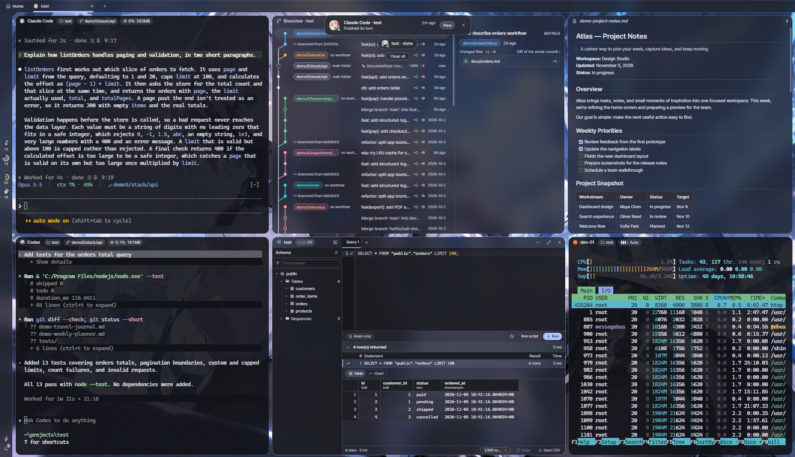
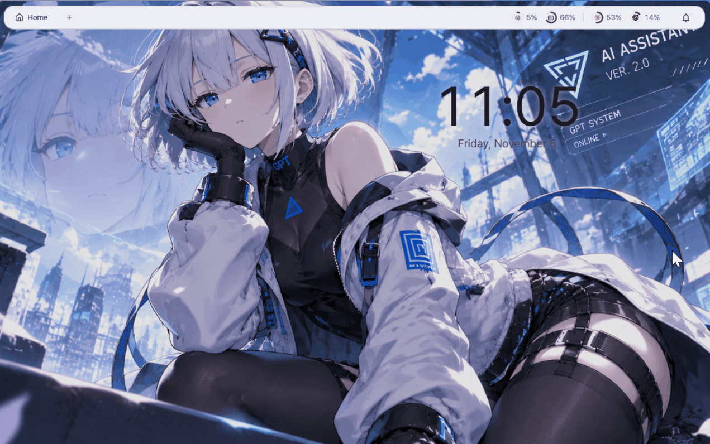
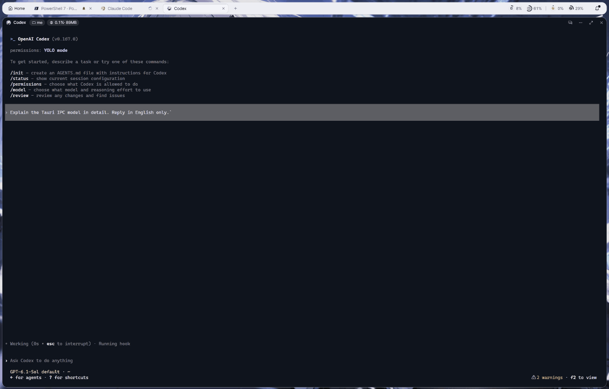
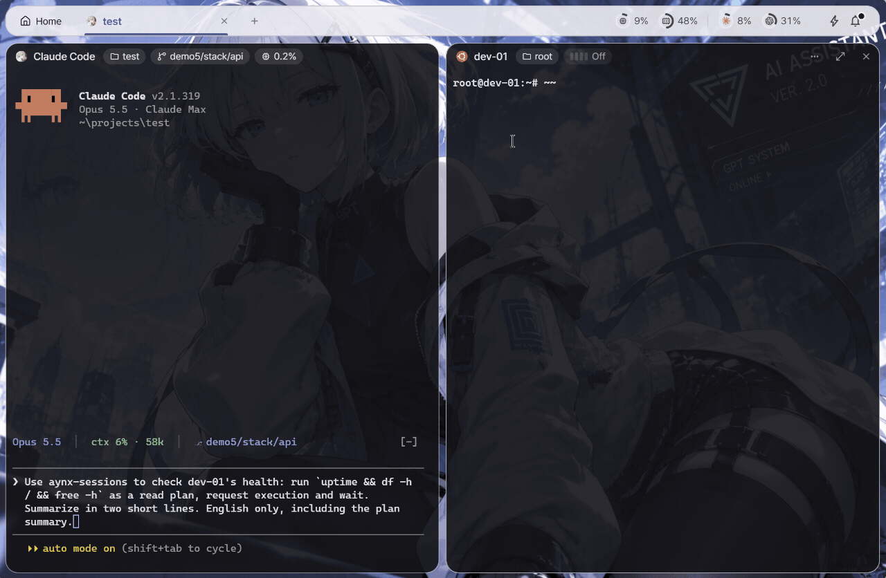
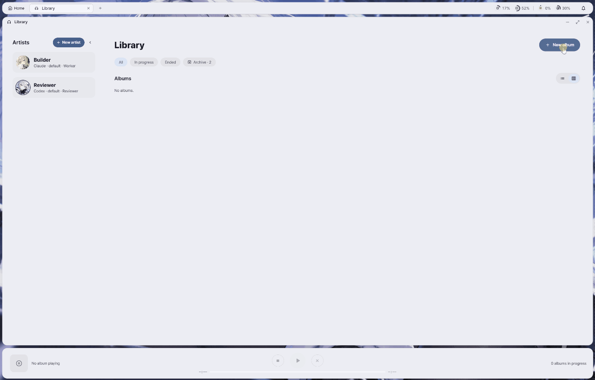
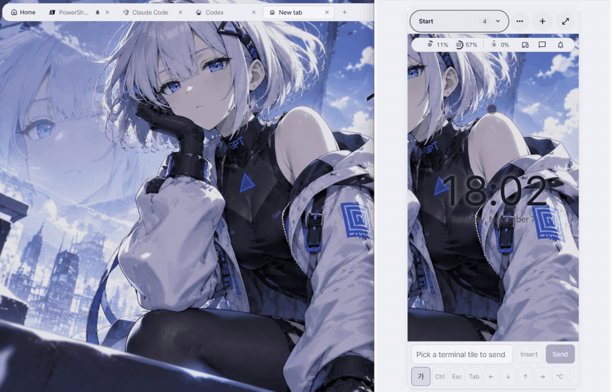
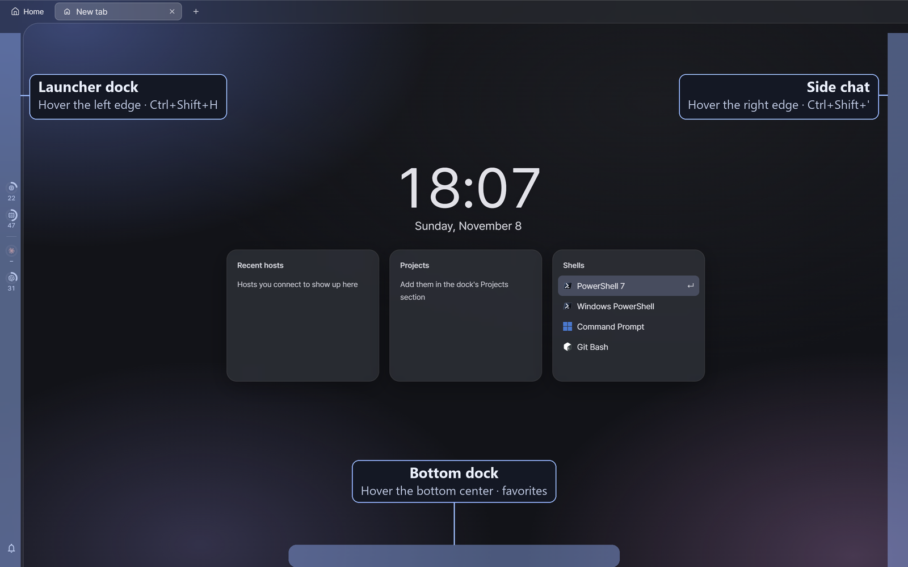

<p align="center">
  
</p>

<h1 align="center">AYNX</h1>

<p align="center">
  <b>Hyprland 감성의 AI 코딩 에이전트 작업 공간.</b><br>
  에이전트, 셸, SSH, 파일, DB를 타일로 나란히 띄웁니다.
</p>

<p align="center">
  <a href="README.md">English</a> · 한국어
</p>

<p align="center">
  <sub>디자인은 <a href="https://github.com/end-4/dots-hyprland">end-4/dots-hyprland</a>를 참고했습니다.</sub>
</p>

<p align="center">
  
</p>

## 주요 기능

| 화면 | 기능 |
|---|---|
|  | **Hyprland 스타일 타일링**<br>간격과 둥근 모서리를 갖춘 이진 분할 타일. 포커스 이동, 타일 이동과 크기 조절을 키보드와 마우스로 모두 할 수 있습니다. |
|  | **월페이퍼에서 뽑은 색**<br>월페이퍼에서 추출한 Material 3 톤 색상, 글래스·평면 재질, 바꿔 쓰는 테마 프로필을 제공합니다. |
|  | **작업 옆의 사이드 채팅**<br>작업 화면을 벗어나지 않고 AI에게 묻습니다. 터미널 세션을 연결할 수도 있습니다. |
|  | **세션 판**<br>모든 탭과 타일의 상태를 한눈에 봅니다. 타일을 눌러 바로 이동하고, 세션 판 안에서 마우스로 끌어 옮길 수 있습니다. |
|  | **AI가 제안하고, 사람이 승인**<br>Claude Code와 Codex를 타일에서 실행합니다. SSH 호스트와 데이터베이스 연결마다 승인 범위를 지정해 주면, 그 범위 안에서 AI가 원격 서버 명령과 데이터베이스 쿼리를 자동으로 처리합니다. 범위 밖의 일은 사람의 승인을 기다립니다. |
|  | **오케스트레이션**<br>음악 플레이어처럼 구성한 화면입니다. *앨범*을 시작하면 *프로듀서* AI가 일을 *트랙*으로 나누고, *아티스트*가 각자의 git worktree에서 작업하며, 검토자가 결과를 확인합니다. 앨범이 끝나면 **병합** 단추로 main에 합칩니다. |
|  | **폰에서도 내 에이전트를**<br>Tailscale tailnet 안의 폰이나 다른 PC에서 앱을 엽니다. 폰에서 보낸 말이 PC 타일에 바로 이어지고, 알림도 함께 받습니다. |

[전체 기능 보기](docs/features.ko.md)

## 시작하기

처음에는 창이 거의 비어 보입니다. AYNX는 메뉴를 독 세 개에 넣어 두고, 창 가장자리에 마우스를 대면 꺼냅니다.

- **왼쪽 끝**: 런처 독 — 셸, Claude Code, Codex, 호스트, 프로젝트, DB (`Ctrl+Shift+H`)
- **오른쪽 끝**: 사이드 채팅 (`Ctrl+Shift+'`)
- **아래 가운데**: 즐겨찾기
- AI 에이전트는 `Ctrl+Shift+A`로 열고, `Ctrl+Shift+P`를 누르면 모든 명령과 단축키가 보입니다.

<p align="center">
  
</p>

[시작하기](docs/user/getting-started.ko.md) 안내에서 AI 타일, 타일 배치 단축키, SSH 호스트 추가, 사이드 채팅, 세션 판, 테마까지 처음 쓰는 흐름을 차례로 볼 수 있습니다.

## 상태

활발히 개발 중인 개인 프로젝트로, 호환되지 않는 변경이 있을 수 있습니다. **Windows 11**(WebView2)만 지원하며, 설치 관리자는 **서명 없이** 제공합니다. Linux와 macOS 지원 여부는 미정입니다.
지원하는 AI 에이전트는 **Claude Code**와 **Codex**뿐입니다. 이 PC에서는 Windows 네이티브로 설치해야 합니다. WSL의 에이전트는 지원하지 않으며, WSL은 일반 셸 타일로만 쓸 수 있습니다.

## 다운로드

[최신 릴리스](https://github.com/lzyxion/aynx/releases/latest)에서 설치 관리자를 받습니다. `AYNX_<버전>_x64-setup.exe`는 현재 사용자에게, `AYNX_<버전>_x64_en-US.msi`는 모든 사용자에게 설치합니다.
설치 관리자에 서명이 없어서 처음 실행할 때 Windows SmartScreen 경고가 뜰 수 있습니다. **추가 정보 → 실행**을 누르세요.
처음이라면 [시작하기](docs/user/getting-started.ko.md) 안내부터 보세요.

## 소스에서 빌드

Node.js와 npm, stable Rust 툴체인([Tauri 사전 준비](https://tauri.app/start/prerequisites/)), WebView2 런타임(Windows 11에 기본 설치)이 필요합니다.

```sh
npm ci
npm run tauri dev     # 개발 빌드, 설치한 앱과 별도로 실행
npm run tauri build   # 설치 관리자: src-tauri/target/release/bundle/{nsis,msi}/
```

## 문서

[시작하기](docs/user/getting-started.ko.md) · [전체 기능](docs/features.ko.md) · [보안](docs/security.ko.md)

사용자 안내(영어): [설정](docs/user/settings.md) · [호스트](docs/user/hosts.md) · [프로젝트](docs/user/projects.md) · [파일 · 문서 타일](docs/user/files.md) · [쿼리 타일](docs/user/query-tile.md) · [세션과 작업안](docs/user/dashboard.md) · [오케스트레이션](docs/user/orchestration.md) · [원격 접속](docs/user/remote-web.md) · [단축키](docs/user/shortcuts.md)

기여자용: [기여 안내](CONTRIBUTING.ko.md)

## 라이선스

[MIT](LICENSE)
