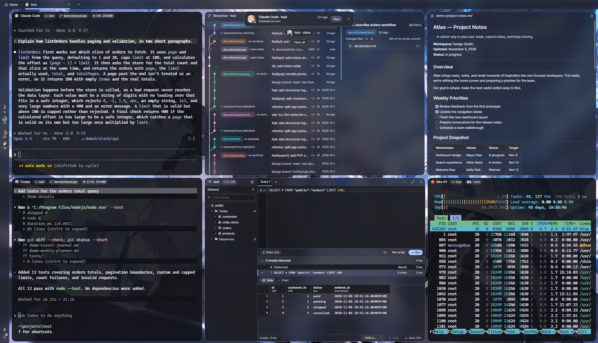
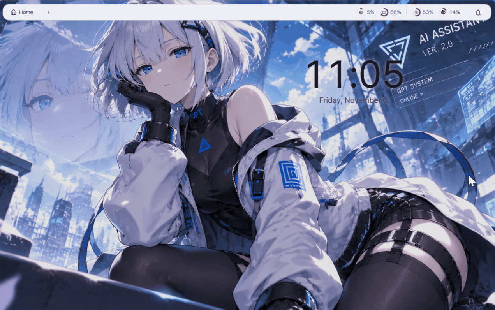
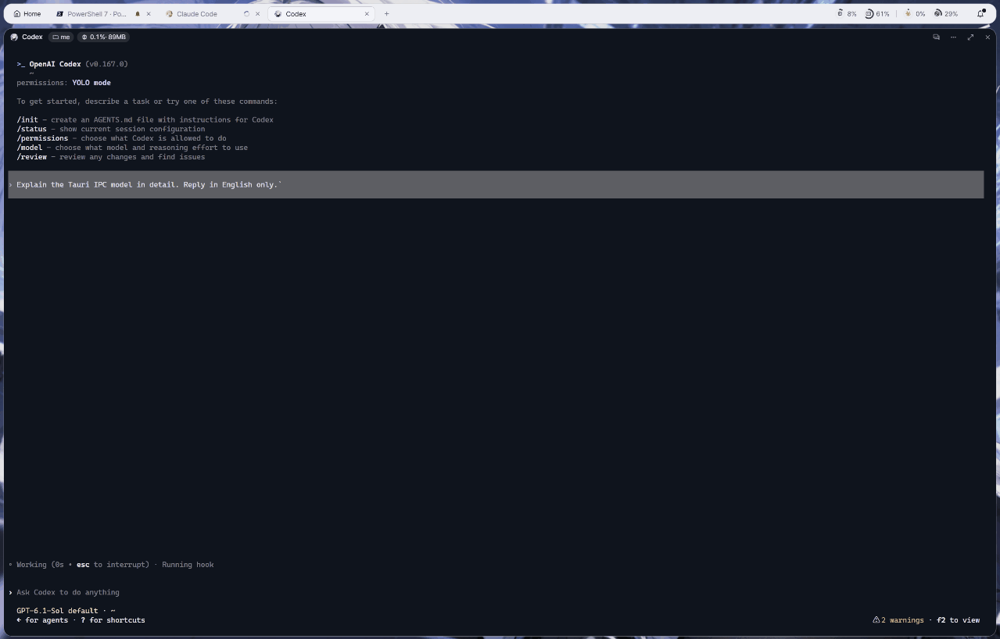
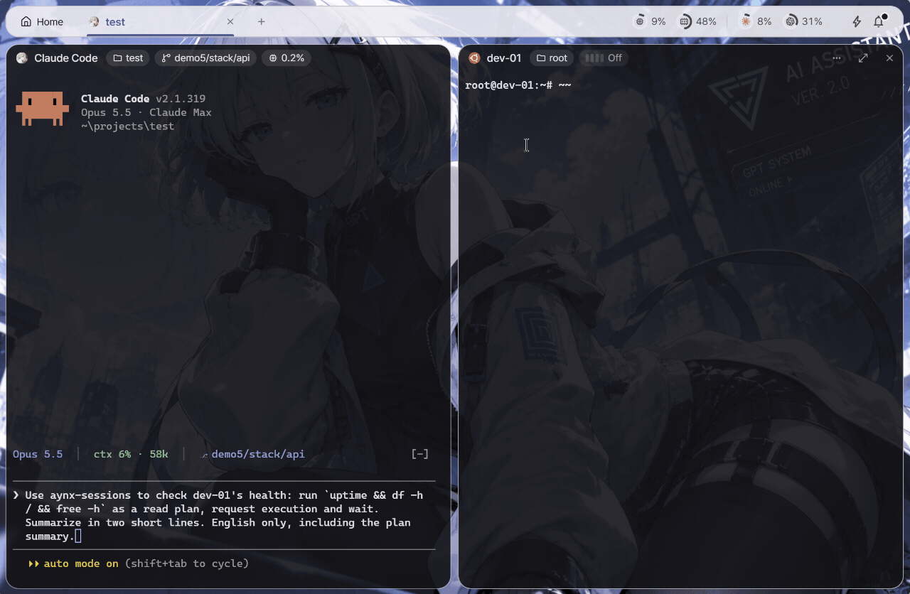
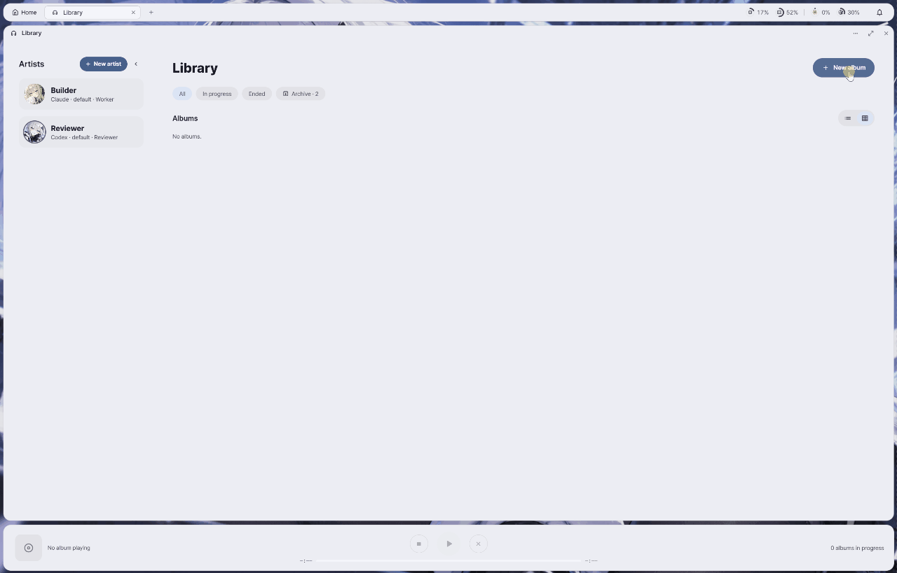
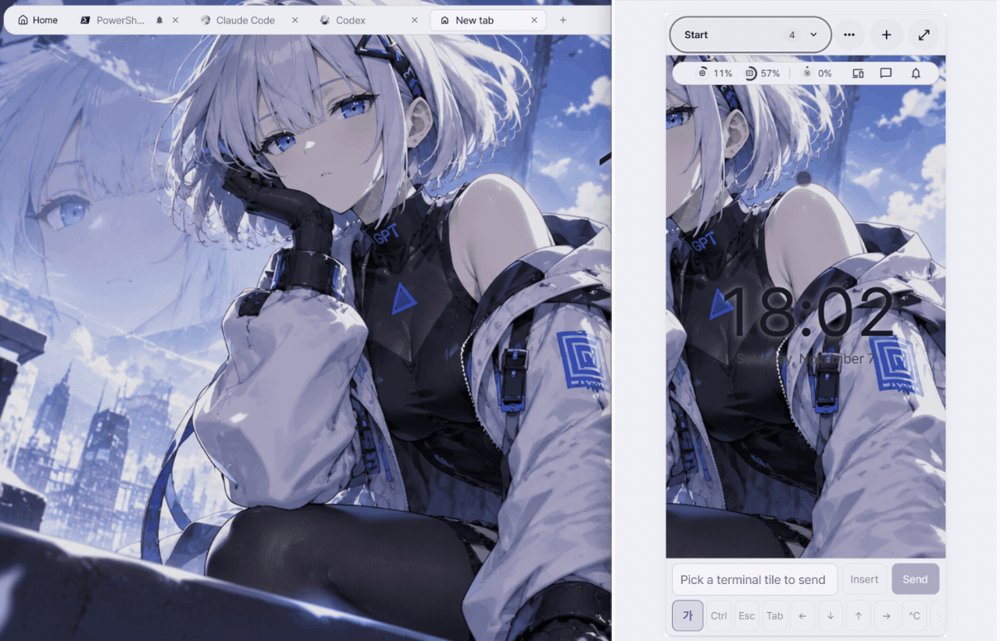
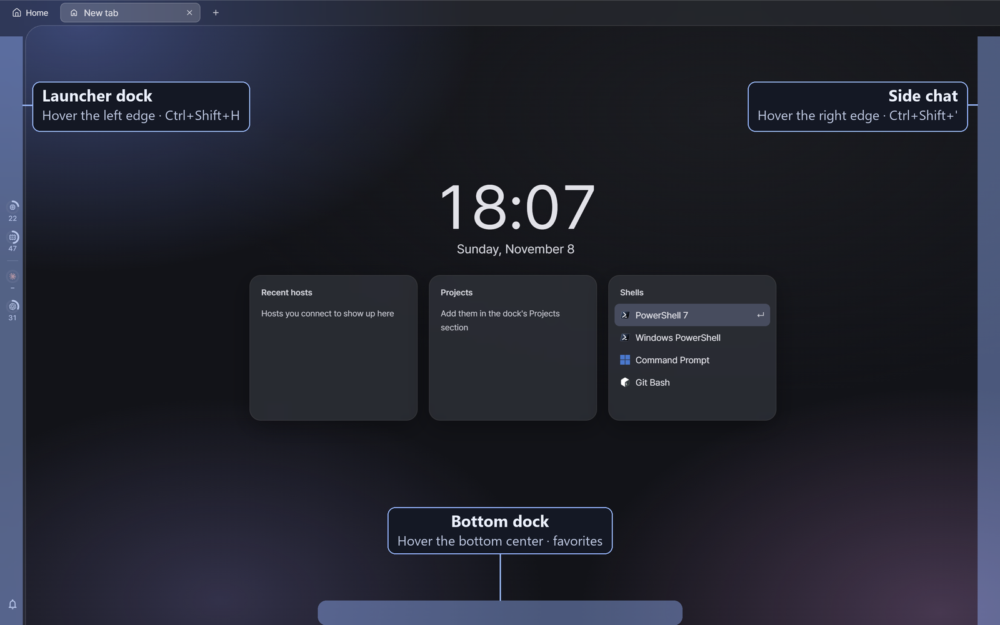

<p align="center">
  
</p>

<h1 align="center">Aynx</h1>

<p align="center">
  <b>A Hyprland-style workspace for AI coding agents.</b><br>
  Tile agents, shells, SSH, files and databases side by side.
</p>

<p align="center">
  English · <a href="README.ko.md">한국어</a>
</p>

<p align="center">
  <sub>Design inspired by <a href="https://github.com/end-4/dots-hyprland">end-4/dots-hyprland</a>.</sub>
</p>

<p align="center">
  
</p>

## Features

| Screen | Feature |
|---|---|
|  | **Hyprland-style tiling**<br>Binary split tiles with gaps and rounded corners. Move focus, rearrange and resize tiles with the keyboard or the mouse. |
|  | **Colors from your wallpaper**<br>Material 3 tonal colors extracted from your wallpaper, glass or flat panels, and theme profiles you can swap. |
|  | **Side chat beside your work**<br>Ask AI without leaving your work, with a terminal session linked for context. |
|  | **Session sheet**<br>See the state of every tab and tile at a glance. Click a tile to jump to it, or drag it with the mouse to move it right inside the sheet. |
|  | **AI proposes, you approve**<br>Run Claude Code and Codex in tiles. Set the approval scope per SSH host and database connection, and within it AI handles remote server commands and database queries automatically. Anything outside it waits for your approval. |
|  | **Orchestration**<br>Laid out like a music player. Start an *album*: a *producer* AI splits the work into *tracks*, *artists* each work in their own git worktree, and a reviewer checks the results. When the album is done, you bring it into main with **Merge**. |
|  | **Your agents, on your phone**<br>Open the app from a phone or another PC inside your Tailscale tailnet. What you send from your phone goes straight to the PC's tile, and you get the same notifications. |

[See all features](docs/features.md)

## Getting started

At first the window looks almost empty: Aynx keeps its menus in three docks that open when you hover an edge of the window.

- **Left edge**: the launcher dock with shells, Claude Code, Codex, hosts, projects and databases (`Ctrl+Shift+H`)
- **Right edge**: the side chat (`Ctrl+Shift+'`)
- **Bottom center**: your favorites
- Open an AI agent with `Ctrl+Shift+A`; `Ctrl+Shift+P` lists every command and its keys.

<p align="center">
  
</p>

The [Getting started](docs/user/getting-started.md) guide walks through the first session step by step: AI tiles, tiling keys, adding an SSH host, the side chat, the session sheet and themes.

## Status

Personal project under active development; expect breaking changes. It supports **Windows 11** only (WebView2), and installers are **unsigned**. Linux and macOS support is undecided.
The supported AI agents are **Claude Code** and **Codex** only. On this PC they must be native Windows installs: agents in WSL are not supported, and WSL works only as a plain shell tile.

## AI agents and your account

Aynx runs the official `claude` and `codex` CLIs you install and sign in to yourself, without modifying them, and configures them only through their documented flags, hooks and MCP settings.
It never reads, stores or forwards their credentials, and it sends no model requests of its own.
Terminal and AI tiles run the agents interactively. The side chat and orchestration run them non-interactively (`claude -p`, `codex exec` / `app-server`), and that usage counts toward your own plan or API key like any other use.
Your use stays subject to each provider's terms: see Anthropic's [Claude Code legal and compliance](https://code.claude.com/docs/en/legal-and-compliance) page and OpenAI's [terms of use](https://openai.com/policies/terms-of-use/).
Aynx is not affiliated with or endorsed by Anthropic or OpenAI.

## Download

Get the installer from the [latest release](https://github.com/lzyxion/aynx/releases/latest): `Aynx_<version>_x64-setup.exe` installs for the current user, `Aynx_<version>_x64_en-US.msi` for all users.
The installers are unsigned, so Windows SmartScreen may warn on first run. Choose **More info → Run anyway**.
New to Aynx? Start with the [Getting started](docs/user/getting-started.md) guide.

## Build from source

Requires Node.js and npm, the stable Rust toolchain ([Tauri prerequisites](https://tauri.app/start/prerequisites/)), and the WebView2 Runtime (preinstalled on Windows 11).

```sh
npm ci
npm run tauri dev     # debug build, runs separately from an installed copy
npm run tauri build   # installers in src-tauri/target/release/bundle/{nsis,msi}/
```

## Documentation

[All features](docs/features.md) · [Security notes](docs/security.md)

User guides: [Getting started](docs/user/getting-started.md) · [Settings](docs/user/settings.md) · [Hosts](docs/user/hosts.md) · [Projects](docs/user/projects.md) · [Files and documents](docs/user/files.md) · [Query tile](docs/user/query-tile.md) · [Sessions and task plans](docs/user/dashboard.md) · [Orchestration](docs/user/orchestration.md) · [Remote access](docs/user/remote-web.md) · [Shortcuts](docs/user/shortcuts.md)

For contributors: [Contributing](CONTRIBUTING.md)

## License

[MIT](LICENSE)
