# Aynx features

English · [한국어](features.ko.md)

**Workspace and tiles**
- Binary split-tree tiling (spiral or focused placement), drag-and-drop rearranging, broadcast input to selected tiles of a tab.
- Multiple workspaces and tabs in a main window plus extra windows; tabs and tiles can be torn out into a new window.
- Launcher dock for hosts, projects, databases, launch buttons and notifications; favorites in a bottom dock; command palette (`Ctrl+Shift+P`).
- Session sheet (`Ctrl+Shift+M`) with a map of every tab and tile.
- Start screen widgets (clock, shells, hosts, projects) with an edit mode.
- Local resource monitor: CPU and memory rings in the status bar, a per-tile resource chip, and a resource view with charts.

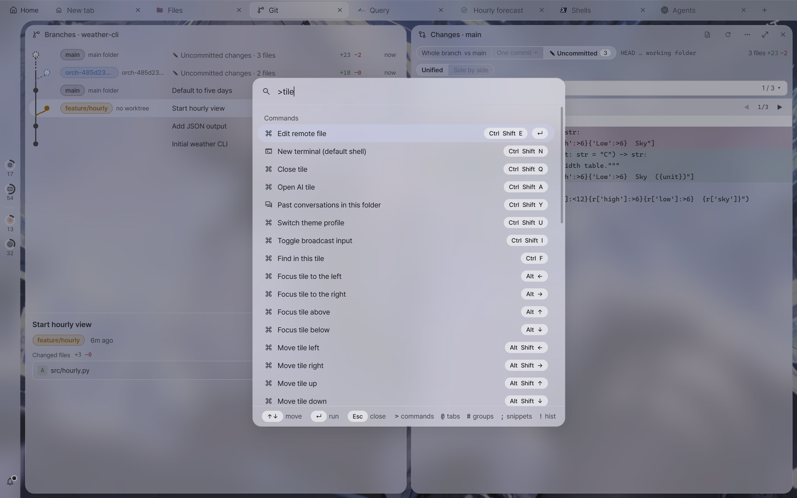

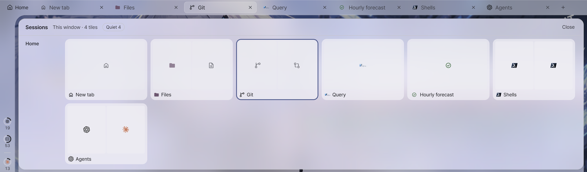

**Sessions**
- Local shells (PowerShell, cmd, Git Bash, WSL) and SSH, with one default shell plus an on-demand shell menu.
- SSH: connection sharing, single-hop jump host, port forwarding (`-L` / `-R` / `-D`), per-host agent forwarding,
  optional tmux attach, commands after connect, reconnect on startup, connection history.
- Host form that edits `~/.ssh/config` in place, key generation, public-key install, forgetting host keys.

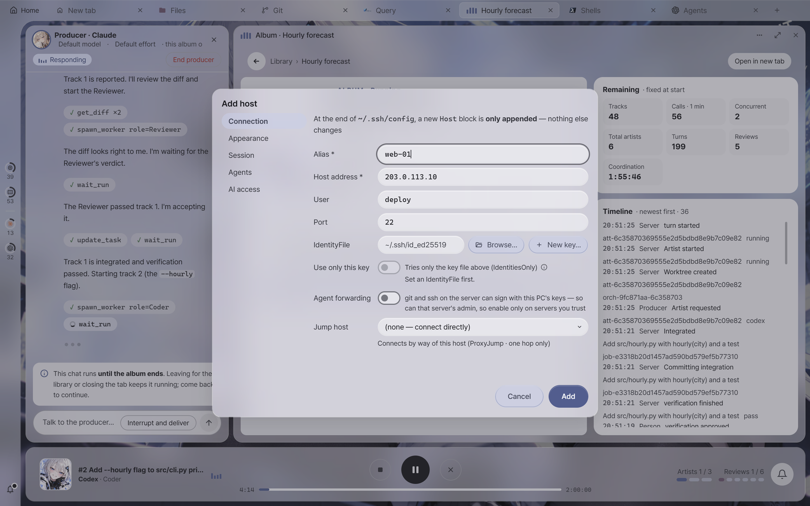

**Session server and tray**
- Sessions run in a separate `aynx session-server` process. Quitting the GUI, killing it, or a webview crash only detaches the
  window — shells keep running and reattach on the next launch.
- When the last window closes, the app stays in the tray (configurable). The tray menu can reopen a window,
  quit only the GUI, or end every session.
- Sessions that a restored layout did not pick up are kept as **detached sessions** — attach them in a new tab or close them.
- The server exits on its own after 10 minutes with no sessions, no clients and no task plans.

**Terminal**
- Find in this tile (`Ctrl+F`) or across all terminals (`Ctrl+Shift+F`), including command-block search.
- Shell integration (OSC 133 command blocks, OSC 7 current folder) for PowerShell, Git Bash, WSL and remote bash.
- Rich view for command output: JSON tree and table, CSV, aligned tables, Markdown.
- WebGL rendering, ligatures, inline images (sixel / iTerm2), OSC 52 clipboard, OSC 8 links, OSC 9 / 777 notifications.
- Snippets, regex triggers (highlight / link / tooltip), long-command notifications, per-session opt-in logging.

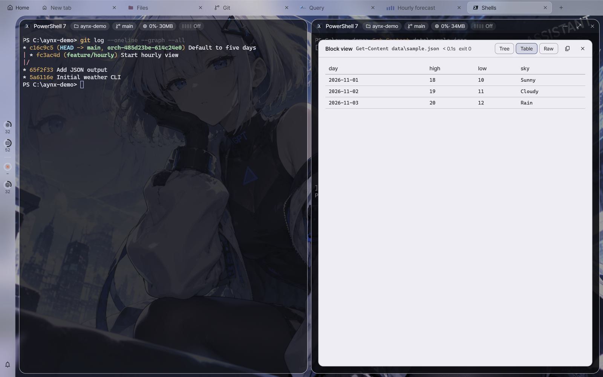

**Files, documents and databases**
- File tiles (SFTP and local) with places panel, several views, preview, upload, drag and drop, and editing remote files in a
  local editor. Local file tiles refresh on their own when files change (remote ones refresh on demand).
- Document tiles: Markdown preview (mermaid, table of contents, GFM) with in-app editing (`Ctrl+S`, conflict detection), local and remote.
- Query tiles for PostgreSQL, MySQL / MariaDB and SQLite — direct or through a host's SSH connection. Read-only by default;
  writes are turned on per tile and run in a transaction. Results as a table or a chart (line / bar / scatter).
  Database passwords live only in the vault.

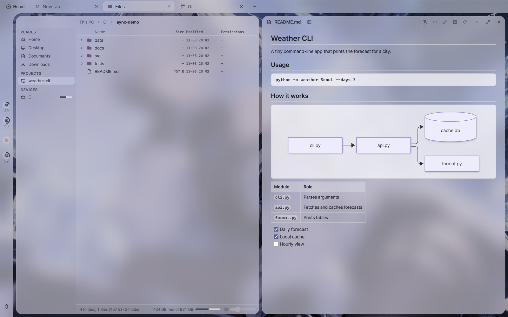

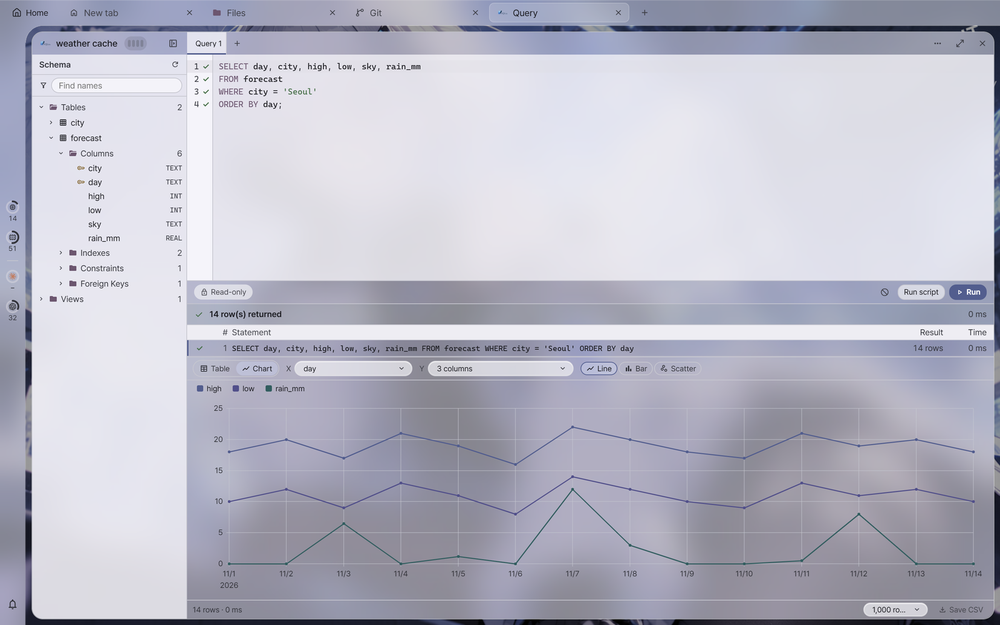

**Projects and git**
- Local and remote projects with git worktrees (one worktree per branch), change badges, and a branch / commit graph tile.
- Diff tile with line comments that can be handed to an AI tile.
- Project start screen with past agent conversations: resume, continue as new, or read the transcript.

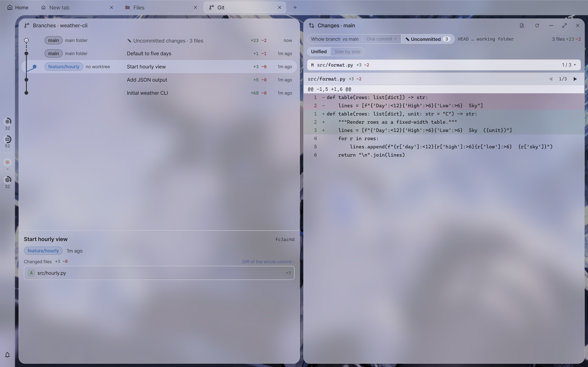

**AI agents**
- Claude Code and Codex tiles with hook-driven status glyphs, local and remote, and a chat view next to the terminal view.
- Permission and question cards in the chat view of local AI tiles.
- Side chat dock with session chips, image attachments and source chips, on the desktop and in remote windows.
- Attach files from a file tile to an AI tile; per-agent extra arguments; per-project setup scripts that run before the agent starts.
- Claude Code or Codex typed in a local PowerShell or Git Bash tile gets the same integration as an AI tile (shell integration on).
- Manage agent instructions in one place and write them into each agent's instruction file as a managed block.
- External MCP servers (stdio / HTTP) scoped app-wide or per project; their secret environment values and headers can stay in the vault.
- Usage view for Claude Code and Codex, from this PC or a connected host.

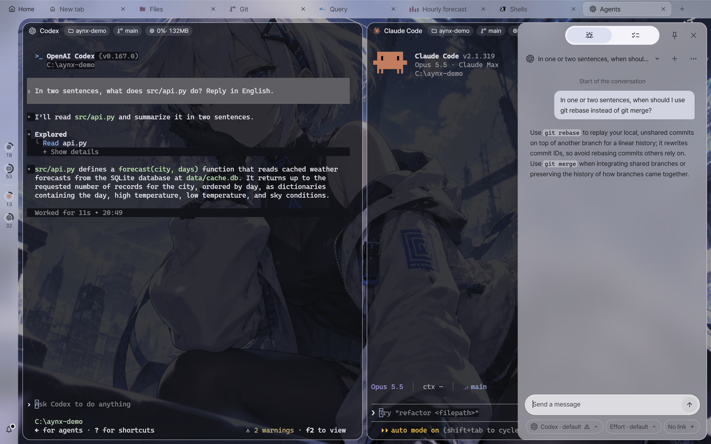

**Task plans and approval**
- AI permission is set per host: Off, Read, Ask (runs after your approval), Auto (allow-listed commands run on their own) or YOLO (anything runs on its own). Local tiles only offer Off or Read,
  per tile, and are never execution targets.
- An AI proposes a task plan (command + targets); you approve it in the app, and it runs as a sequential canary rollout with an audit log.
- Approval cards show the AI's summary and declared effect next to the app's own analysis of the raw command;
  if the declared effect is weaker, the card turns red and asks for a second click.
- Auto-approval policy with allow patterns and argument-aware command bundles (pipes are opt-in).
- Database connections get their own AI permission (Off, Schema, Read, Ask, YOLO). The AI reads through
  a separate read-only connection; writes are only drafts that you approve.
- Notifications in the app, in the OS, and optionally to Discord or Slack webhooks (including "awaiting approval").

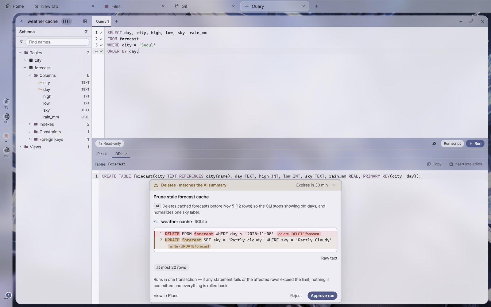

**Orchestration**
- The Orchestration tab is a library of **albums** (runs), each with **tracks** (tasks), grouped into a **studio** per repository. **Artists** are permission-free profiles (name, CLI, model, instructions).
- The library shows a card for each studio, **Recent** albums (those in progress first) and the album list, as square cover cards or rows.
- Start an album with **New album**: choose the repository, the artists and their permission grades, the acceptance rule, the verification command and the limits, then send the first message.
  You can also fork an AI tile's conversation into a new album.
- The **producer** is a read-only chat that coordinates the album. Artists run headless in their own git worktrees; reviewer artists only read the reported commit and give a verdict.
- Accepted tracks are squashed onto an integration ref; the verification command runs before acceptance, either after you
  confirm it or inside an auto-run scope you turned on.
- After an album ends, **Clean up** opens a window where you pick which work folders to delete, beside a read-only branch graph.
  Finished albums move to the **archive**, where they can be restored as finished records or deleted forever.
- Only a person can start an album or widen its permissions — no AI or MCP path exists. **Merging into main happens only through a person's Merge button or auto-merge a person turned on for that album — no AI or MCP path exists, and nothing is pushed.**

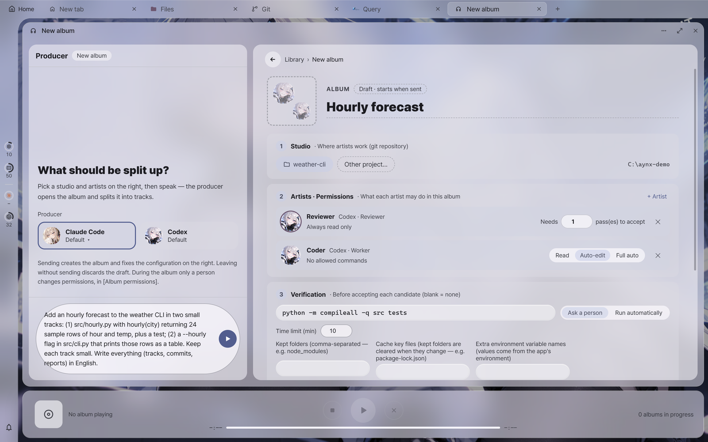

**Remote web client**
- Open the app from another PC or a phone browser inside your Tailscale tailnet. The app listens on `127.0.0.1` only;
  `tailscale serve` exposes it (you start it yourself, or **Connect** in Settings on the main PC does), and the app refuses to open if the port is exposed through Funnel.
- New devices are paired by a person at the main PC, comparing a 6-digit code.
- A phone layout with a chat view, and approving task plans remotely (the master password is asked again when one is set).
- The main PC always shows an OS notification and a "remote access" indicator while a remote window is open.

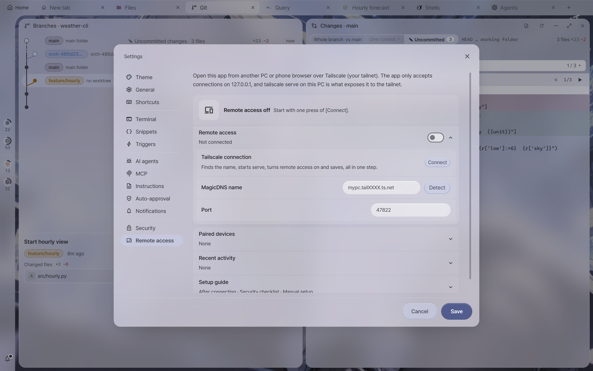

**Vault and security**
- Opt-in encrypted vault (one file) for passwords, key passphrases, database passwords and MCP secrets, with an optional master password.
- The lock screen is the vault: locking the screen locks the vault, and the vault also locks when no window is open.
  Idle auto-lock is optional.
- Settings › Security asks you to unlock (or confirm the master password) each time you enter it.

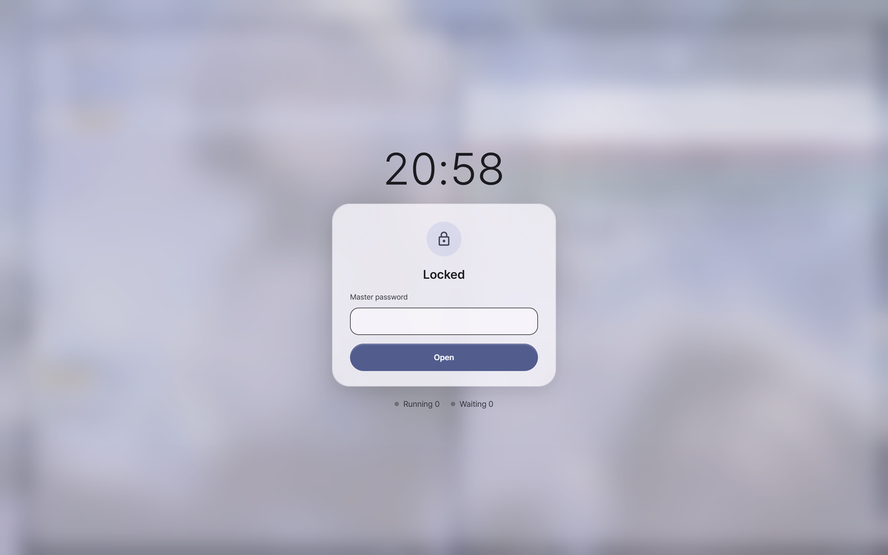

**Appearance**
- Material 3 tonal color roles generated from a color theme or extracted from your wallpaper; light / dark / system mode.
- Glass or flat material for the app chrome; the opacity slider controls how much the wallpaper shows through panels and tiles.
- Wallpapers with dim / blur / tinting, status bar styles (flush, panel, hug), tab styles, configurable tile header chips.
- Theme profiles with quick switching (`Ctrl+Shift+U`).
- App icon picked from built-in characters (GPT by default, Claude, Gemini, Grok) or your own pictures, cropped to the same rounded shape.
- English and Korean UI.

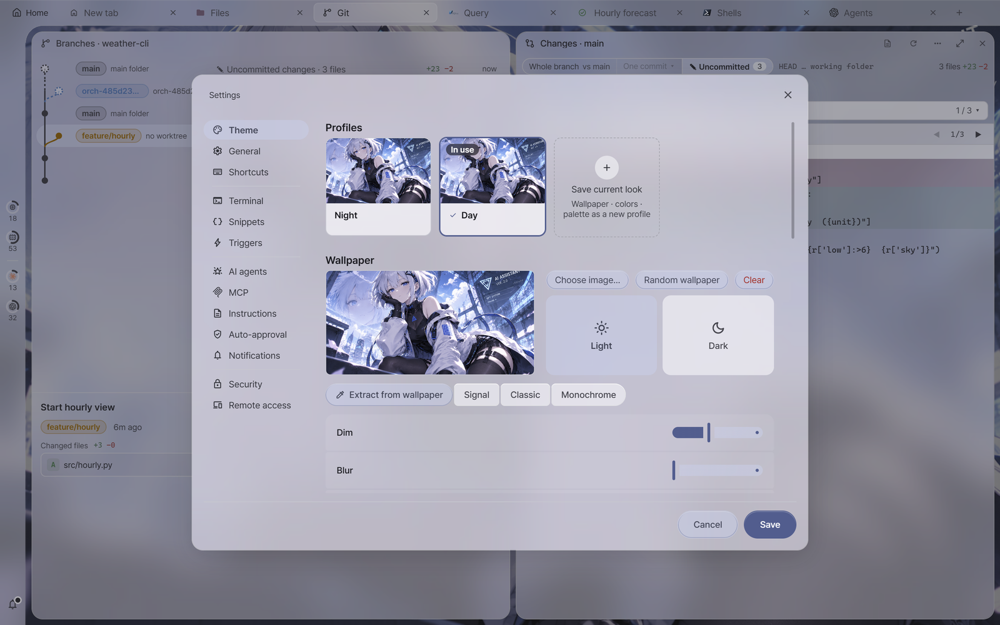

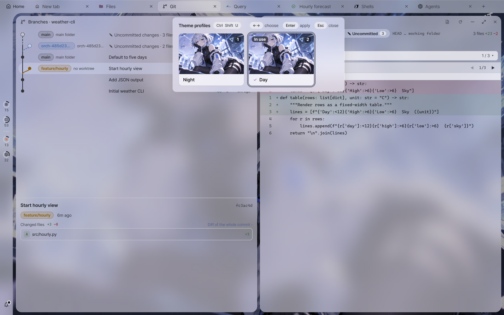

[Back to README](../README.md)
