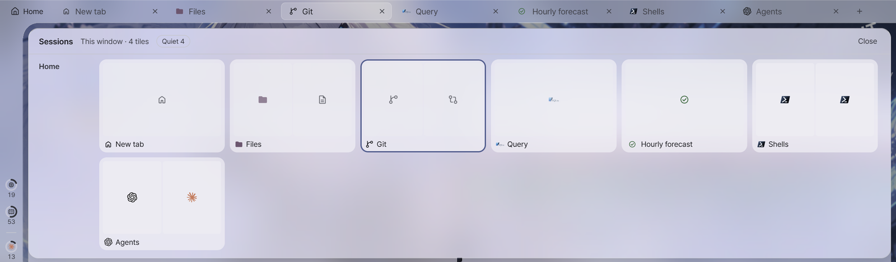
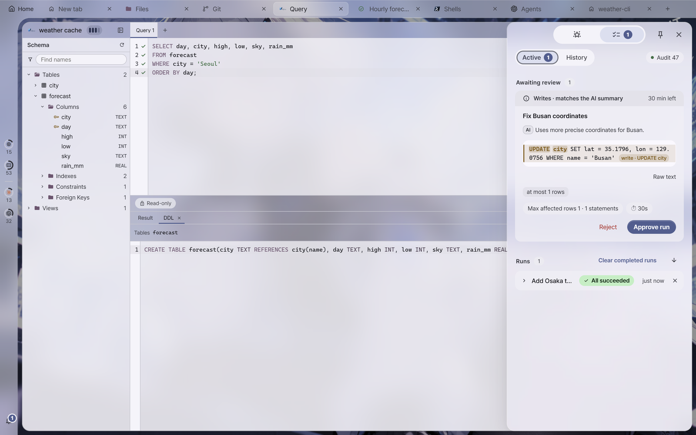

# Sessions · task plans · usage guide

This is the detailed explanation of the session sheet, task plans and usage screens, along with the review card and the dock's Alerts section. Tooltips on screen give only names;
the flow, circumstances and exceptions are written here. The three screens open separately.

| Screen | Where | How to open it |
| --- | --- | --- |
| **Session sheet** | An overlay that comes down from the top of the tile canvas | `Ctrl+Shift+M` · the **Sessions** row in the dock's Alerts section |
| **Task plans** | The task plans branch of the chat dock | `Plans` as set in Settings › Shortcuts (no default combination) · the command palette · the branch button at the top of the chat dock (`Ctrl+Shift+'`) |
| **Usage** | A panel that covers the tile canvas | The usage ring in the status bar · the usage row in the command palette |

---

## Session sheet

### Tab map

This shows the window's tabs reduced **exactly as their actual tile layout**. The sheet is an overlay, so it does not resize tiles. `Esc`, the same key,
clicking outside the sheet, or the window losing focus collapses it.

- **Summary chips in the head** — counts of Waiting for permission · Finished · Failed · Running · Quiet · Disconnected. They match the cell colors, so they double as a legend, and chips at 0 do not appear.
- **One row per workspace** — the name on the left, and that workspace's tab cards on the right, in tab bar order. A tab card has the miniature plus the same mark
  as the tab bar and the tab name, and the tab you are viewing has an accent-colored border. In the main window, tabs of auxiliary windows also appear, but this window does not know their layout, so they are lined up
  as equal-width cells (named "Other window").
- **Cells** — they speak through a tile icon (for AI, that agent's logo) and state, without text. Tiles with no session (documents · files · queries, etc.) are dim cells.
- **Tooltips** — they appear when you hover over a cell or reach it by keyboard. They give the tab and name, the last command and exit code (for AI: a permission question, turn in progress or turn finished),
  and the state and elapsed time. The number of subagents in progress also goes here. A tile with no session gives its location, and DB and remote file tiles give their connection state.

Only cells a person should look at are filled. A cell has one mark at its top right, and the earliest row in this table wins.

| Order | State | Cell |
| --- | --- | --- |
| 1 | **Waiting for permission** — the AI is asking for permission | Accent-colored surface + mark |
| 2 | **Finished** — the AI's turn ended ([agent status dot](projects.md#agent-status-dot)) | Green surface + mark |
| 3 | **Failed** — the last command failed | Error-colored surface + mark |
| 4 | **Bell** — a tile in a tab you are not viewing has an unseen bell | A yellow bell with no surface |
| 5 | **Running** — an agent turn or a command is running | Lightly tinted surface + progress arc (agent) · dot (command) |

A cell with no mark is quiet (including AI cells with no hook signal — the tooltip says "No signal yet"). An SSH cell whose connection closed stays as **dashed and dim**
("Connection closed").

Cells are buttons.

- **Clicking** goes to that tile and collapses the sheet (including tiles in other workspaces and auxiliary windows). A disconnected SSH cell also goes to that tile, where you can reconnect.
- **Dragging** moves that tile. Dropping on another cell in the sheet moves it next to that cell, and the tab you were viewing and the sheet stay as they are. Dropping on a tile outside the sheet or on the tab bar
  is treated the same as dragging a tile header, and the sheet collapses. Dropping outside the window detaches it to a new window. Orchestration tabs, cells of auxiliary windows and start tiles
  cannot be dragged, and the phone layout has no dragging.
- **Keyboard** — `Tab` enters the cells, then move with `←→` cells · `↑↓` previous and next tab cards · `Home`/`End`.

Nothing is run or approved from the sheet.

### Detached sessions

These are sessions **still running in the session server** with no window attached — for example, a detached window disappeared along with the app, or a tab from the last run did not
reopen that tile. The app does not close such sessions. If there is at least one, **Detached sessions N** appears at the top of the session sheet, above the bottom of the launcher dock, as one line of notice when the app starts,
and in the tray menu.

- Each row shows the name (a shell for local; host and tmux session for SSH), the window it was last attached to, when it was detached, and when it last produced output.
- **Attach in new tab** — creates a tile of that kind in a new tab and attaches to **the same session** (it does not open a new shell; the screen continues from the remaining output).
- **Close** — ends that session (the shell or SSH connection closes).

### The Sessions row in the dock's Alerts section

This is the top row of the dock's [Alerts section](#notify-center). It gives the current workspace's **n running** and **n waiting** as chips (chips at 0 do not appear),
and clicking it closes the dock and opens the session sheet.

---

## Task plans

This is where you review, approve and reject **task plans** the AI proposed through MCP (run this command on these targets), and see the results. It lives in the main window's chat dock,
and opening it from an auxiliary window moves to the main window. A remote window does not change the main PC's layout and shows it as an overlay within its own window.
There are two views — **Active** (awaiting review · current and recent runs) and **History** (past runs). The audit pill on the right of the head row says whether the audit log is recording and how many
records it holds.

### Run flow — sequential canary

An approved task plan always runs in the same order.

1. It runs first on the **first target (canary)**. It must succeed (exit code 0) before spreading to the rest.
2. If there is a **validation command**, it runs on the **same target** after the canary succeeds. This must also exit 0 before moving on to the rest.
3. The remaining targets run together, up to Settings › Auto-approval › Concurrency limit at a time.

- This order is enforced regardless of the run mode or strategy the AI wrote in the task plan.
- The only success condition is exit code 0 — this does not guarantee the service is healthy.
- If there is a path (`cwd`), it runs after `cd` to that folder.
- A target that exceeds its timeout (⏱) ends as failed.

### Review · approval

The task plan card and the [review card](#review-card) have the same form. The **verdict band** at the top gives the judgment the app made from the raw text alone (Read-only · Writes · Deletes · The app could not judge it) and
whether it matches the AI's summary. Below it stand the title, AI summary, command, targets, path and validation.

- **Commands that need attention** — commands that look hard to undo, commands stronger in the raw text than the AI's summary says, and DB writes with no `WHERE` have a failure-colored border.
  This is an **advisory** judgment, not a security boundary. Pressing [Approve run] changes the button to [Checked — run it], and only that second press approves.
- **Truncated commands** — for a command folded at two lines, the first [Approve run] only expands the whole text. Check it, then press again.
- **Auto-approval** — commands such as deleting, overwriting and changing permissions are not auto-approved even if they are on the allow list. The only exception is a task plan whose targets are all
  **YOLO**, for which the command is not looked at. Edit the allow list in [Settings › Auto-approval](settings.md#auto-approve).
- **Expiry** — a task plan awaiting review expires if not approved within the Settings › Auto-approval › **Review expiry** time (0 = never expires).
- Only a person approves or rejects, inside the app — an AI cannot approve itself.

### Run · cancel · clear

- **[Cancel]** is cooperative — it stops the run on the app side, but **a command already started on the remote may keep running** (SSH does not guarantee a standard signal to kill a running
  process).
- **[Dismiss]** · **[Clear completed runs]** clear finished runs **from the screen only**. The records in the audit log stay.

### History

Past runs are read from the **audit log** and shown — they survive an app restart. Filter by period (7 · 30 · 90 days), host, result and approval
method, and find by command or title. [Plan history] in the dock's Alerts section opens this view directly.

- Selecting a row expands its details in place. In the per-target table, failed rows come first — this table and the host and result filters show which hosts stood out.
- **[Copy]** copies that run as Markdown (time · description · command · per-target results · saved output).
- **No end record** — a run with no finished line in the audit log. It is still running, or the app closed before the run ended.
- **Output** in the details — only runs after turning on Settings › Auto-approval › Save run output excerpts keep an output tail. If it is off, "Output was not saved" appears with
  a link to that setting. There are three cases in which "No output was saved" appears even with it on: the output was empty · AI read sharing for that target was
  off · the run came before excerpts were turned on.

---

## Usage

### What is read, and from where

This shows tokens and plan limits for agents (Claude Code · Codex). The values are read from **conversation log files** and are not converted to charges.
The top of the panel is plan limits, and below it are a summary filtered by agent and period (7 · 30 days), the activity grid, the last 7 days' bars by model, the token mix and the model table.
Close it with `Esc` or the same ring.

- **Source chips** — the default is this PC's conversation logs. If SSH-connected hosts exist, that server's conversation logs and **All** (the sum of this PC and the servers) can also be picked as
  chips. A host with no connected SSH tile shows the **last values read** ("not connected") — the app does not connect on its own to read them.
- **Claude limits** — these values come from Claude Code through the status line of AYNX tiles, so they come **from this PC only**. They appear only on Pro and Max plans,
  and show up once you use Claude Code in an AYNX tile.
- **Codex limits** — the last values Codex left in its conversation logs. If you pick a remote source, they are read from that server's Codex logs.
- **Stale** — the limit's reset time has already passed. This % is a value from the previous window.

### Large remote conversations

Remote conversation files are read only partly at first. Large files that did not arrive in one go remain "not counted yet".

- **[Read full usage]** reads those large files to the end and counts tokens. It **only reads** through the attached SSH connection and writes nothing on the
  server. While it runs, [Stop] can halt it. With no connection, it shows the last counted values.
- Remote Claude subagent files are not counted.

### Retention

Claude Code deletes conversation logs after **30 days** by default — so usage also goes back only that far. To keep them longer,
increase `cleanupPeriodDays` in the Claude Code settings.

---

## Review card · Alerts section

### Review card

When an AI requests review, a review card appears at the bottom center of the screen and stays until no plans are waiting (it can be collapsed but not closed).
On the card, you can [Approve run] · [Reject] right away, or open the task plan with [View in Plans]. With several plans, ‹ › moves between them.

- The card steps aside while task plans are already visible (the chat dock's task plans branch). It appears only in the main window.
- **(first)** mark — the first target (canary) of several targets. It must succeed here before spreading to the rest.
- Commands that need attention must be pressed **twice** to approve ([Review · approval](#plan-review)). Moving to another card, collapsing the card or
  pressing `Esc` after the first press backs out.
- The card does not take focus — an `Enter` you were typing in the terminal does not reach the card's buttons.

### Alerts section

This is the dock's **Alerts** section. Clicking the pill at the end of the status bar (bell · count badge · unread dot) opens and closes it (on phones, the alerts screen). Notifications become read while the section is visible.

- **Sessions** row — opens the [session sheet](#chips).
- **{n} awaiting approval** row — opens the oldest task plan in Task plans.
- **New** rows — finished turns and permission questions. Clicking one goes to that tile and counts as checked. Those set aside with × on a banner stay here with a "Later" label.
- **Recent notifications** rows — go to that tile. Rows from the same source fold into one group card, and the expand button beside it opens them. × removes that row (or the whole group, for a group).
- **Task plan run** rows — open that run in Task plans. A run no longer in memory goes to the History view.
- **Auto-approved** chip — a run done through auto-approval (no person pressed anything).
- **Bottom row** — [Plan history] · [Mark all read] (permission questions and those awaiting approval remain) · [Clear alerts] (empties Recent notifications).
