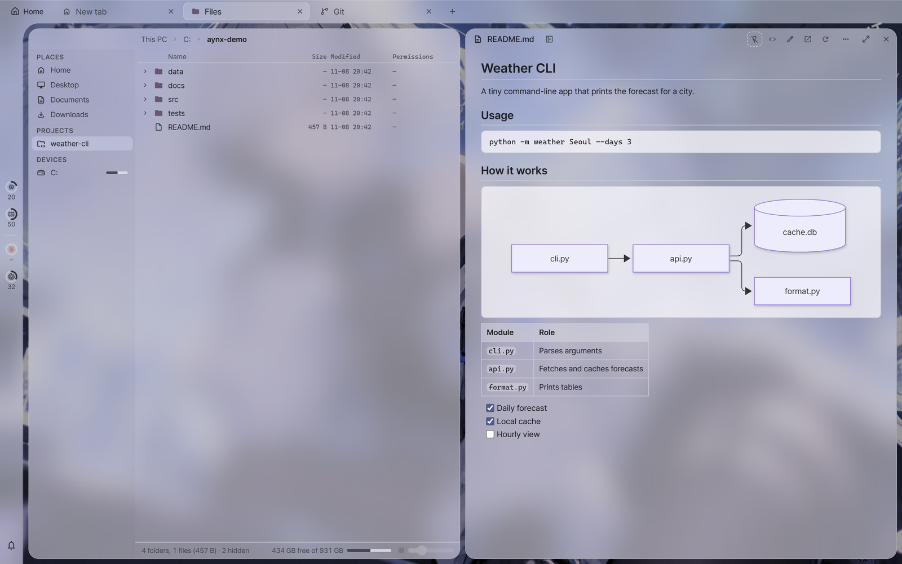
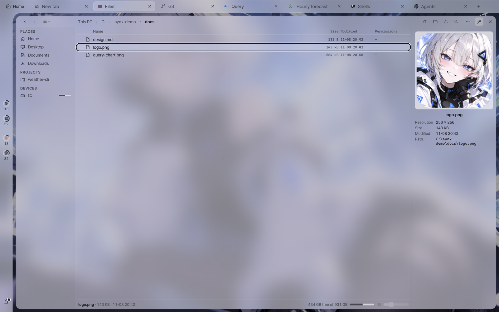
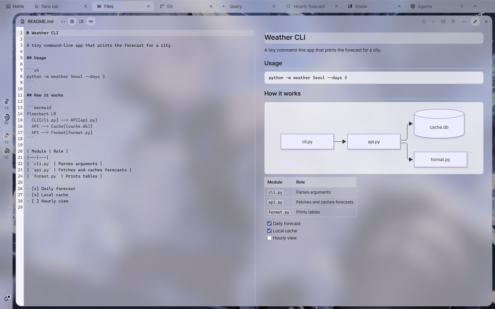

# File tiles guide

This guide explains file tiles (local and SFTP), the upload, import and remote file editing dialogs, and document tiles in detail. The screen holds only names and
short hints, and circumstances and exceptions are written here. Keys and mouse gestures (drag, copy/move, dragging out to Explorer, `Alt`) are
in the "File tiles" and "Mouse" sections of the [shortcuts guide](shortcuts.md).

---

## File tiles

<a id="files-view"></a>
### Three views: Icons · Compact · Details



The three buttons next to back/forward on the left of the toolbar (`Ctrl+1` · `Ctrl+2` · `Ctrl+3`) choose the view. The view is remembered per tile. A new
tile opens in the view last picked from a toolbar, and otherwise uses Settings › General › File tile default view.

When a tile is narrow, the toolbar collapses what is around the path field to keep it. Below a width of 560px (when the places panel shows icons only), the three views become
one picture of the current view (press it for a list of the three). Below 420px, the buttons on the right (hidden files · upload/import · new folder ·
find · preview panel) shrink into one ⋯ menu. The space freed by collapsing is not all given to the path field at once and stays blank:
the path field stays at the width it had when things collapsed, and shrinks only once you narrow the tile further and the blank space is used up (⋯ stays at the right end).
Shortcuts still work when collapsed.

- **Icons** is a grid of large pictures. A small extension label sits under file pictures. Size is set with the slider in the status line or `Ctrl+wheel`.
- **Compact** fills from top to bottom, and columns grow sideways (scroll sideways).
- **Details** is a list with Name · Size · Modified · Permissions columns. The arrow in front of a folder (or `→` · `←`) expands and collapses it
  in place. Double-click or `Enter` goes into that folder. (The former "tree view" and "navigate view" were merged into this view.)

In Icons and Compact views, the arrow keys move up, down, left and right across the grid.

<a id="files-location"></a>
### Path field

The field in the middle of the toolbar is normally a **breadcrumb** (`This PC › C: › Users › …`). Pressing a piece goes to that folder, so press a parent piece instead of an
up button. Pressing the empty space between pieces, or `Ctrl+L`, turns it into a **path input field**: `Enter`
goes there (for a path that cannot be read, the field stays red and the reason appears above the list), and `Esc` reverts. The ⟳ at the right end of the field refreshes.

<a id="files-places"></a>
### Places panel

The left column (toggled with `F9`, with no toolbar button, and remembered per tile) holds shortcuts:

- **Places**: on local tiles, Home · Desktop · Documents · Downloads (folders the OS reports); on remote tiles, `~` (home) · `/`.
- **Projects**: the projects registered in this app that belong to this tile (local projects for a local tile, the same host for a remote tile).
- **Devices**: local drives. If free space is known, a short bar is added (numbers in the tooltip).

When the tile is narrow (below 560px) it shows icons only, and when narrower still (below 400px) the panel steps aside. Dropping files on a row moves or copies them into that
folder.

<a id="files-filter"></a>
### Find in folder

`Ctrl+F` · `Ctrl+I` (or the funnel button on the toolbar) shows a **Find in folder** field above the list. In the current folder (in Details view, including expanded subfolders),
it keeps only items whose name contains that text and the folders containing them, and highlights the matching part. Closing it with `Esc` or × also clears the find.

<a id="files-preview"></a>
### Preview panel

`F11` (or the right panel button at the far right of the toolbar) shows a preview panel to the right of the list. It is remembered per tile and is off at first.



- With one item selected: image files (png · jpg · gif · webp · bmp · svg · ico) show a fitted picture and resolution, and other files and folders show a
  large picture. Below that come Size · Modified · Permissions · Path. A folder shows its item count if it has been expanded before.
- Images over 20 MB are not previewed, and only properties appear. If something cannot be read (permissions and so on), one line inside the panel says so.
- With several selected, it shows the count and total file size. With nothing selected, it shows a summary of the current folder.
- When the tile is narrower than 720px, the panel steps aside to give the list room (its on state is kept).

<a id="files-status"></a>
### Status line

The line at the very bottom of the tile gives the folder and file counts and total size of the current folder (the hidden count if hidden files are off), and a summary of the selection if there is one
(name · size · date for a single item). On the right is **free space**. Locally it appears only on Windows for now, and remotely only when the server supports the
`statvfs@openssh.com` extension (most OpenSSH servers). If it is unknown, that slot is absent.

<a id="files-hidden"></a>
### Hidden files

Turning on the eye button (Show hidden files) on the right of the toolbar also shows files whose names start with `.` (and files with the Windows hidden attribute). If a folder has
only hidden files, the line "Only hidden files here." appears, and this button shows them.

<a id="files-target"></a>
### Target of upload, import and new folder

Where the toolbar's upload (remote), import (local) and new folder buttons on the right place files:

- **Icons and Compact views**: the current folder.
- **Details view**: the folder of the selected row (if a file is selected, the folder containing it). If it differs from the current folder, the button's tooltip
  shows "Into: …".
- On a local tile's "This PC" (the drive list), there is nowhere to place anything, so these buttons are off.

<a id="files-drop-size"></a>
### Drag-and-drop size limit

Files dragged from Explorer into a file tile or brought in through the upload or import dialog can be **up to 100MB each**.
For anything larger, if it is a local folder, copy it directly in Explorer.

---

## Upload and import dialogs

<a id="upload"></a>
### Upload (remote)

Uploads the selected files to a remote directory over that session's SFTP.

- If the remote directory starts with `~/`, it is relative to **the connected account's home**.
- If the same name already exists, it is **not overwritten**, and only that file stays as an error. Choose then and there with that row's [Overwrite].

<a id="import"></a>
### Import (local)

**Copies** the selected files into a local folder. The same-name rule is the same as for upload.

- **Folders** do not come through this dialog. Use [Import folders…] in the tile's right-click menu.

---

## Remote file editing

<a id="remote-edit"></a>
### Editing a remote file in this PC's editor

Downloads a remote file and opens it in **this PC's default editor**.

- **Each time you save in the editor, it is uploaded back automatically.** The remote does not need an editor like `vi`.
- Closing that session stops the watch. The downloaded local copy is not deleted and stays.

---

## Document tiles

<a id="doc-keep"></a>
### Preview and Keep

Opening a document from a file tile first shows it as a **preview** (italic name, dotted [Keep] button). The next time you open another file, this
preview tile **changes** to that file.

- Pressing [Keep] fixes this document in place. The next file you open does not change this tile and appears **beside** it.
- Pressing [Edit] also keeps it, even if it was a preview.
- If the file changes while visible, it reloads on its own (at the same reading position, or at the bottom if you were at the bottom). The last read time and check
  interval are in the tooltip of the toolbar's reload button ("Auto-reload paused" if the connection drops or an error occurs).
- `Ctrl+wheel` over the body changes the text size (80–200%, in preview, source, code files and the editor alike, and lines rewrap to the tile
  width). It is remembered per tile, and when it is not 100%, a small button such as "120%" appears on the toolbar and pressing it returns to 100%. `Ctrl+wheel` over a mermaid diagram
  zooms that diagram.

<a id="doc-edit"></a>
### Editing

[Edit] edits within that tile. Save with `Ctrl+S` or [Save], and [Done] returns to the reading view.



- If there are unsaved changes, [Done] changes to [Revert]. Pressing it **discards** the changes and ends editing.
- Files that are too large, files that could not be read fully as text, and remote files whose connection dropped cannot be edited (the button's tooltip gives the reason).
- Markdown shows the rendered result while you edit. A wide tile chooses with the toolbar's [Source only | Side by side | Preview only] (Side by side by default;
  drag the center border to change the width, double-click for half and half; the chosen view and width are remembered per tile), and a narrow tile has [Source | Preview] tabs.
  The rendered result catches up soon after you stop typing. With Side by side, turning on [Sync scroll] makes the preview follow the section your cursor is in.
- Links in Markdown open with `Ctrl+click`.

<a id="doc-markdown"></a>
### Markdown

- Checkboxes (`- [ ]`) toggle when pressed. In the reading view, the change is applied **directly to the file** (if the file changed in the meantime, it is not applied and the file is reread),
  and in the preview during editing, only the editor's text changes (you save it yourself). If the file cannot be written, the tooltip gives the reason.
- Front matter at the very start of a file (`---` … `---` · `+++` … `+++`) is a collapsed box above the body, "Front matter · N items". Expanded, it is a table of `key: value`
  (or the source if there is nesting or lists), and `#` lines inside it are not headings in the table of contents.
- Images (``) are drawn only for relative and absolute paths in the same place as the document (local disk or remote server) (png · jpg · gif · webp ·
  bmp · avif · svg, up to 10MB). External addresses such as `https://…` are not loaded and stay as the text `[image: description]`. The reason it was not drawn is in the tooltip.
- Footnotes (`text[^1]` + `[^1]: footnote text`) are superscript numbers, and a list of footnotes is added at the end of the text. Pressing a number goes to that footnote, and pressing the ↩ at the end of a footnote
  returns to your reading position (a plain click). Hovering a number shows the footnote text.
- Math is `$…$` (inline) · `$$ … $$` (on its own line) · ```math blocks (KaTeX). Prices and shell variables such as `$5 and $10` · `$HOME/$USER` are not
  math, and a literal `$` is written as `\$`. Math that cannot be drawn appears as its source, with the reason in the tooltip. The history view has no math.
- ```mermaid diagrams show [zoom %] [Zoom out] [Zoom in] buttons at the top right on hover. `Ctrl+wheel` over a diagram also
  zooms in and out, dragging while zoomed pans it, and a double-click switches between fit and 100% (pressing [zoom %] fits). The zoom is not remembered.

<a id="doc-find"></a>
### Find in document

Pressing `Ctrl+F` with focus on a document tile opens a find field below the toolbar (in preview, source and code files alike).
`Enter` · `F3` for next, `Shift+Enter` · `Shift+F3` for previous, `Esc` to close, and [Aa] matches case. During editing, the editor's find and replace opens.
`Ctrl+F` finds **within that tile** on any tile. A file tile opens the Find in folder row (same as `Ctrl+I`). What it means per tile is in the find section of
[shortcuts](shortcuts.md#find).
