# 시작하기

[English](getting-started.md)

AYNX를 처음 쓰는 흐름을 따라갑니다. 설치하고, AI 에이전트를 열고, 타일을 배치하고, SSH 호스트를 추가하고, 화면 곳곳을 찾아가는 방법입니다. 단계마다 더 자세한 안내로 가는 링크가 있습니다(상세 안내는 영어입니다).

그림은 영어 화면과 기본 테마로 찍었습니다. 앱은 Windows 언어를 따라 한국어로 뜨고(설정 › 일반에서 바꿉니다), 색은 고른 월페이퍼와 테마를 따릅니다. 본문의 메뉴 이름은 한국어 화면 기준이고, 처음 나올 때 괄호에 영어 이름을 함께 적었습니다.

## 1. 설치

1. [최신 릴리스](https://github.com/lzyxion/aynx/releases/latest)에서 설치 관리자를 받습니다.
   - `AYNX_<버전>_x64-setup.exe`는 현재 사용자에게 설치하고, 관리자 권한이 필요 없습니다.
   - `AYNX_<버전>_x64_en-US.msi`는 모든 사용자에게 설치합니다.
2. 설치 관리자에 서명이 없어서 처음 실행할 때 Windows SmartScreen 경고가 뜰 수 있습니다. **추가 정보 → 실행**을 누르세요.
3. AI 타일을 쓰려면 **Claude Code**나 **Codex**를 Windows에 직접 설치해야 합니다(WSL 안의 설치는 안 됩니다). AYNX가 알아서 찾습니다. 둘 다 없으면 런처 독에 설치 칸이 떠서 설치 안내로 이어 줍니다.

## 2. 첫 화면

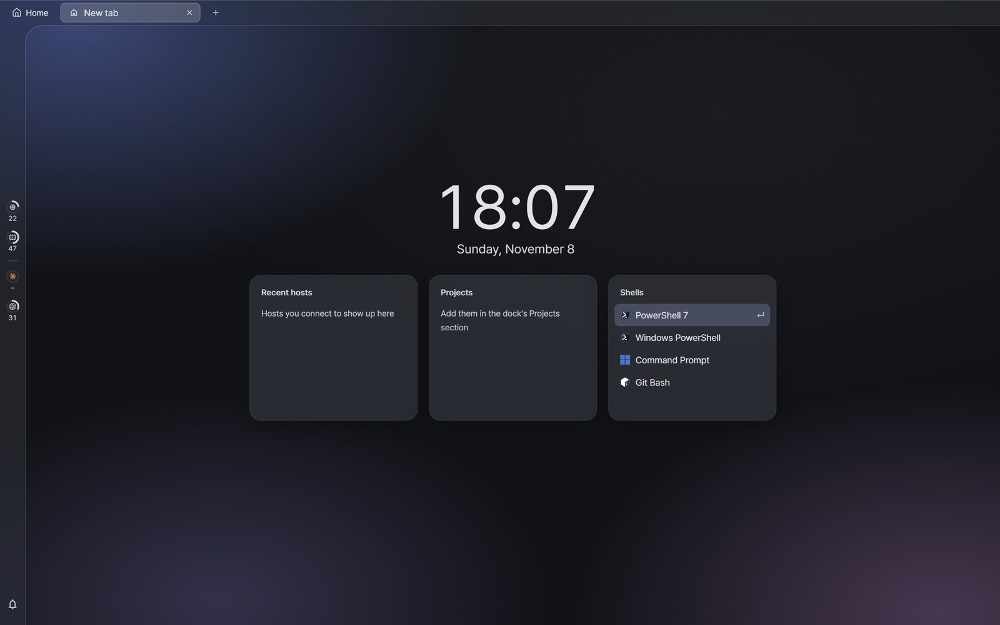

새 탭은 **시작 화면**으로 열립니다.

- **최근 호스트**(Recent hosts)에는 접속했던 SSH 호스트가 쌓입니다.
- **프로젝트**(Projects)에는 프로젝트로 추가한 폴더가 보입니다.
- **셸**(Shells)에는 이 PC에서 찾은 셸이 보입니다. `Enter`를 누르거나 하나를 누르면 열립니다.

왼쪽의 가는 띠는 **상태바**입니다. 고리들은 이 PC의 CPU·메모리 사용량과 AI 사용 한도를 보여 줍니다. 마우스를 올리면 자세히 보이고, 누르면 전체 화면이 열립니다. 맨 아래 종은 알림입니다.

## 3. 숨은 독 찾기

처음에는 창이 거의 비어 보입니다. AYNX는 메뉴를 **독** 세 개에 넣어 두고, 부를 때만 꺼내기 때문입니다. 창 가장자리에 마우스를 잠깐 대고 있거나 단축키를 누르세요.

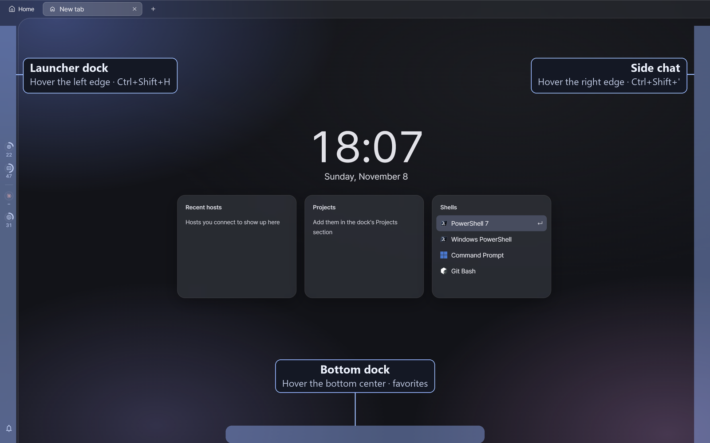

| 독 | 마우스 | 단축키 | 들어 있는 것 |
|---|---|---|---|
| **런처 독** | **왼쪽 끝**에 대기 | `Ctrl+Shift+H` · `J` · `K` | 실행 단추, 알림, 호스트, 프로젝트, DB |
| **사이드 채팅** | **오른쪽 끝**에 대기 | `Ctrl+Shift+'` | 하던 일 옆에서 AI와 대화 |
| **하단 독** | **아래 가운데**에 대기 | 없음 | 즐겨찾기와 실행 단추 |

- 독은 `Esc`를 누르거나 바깥을 누르면 닫힙니다.
- 하단 독은 핀 단추로 화면에 고정할 수 있습니다.
- 런처를 오른쪽에, 채팅을 왼쪽에 두려면 설정 › 테마 › **독 배치**(Dock layout)에서 바꿉니다.
- 단축키가 기억나지 않으면 `Ctrl+Shift+P`로 명령 팔레트를 여세요. 모든 명령이 단축키와 함께 보입니다.

대부분의 일은 **런처 독**에서 시작합니다.

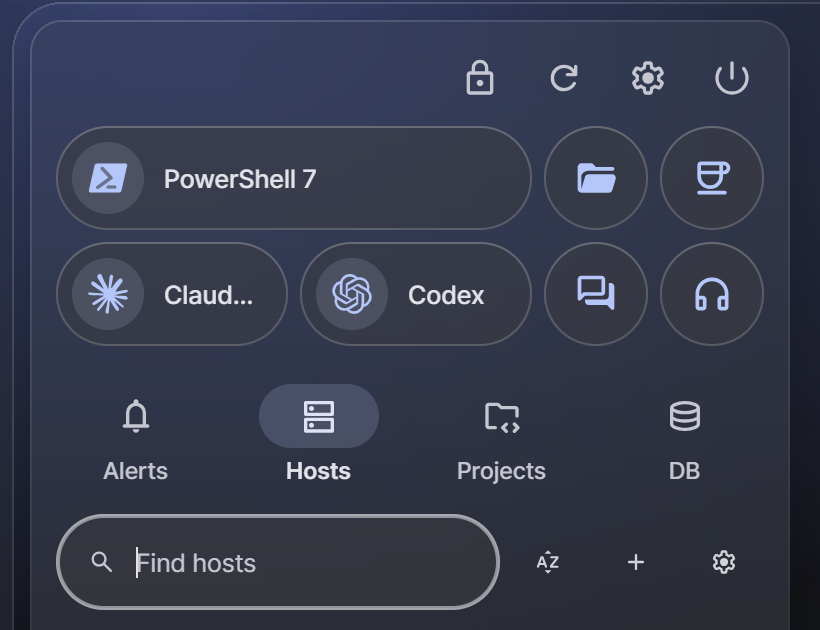

위쪽 두 줄은 실행 단추입니다. 기본 셸, Claude Code, Codex, 파일 탐색기, 사이드 채팅, 오케스트레이션이 있습니다. 그 아래에 **알림**·**호스트**·**프로젝트**·**DB** 칸이 있습니다. `Ctrl+Shift+H`·`J`·`K`는 독을 각각 호스트·프로젝트·DB 칸으로 바로 엽니다.

## 4. AI 에이전트 열기

`Ctrl+Shift+A`를 누르고 **Claude Code**나 **Codex**를 고른 뒤 `Enter`를 누릅니다. 런처 독의 에이전트 단추로 열어도 됩니다.

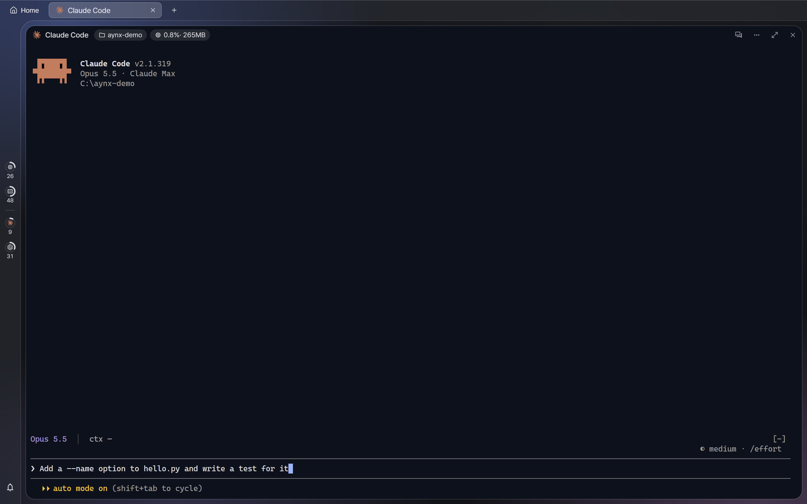

AI 타일은 에이전트 자체의 터미널 화면이 AYNX 안에서 도는 것이라, 터미널에서 쓰던 그대로 쓰면 됩니다. 타일 머리줄에는 다음이 보입니다.

- 에이전트가 일하는 **폴더**(기본값은 설정 › AI 에이전트 › **AI 타일 시작 폴더**에서 정합니다)
- 타일 프로세스가 쓰는 **CPU와 메모리**
- 오른쪽에는 터미널 화면과 **대화 화면**(권한 요청이 채팅식 카드로 뜹니다)을 오가는 단추, 타일 메뉴, 확대, 닫기

탭 아이콘과 상태바가 에이전트가 일하는 중인지, 권한을 기다리는지, 끝났는지 보여 주니 다른 일을 하다 돌아와도 됩니다.

## 5. 타일 배치

타일은 타일링 창 관리자처럼 화면을 나눕니다(Hyprland의 dwindle 배치).

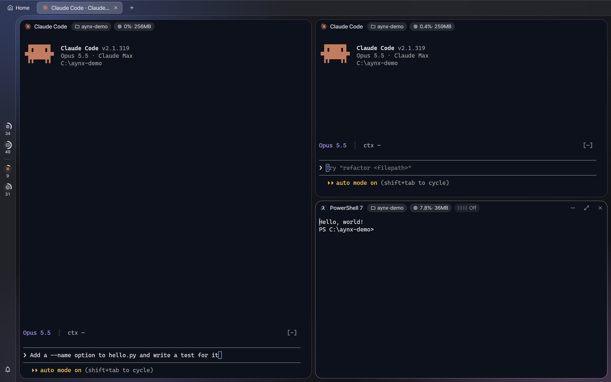

| 동작 | 단축키 |
|---|---|
| 새 셸 타일 | `Ctrl+Shift+N` |
| 나누기(지금 타일을 복제) | `Ctrl+Shift+D` |
| 포커스 옮기기 | `Alt+방향키` |
| 타일 옮기기 | `Alt+Shift+방향키` |
| 크기 조절 | `Ctrl+Alt+방향키` |
| 타일 하나 크게 보기 · 되돌리기 | `Ctrl+Shift+Z` |
| 타일 닫기 | `Ctrl+Shift+Q` |
| 새 탭 | `Ctrl+Shift+T` |

전체 단축키는 `Ctrl+Shift+/`(터미널 밖에서는 `?`)로 봅니다. [단축키 안내](shortcuts.md)(영어)도 있습니다.

## 6. SSH 호스트 추가

런처 독을 호스트 칸으로 열고(왼쪽 끝에 마우스, 또는 `Ctrl+Shift+H`) **+**를 누릅니다.

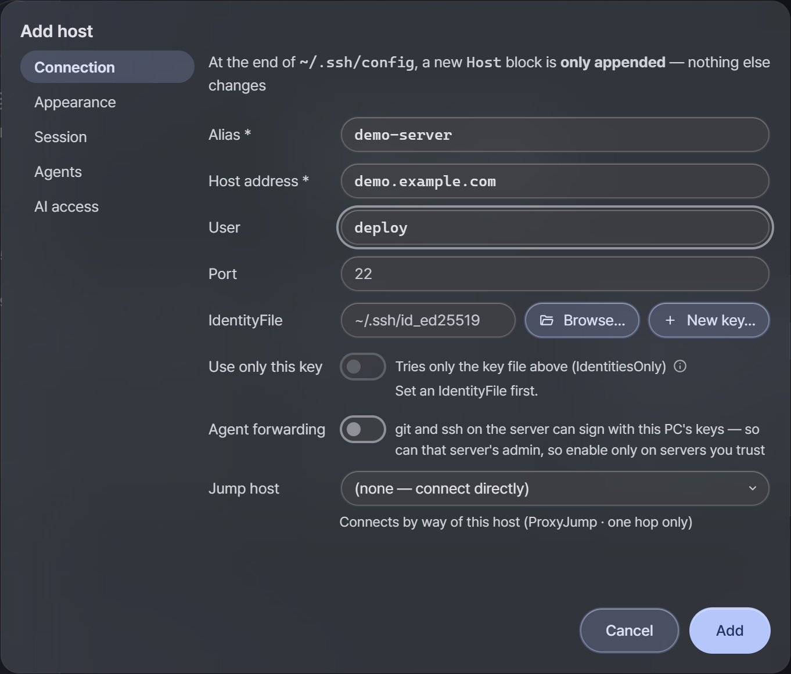

별칭, 주소, 사용자를 채웁니다. AYNX는 `~/.ssh/config` 끝에 `Host` 블록 하나를 덧붙이기만 하고 다른 곳은 건드리지 않습니다. 그 파일에 이미 있는 호스트는 따로 설정하지 않아도 목록에 보입니다.

**AI 권한**(AI access) 탭에서는 이 호스트에서 AI가 할 수 있는 일을 정합니다.

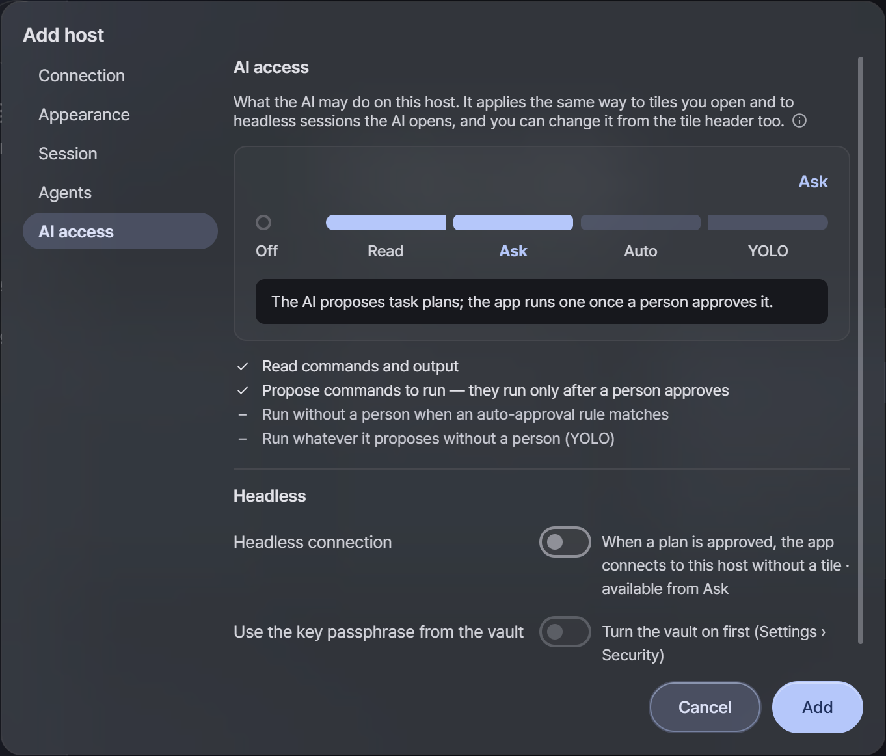

| 단계 | AI가 할 수 있는 일 |
|---|---|
| **Off** | 아무것도 못 합니다. 이 호스트의 세션은 목록에도 나오지 않습니다. |
| **Read** | 명령과 출력을 읽습니다. |
| **Ask** | 실행할 명령을 작업안으로 제안합니다. 사람이 승인해야만 실행됩니다. |
| **Auto** | 자동 승인 규칙에 맞는 명령은 묻지 않고 실행합니다. |
| **YOLO** | 제안한 것은 무엇이든 사람 없이 실행합니다. |

처음에는 **Read**나 **Ask**로 시작하세요. 접속은 호스트를 고르고 `Enter`, 새 탭으로 열려면 `Ctrl+Enter`입니다. 자세한 내용은 [호스트 안내](hosts.md)(영어)에 있습니다.

## 7. 사이드 채팅

창 오른쪽 끝에 마우스를 대거나 `Ctrl+Shift+'`를 누르면 사이드 채팅이 열립니다.

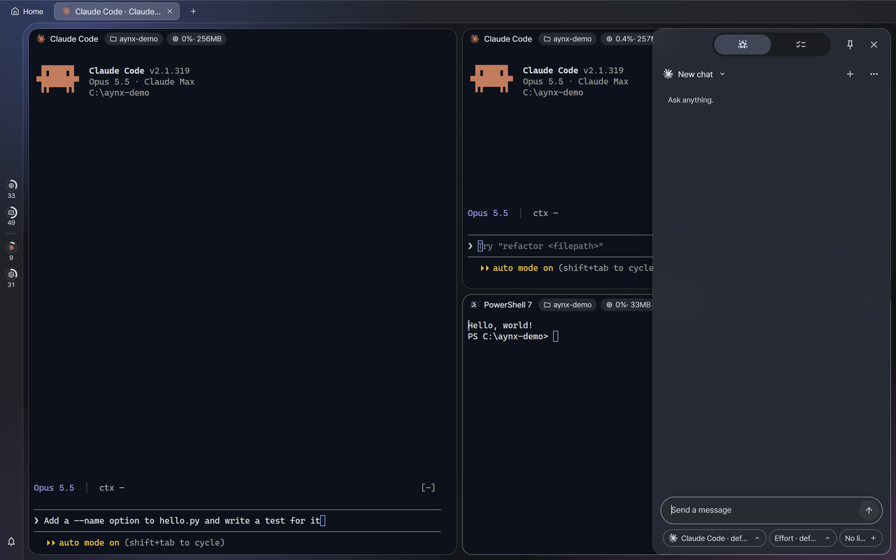

하던 일을 떠나지 않고 바로 물어볼 수 있습니다. 입력 칸 아래 칩으로 에이전트, 추론 수준(Effort), **연결할 세션**을 고릅니다. 터미널을 연결하면 AI가 그 세션 내용을 읽고 답합니다.

## 8. 세션 판

`Ctrl+Shift+M`을 누르면 모든 탭과 타일을 한눈에 봅니다.

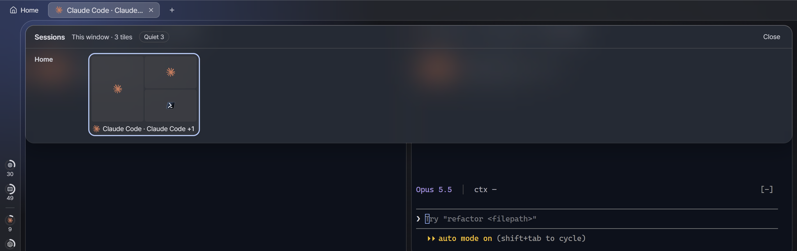

카드 하나가 탭 하나이고, 타일 배치 모양 그대로 각 에이전트의 상태가 보입니다. 타일을 누르면 그리로 가고, 다른 탭으로 끌어다 놓으면 옮겨집니다. 자세한 내용은 [세션과 작업안](dashboard.md)(영어)에 있습니다.

## 9. 내 모양으로 꾸미기

`Ctrl+,`로 설정을 엽니다. **테마** 화면에서 월페이퍼, 라이트·다크 모드, 색을 정합니다.

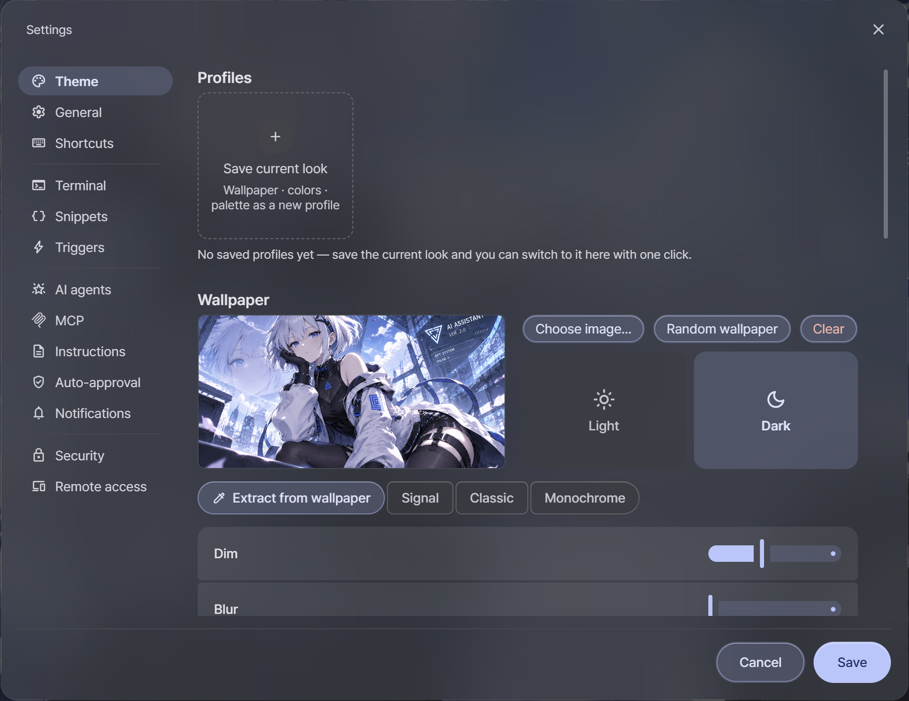

1. **이미지 선택…**(Choose image…)으로 월페이퍼를 고릅니다.
2. **월페이퍼에서 추출**(Extract from wallpaper)을 누르면 창 색, 강조색, 터미널 색까지 한 벌로 뽑습니다.
3. 월페이퍼가 타일 뒤로 비치게 하려면 같은 화면 아래쪽 **터미널 투명도**(Terminal opacity)를 낮춥니다(아래 그림은 약 70%).
4. **저장**을 누릅니다.

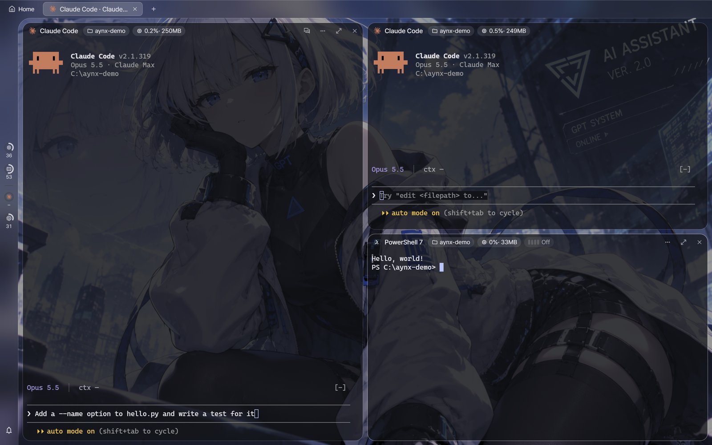

**현재 모양 저장**(Save current look)은 월페이퍼, 색, 터미널 색을 **프로필**로 저장합니다. 프로필은 테마 화면이나 `Ctrl+Shift+U`로 바꿉니다.

설정 화면의 모든 항목은 [설정 안내](settings.md)(영어)에 설명돼 있습니다.

## 다음으로 볼 것

상세 안내는 영어입니다.

- [프로젝트와 워크트리](projects.md)
- [파일과 문서](files.md)
- [쿼리 타일](query-tile.md) — 데이터베이스
- [오케스트레이션](orchestration.md) — 큰 일을 여러 에이전트에 나눠 맡기기
- [원격 접속](remote-web.md) — Tailscale로 폰에서 AYNX 열기
- [전체 기능](../features.ko.md) · [보안](../security.ko.md)
