# Getting started

[한국어](getting-started.ko.md)

This guide walks through a first session with AYNX: install it, open an AI agent, arrange tiles, add an SSH host and find your way around. Each step links to a detailed guide when you want more.

The screenshots use the default theme. Your colors follow the wallpaper and theme you pick.

## 1. Install

1. Download the installer from the [latest release](https://github.com/lzyxion/aynx/releases/latest).
   - `AYNX_<version>_x64-setup.exe` installs for the current user and needs no admin rights.
   - `AYNX_<version>_x64_en-US.msi` installs for all users.
2. The installers are unsigned, so Windows SmartScreen may warn on first run. Choose **More info → Run anyway**.
3. To use AI tiles, install **Claude Code** or **Codex** natively on Windows (not inside WSL). AYNX finds them on its own. If neither is installed, the launcher dock shows an install entry that takes you to the setup links.

## 2. The first screen

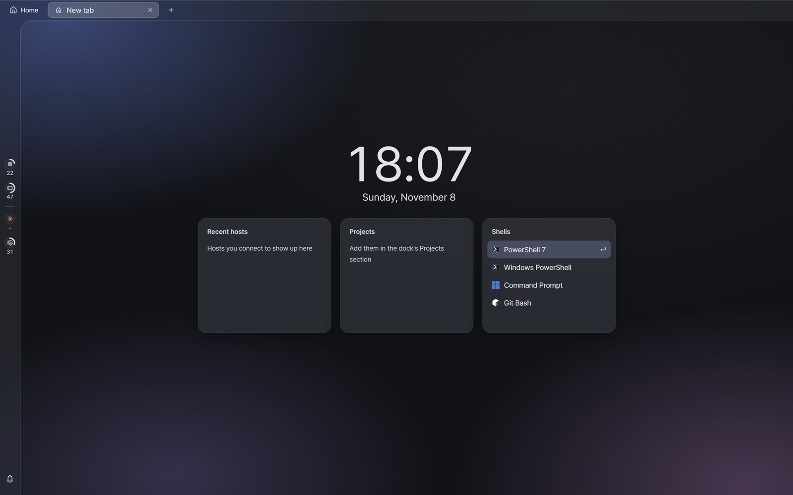

A new tab opens on the **start screen**:

- **Recent hosts** lists the SSH hosts you have connected to.
- **Projects** lists the folders you added as projects.
- **Shells** lists the shells found on this PC. Press `Enter` or click one to open it.

The thin bar on the left is the **status bar**. Its rings show this PC's CPU and memory use and your AI usage limits; hover one for details or click it to open the full view. The bell at the bottom holds alerts.

## 3. Find the hidden docks

At first the window looks almost empty. That's because AYNX keeps its menus in three **docks** that stay hidden until you call them. Move the mouse to an edge of the window and hold it there for a moment, or use the shortcut.

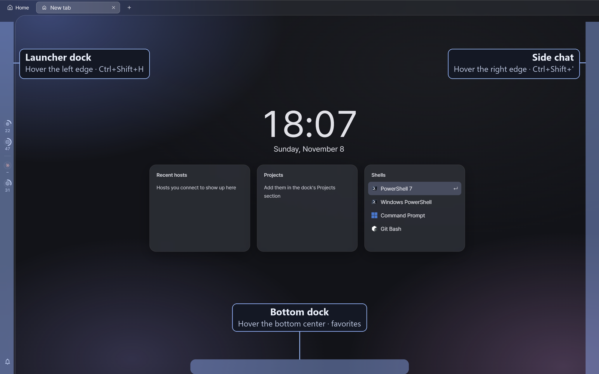

| Dock | Mouse | Keys | What's in it |
|---|---|---|---|
| **Launcher dock** | Hover the **left edge** | `Ctrl+Shift+H` · `J` · `K` | Launch buttons, alerts, hosts, projects, databases |
| **Side chat** | Hover the **right edge** | `Ctrl+Shift+'` | A chat with an AI agent beside your work |
| **Bottom dock** | Hover the **bottom center** | none | Your favorites and launch buttons |

- Press `Esc` or click outside to close a dock.
- Pin the bottom dock with its pin button to keep it on screen.
- To put the launcher on the right and the chat on the left, go to Settings › Theme › Dock layout.
- If you forget a shortcut, `Ctrl+Shift+P` opens the command palette, which lists every command with its keys.

The **launcher dock** is where most things start:

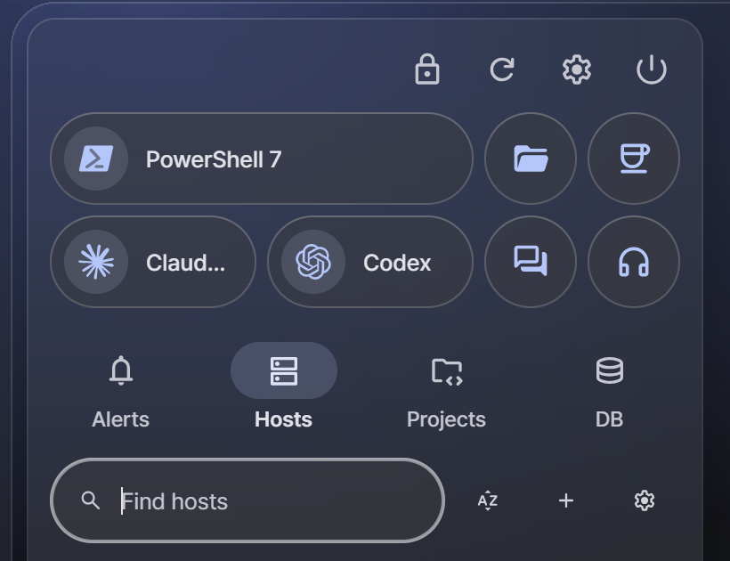

The top rows are launch buttons: your default shell, Claude Code, Codex, the file browser, the side chat and orchestration. Below them are the **Alerts**, **Hosts**, **Projects** and **DB** sections. `Ctrl+Shift+H`, `J` and `K` open the dock straight on Hosts, Projects and DB.

## 4. Open an AI agent

Press `Ctrl+Shift+A`, pick **Claude Code** or **Codex**, and press `Enter`. You can also use the agent buttons in the launcher dock.

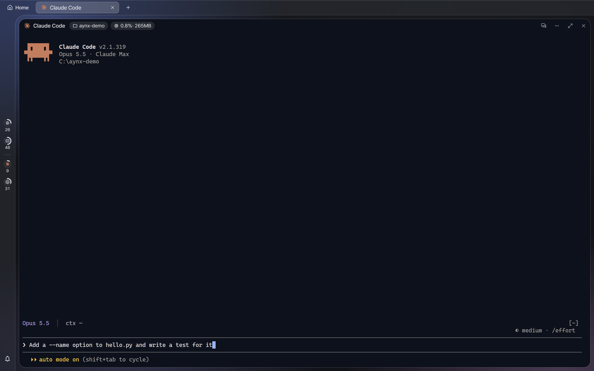

An AI tile is the agent's own terminal UI running inside AYNX, so you use it exactly as you would in a terminal. The tile header shows:

- the **folder** the agent works in (set the default in Settings › AI agents),
- the **CPU and memory** the tile's processes use,
- on the right, a button that switches between the terminal and a **conversation view** with chat-style permission cards, plus the tile menu, zoom and close.

The tab icon and the status bar show when an agent is working, waiting for your permission, or done, so you can leave it and come back.

## 5. Arrange tiles

Tiles split the screen like a tiling window manager (Hyprland's dwindle layout).

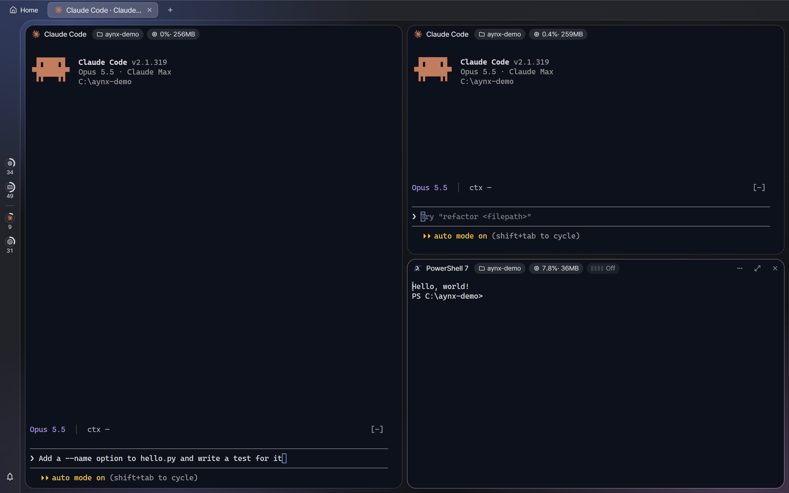

| Action | Keys |
|---|---|
| New shell tile | `Ctrl+Shift+N` |
| Split (duplicate the focused tile) | `Ctrl+Shift+D` |
| Move focus | `Alt+Arrow` |
| Move the tile | `Alt+Shift+Arrow` |
| Resize | `Ctrl+Alt+Arrow` |
| Zoom one tile to full size and back | `Ctrl+Shift+Z` |
| Close the tile | `Ctrl+Shift+Q` |
| New tab | `Ctrl+Shift+T` |

Press `Ctrl+Shift+/` (or `?` outside a terminal) for the full shortcut list. See also the [Shortcuts guide](shortcuts.md).

## 6. Add an SSH host

Open the launcher dock on its Hosts section (hover the left edge, or `Ctrl+Shift+H`) and press **+**.

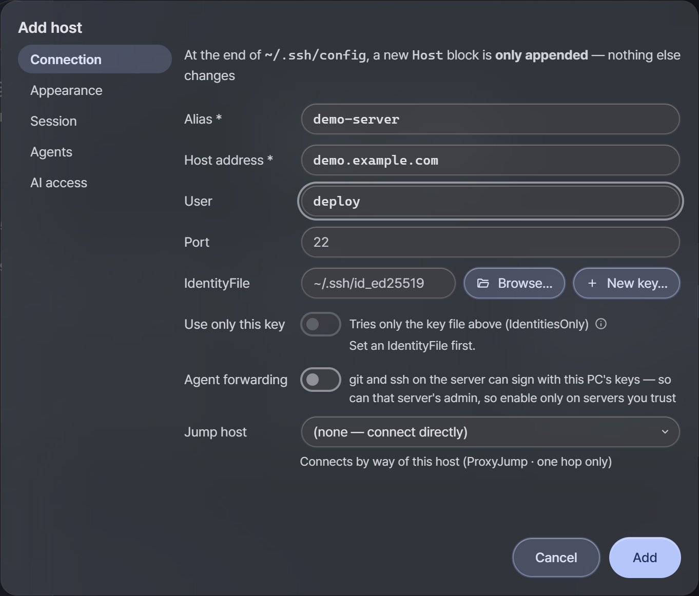

Fill in an alias, the address and the user. AYNX appends a new `Host` block to the end of your `~/.ssh/config` and changes nothing else. Hosts already in that file show up in the list without any setup.

The **AI access** tab sets what AI agents may do on this host:

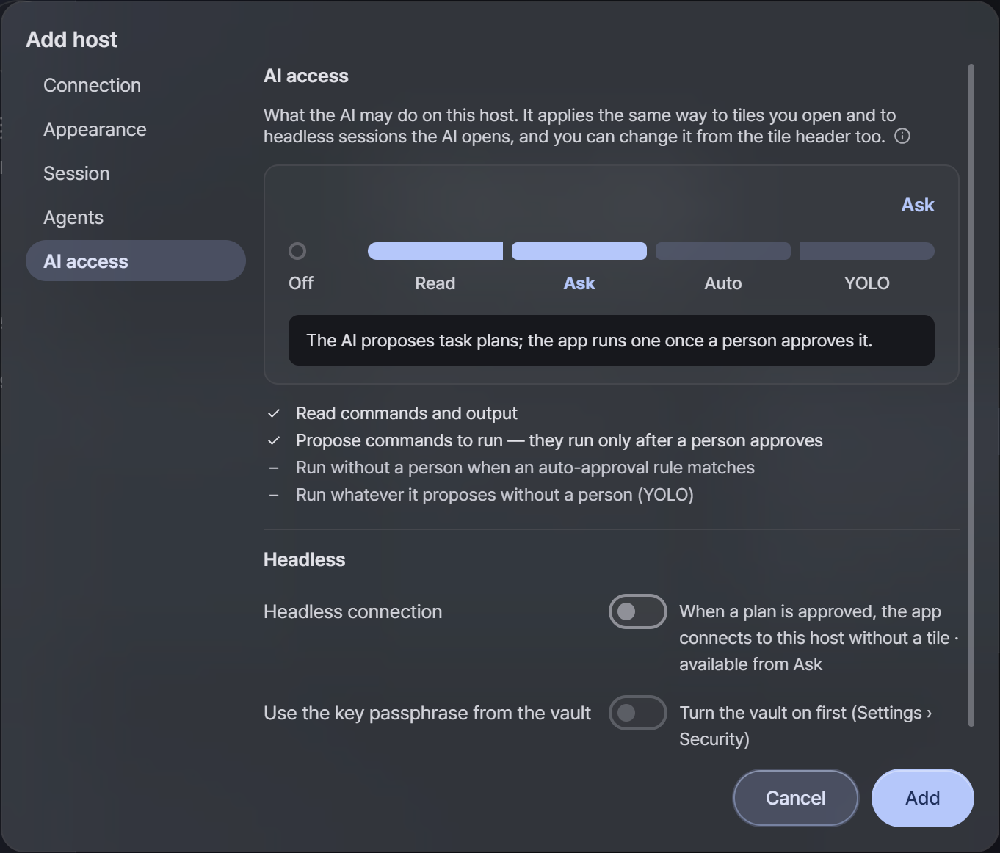

| Level | What the AI can do |
|---|---|
| **Off** | Nothing. The host's sessions are not even listed. |
| **Read** | Read commands and their output. |
| **Ask** | Propose commands as task plans. They run only after you approve them. |
| **Auto** | Also run commands that match your auto-approval rules without asking. |
| **YOLO** | Run whatever it proposes without a person. |

Start with **Read** or **Ask**. Connect by selecting the host and pressing `Enter`, or `Ctrl+Enter` to open it in a new tab. Details: [Hosts guide](hosts.md).

## 7. Side chat

Hover the right edge of the window or press `Ctrl+Shift+'` to open the side chat.

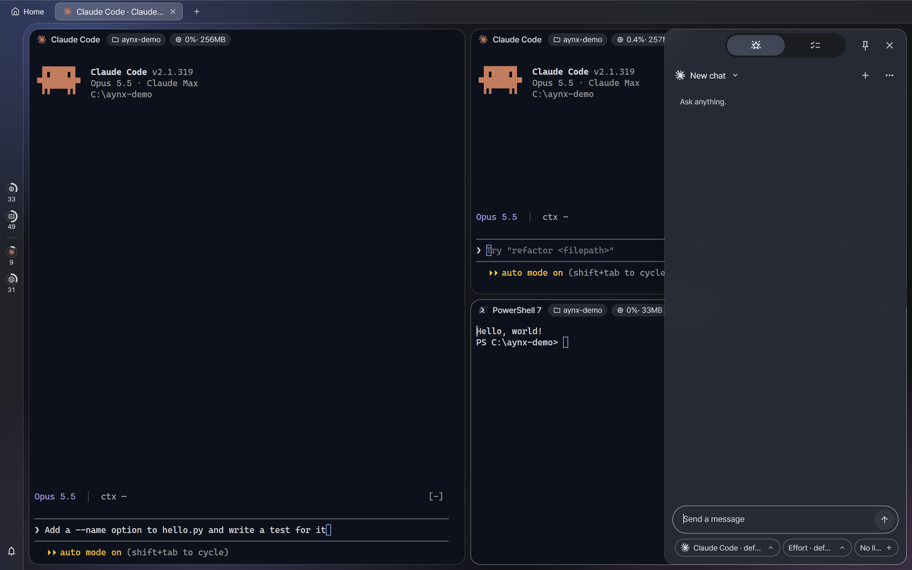

Ask a quick question without leaving your work. The chips under the message box choose the agent, the effort level and a **linked session**: link a terminal and the AI can read that session for context.

## 8. Session sheet

Press `Ctrl+Shift+M` to see every tab and tile at a glance.

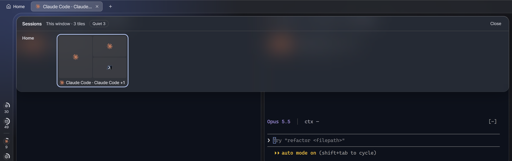

Each card is a tab drawn as its tile layout, with each agent's state. Click a tile to jump to it, or drag it onto another tab to move it there. Details: [Sessions and task plans](dashboard.md).

## 9. Make it yours

Open Settings with `Ctrl+,`. The **Theme** page sets the wallpaper, light or dark mode and colors.

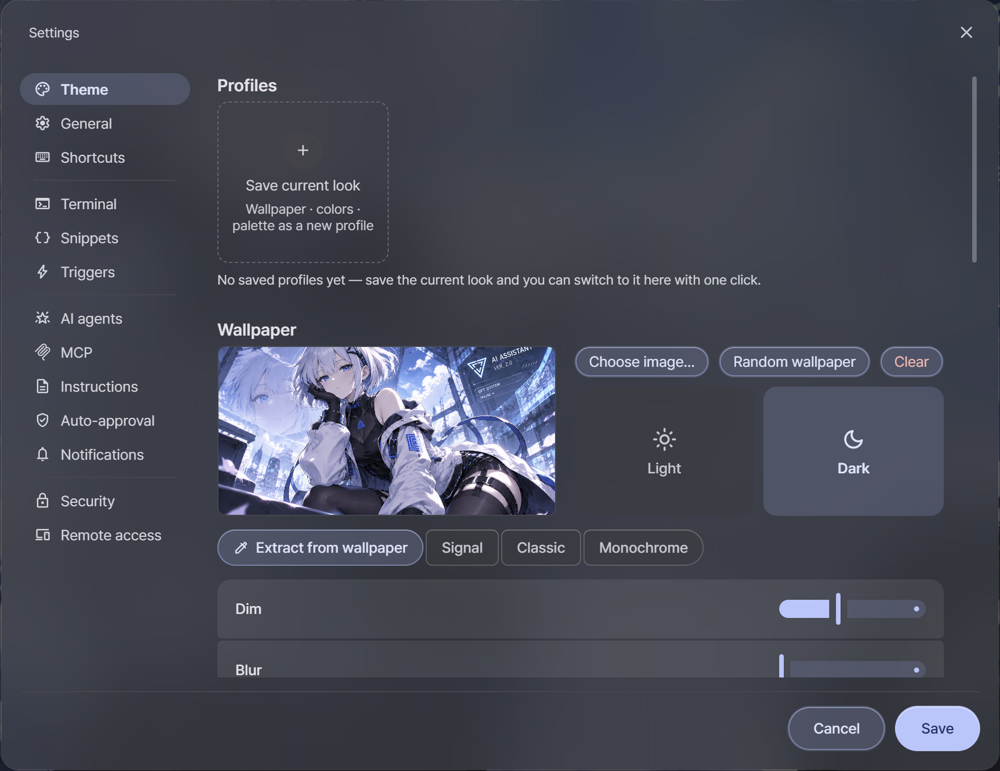

1. **Choose image…** sets a wallpaper.
2. **Extract from wallpaper** builds the whole color scheme from it: window colors, accents and the terminal palette.
3. To let the wallpaper show through your tiles, lower **Terminal opacity** further down the same page (the shot below uses about 70%).
4. Press **Save**.

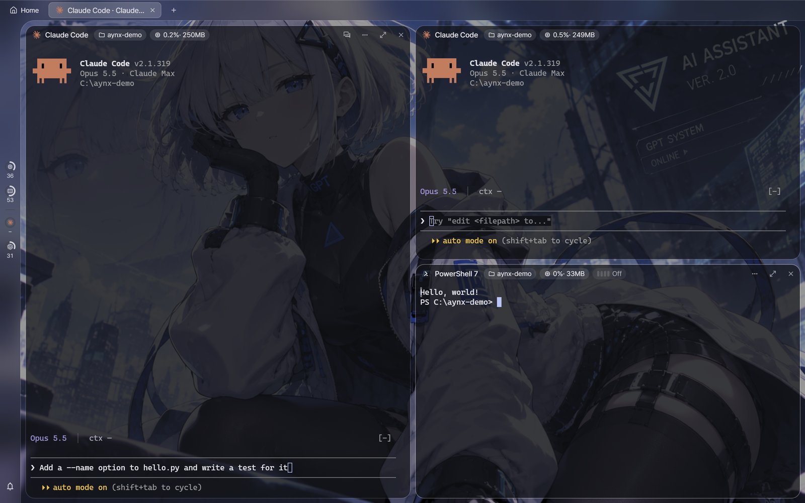

**Save current look** stores the wallpaper, colors and terminal palette as a **profile**. Switch profiles from the Theme page or with `Ctrl+Shift+U`.

Every item on the settings screen is explained in the [Settings guide](settings.md).

## Where to go next

- [Projects and worktrees](projects.md)
- [Files and documents](files.md)
- [Query tile](query-tile.md) for databases
- [Orchestration](orchestration.md): split a larger job across several agents
- [Remote access](remote-web.md): open AYNX from your phone over Tailscale
- [All features](../features.md) · [Security notes](../security.md)
