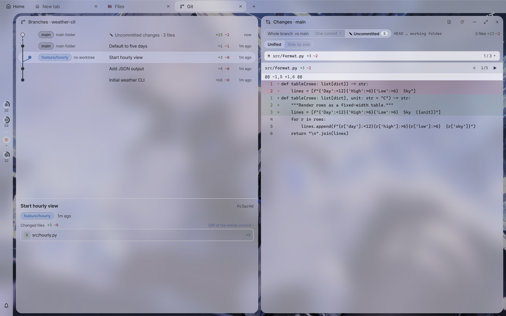
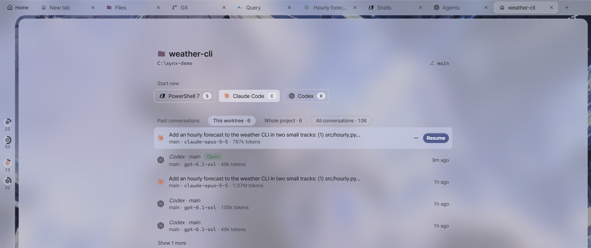

# Projects guide

This guide explains the **Projects section** of the launcher dock (`Ctrl+Shift+J`), its form, worktrees and the project start screen. The dock and the form show only names and short hints. The background, exceptions and interactions with other features are written here.

---

## Projects

<a id="project"></a>
### What a project is

A project is **one** repository folder with a name. It is either local (this PC) or a folder on a remote host. Projects are a global list, visible from every workspace. A workspace is a screen board that remembers the layout of tabs and tiles.

- **Open** (Enter or double-click, and the same from the start screen, palette and favorites): If the current workspace has a tile at that location, the app goes to the most recently focused such tile. If not, it opens in a new tab. A current tab that holds only one empty general start tile is reused.
- **Open in this tab** (Ctrl+Enter): Opens as a tile next to the active tile. The project start screen follows its setting.
- The dock and the start screen list projects open in the current workspace first. In the dock, a small green dot means open here, and a dim name badge `workspace name ↗ +N` means open elsewhere. Existing agent status dots are kept separately.
- Right-click **Go to open location (name)** goes to that workspace and its tab and tile.
- Location is calculated from the host and the folder. The current folder reported by the shell takes priority, and the start folder is used if that is unknown. The basis is the deepest location among paths under projects and known worktrees.

- Opening starts a tile in that folder along with the project's **agent** (Claude Code by default for a new project). With [None (shell)], only a shell starts in that folder. The agent starts the same way as an AI tile, so the extra arguments in Settings › AI agents apply as they are.
- A local project opens with the shell in the [Shell] field (the default shell if empty). A local path must be absolute.
- A remote project opens as an SSH tile on that host, and the path may use `~/…`.
- **Removing** a project only takes it off the list. The folder and worktrees stay on disk, and open tiles stay as they are. What goes with it is the project's settings (agent, shell, worktree folder), the setup script, and the per-worktree script run records. The confirmation dialog shows that list.
- Add with ＋ in the dock, and edit or delete from a row's right-click menu.

<a id="project-create"></a>
### Create new

At the top of the add dialog, choose either [Existing folder] or [Create new] (the edit dialog does not have this).

- **Create new** — Enter a name and a **Create in** location (the parent folder). The app creates the folder `<Create in>/<name>`, initializes it as a git repository (including an empty first commit) and adds it as a project. The branch follows the git setting `init.defaultBranch`, or `main` if there is none.
- The name is also the folder name, so only letters, digits and `. _ -` are allowed (it may not start with `-` or end with `.`, and Windows device names such as `con` and `nul` are also refused).
- If a folder already exists at that location, it is used **only if empty**. If it is not empty, add it with [Existing folder].
- If git has no user name and email (`user.name` · `user.email`), the first commit cannot be made. Below the dialog, "Set your git user name and email on this PC first:" (for remote, "Set your git user name and email on that server first:") appears with two lines to type:

  ```
  git config --global user.name "Your Name"
  git config --global user.email "you@example.com"
  ```

  Copy the two lines with [Copy commands], change them to your own name and email, and type them in the right place (a shell on this PC or a shell on that server). AYNX does not set them for you or commit under a temporary name. The folder and repository remain, so after setting them, clicking the same button again makes only the first commit. If the same thing happens with [Initialize git repository] in the dock or [Make first commit and continue] for a new worktree, the same guidance appears as a notification ([Copy commands] in the notification).
- To create on a remote host, that host must have a **connected session**. The Create in location must start with `/` or `~`.

<a id="project-icon"></a>
### Icon and color

The add and edit dialogs have three pages, chosen from the left menu: **General** (how to add, name, location, host, path, agent, shell/tmux), **Worktrees** (worktree folder, setup script) and **Appearance** (icon → color). If saving is blocked, the dialog moves to the page holding the field to fix, and a red dot appears on that page in the left menu.

The [Appearance] page has the same two fields (icon → color) as the host form's [Appearance] tab and the folder edit dialog. The chosen icon appears on the project dock's row, the command palette, the favorites dock, the projects section of the start page, and the header of the project start screen. If empty, it is the **same default folder as host dock folders** (the same theme color). If you set only a color, that folder takes on the color. Color applies only to basic (single-color) icons and default folders, and logos and emoji keep their own colors.

<a id="project-path-check"></a>
### Path check

When you choose a path with [Existing folder] (Browse, leaving the field, or pausing while typing), the app checks that folder and reports on one line below the path field.

- **git repository** — a green dot and the branch (and the number of worktrees if there are several).
- **Not a git repository** — [Initialize and add] runs `git init`, makes an empty first commit and then adds the folder (the files inside stay as they are, untracked). [Add as is] adds it without a repository, and worktrees cannot be used.
- **A subfolder inside a repository** — [Use the root] changes the path to the repository root. [Keep this] leaves the folder as it is.
- **A repository with no commits** — [Make first commit and add]. A first commit is needed for new worktrees to branch off the main branch.
- **The folder does not exist** — A local folder cannot be added. A remote one only gets a warning.
- If the same folder already exists as another project, the app only tells you (you can still add it).
- Remote folders are checked only while that host has a connected session.

<a id="project-agent"></a>
### Agent

Choose the agent that starts when the project opens: [Claude Code], [Codex] or [None (shell)]. Extra arguments (`--model` and so on) are not set here but in the per-agent extra arguments field in Settings › AI agents (they are added to all AI tiles and resumes).

- The old **start command** field no longer exists. Commands written there were moved as follows:

  | Old start command | Agent | Setup script |
  | --- | --- | --- |
  | `claude` · `codex` | That agent | Unchanged |
  | `claude --model opus` | Claude Code | Unchanged — one line at the top of the edit dialog asks you to move the extra arguments to Settings › AI extra arguments |
  | Empty | None (shell) | Unchanged |
  | Any other command (`npm ci` and so on) | None (shell) | If it was empty, the command moves to the setup script — one line at the top of the edit dialog |

  A moved command now runs **only when a new worktree is created** (not every time the project opens). The line at the top of the edit dialog goes away when you save.

<a id="project-setup-script"></a>
### Setup script

Multiple lines that run **once** when a new worktree is created, in that new tile, before the agent (installing dependencies, copying `.env` and so on). If left empty, nothing runs.

- **The shell it runs in** — A local project uses the project's [Shell] (the default shell if empty), and a remote project uses the server's `sh`. The hint below the field says which shell it runs in now.
- **Main working folder** — Available as the environment variable `AYNX_ROOT_PATH`: `$env:AYNX_ROOT_PATH` in PowerShell, `%AYNX_ROOT_PATH%` in cmd, and `$AYNX_ROOT_PATH` in Git Bash, WSL and remote (in the form `/c/…` for Git Bash and `/mnt/c/…` for WSL). The script runs in the new worktree folder.
- **Stopping rules** — PowerShell checks each statement (it stops there if an error occurs or a command ends with a non-zero code, and `exit N` also ends with that code). Git Bash, WSL and remote check each line (`sh -e`). **cmd is judged only by the exit code of the last command.** To stop partway, add `|| exit /b 1` to the end of that line.
- While it runs, the output is shown in the tile as it is, with `>` in front of the running command. Instead of the whole script, only one short line pointing at a temporary file (such as `sh '…/run-….sh'`) is typed into the tile. That file deletes itself when it starts running.
- **On success**, the agent starts right away (with no agent, you stay in the shell). **On failure**, it stops in the shell and the agent does not start. A bar appears over the tile with [Edit script] (this form), [Run again] (again on the spot, with the agent on success) and [Start {agent}].
- To run it again in an existing worktree, use right-click [Run setup script] on the worktree row. It runs only the script in a new tile and stays in the shell (it is dimmed if the script is empty).
- For each local worktree, "whether it ran, whether it succeeded, and when" is kept in the app's settings folder (deleted with the worktree). Script run records are not kept for remote worktrees.
- The script lives **only in the app's settings**. No file is placed in the repository, and it is not visible to the AI (MCP).

<a id="project-tmux"></a>
### tmux (remote)

This field exists only for remote projects. **This toggle takes priority over the host setting.**

- **On** — Starts inside a tmux session regardless of the host's tmux setting.
- **Off** — Opens this project in a plain shell even if the host is a tmux host.

<a id="project-worktree-dir"></a>
### Worktree folder

The **parent folder** where new worktrees are created. A new worktree is created under this folder as `<name>`.

- If empty, the default location is `<repository parent>/<repository name>-wt` (for example `C:\src\proj` → `C:\src\proj-wt\<name>`, `~/api` → `~/api-wt/<name>`). Dimmed text in the field shows that location.
- If you enter one, it must be an **absolute path outside** the repository folder.

---

## Worktrees

<a id="worktrees"></a>
### Worktree rows

Expanding a project row shows the repository's git worktrees, one per row. Double-click or Enter follows the **Open** rules above (if it is already open here, the app moves to that tab).

- The repository itself gets the **primary** mark. It is the main working folder and cannot be deleted (the menu has no [Remove…]).
- A remote project's worktree list is read **only while that host has an open session**. Without a session, the line "Shown once connected" appears instead. Removing a remote worktree also requires a connected session.
- If the folder is not a git repository, "Not a git repository." and [Initialize git repository] appear. Clicking the button runs `git init`, makes an empty first commit and reads the list again.
- A repository with no commits gets "no commits" on the primary folder row.

<a id="worktree-changes"></a>
### Change badge

On the right of a worktree row (except the primary folder), small text such as `+84 −19 ↑2` appears, as on GitHub (`+` light green, `−` light red, `↑` gray). Hovering shows the same numbers spelled out ("Committed since main: +84 −19 lines" and "2 commit(s) ahead of main").

- **Base** — The only base is the branch of the main working folder (usually `main`).
- **+A −D** — **Lines added and removed, in committed changes only**, from the merge-base with that branch to `HEAD`, by the same rule as a GitHub PR. Uncommitted changes and new files git does not track yet are not counted. The ✎ row in the [branch graph](#branch-graph) shows those. Changes to binary files are not in the line count either. Large numbers are shortened as in `1.2k`, and the tooltip has the full number.
- **↑N** — The number of commits on this side since the fork from that branch. If it cannot be known (for example, the main folder is on a detached HEAD), `↑` is left out, and so are the line counts if there is no merge-base.
- **Merged** — When all of a branch's commits are in that branch, a "Merged" chip appears instead of numbers. This includes branches merged by squash or rebase, detected by content. A newly created branch that has no commits of its own yet is not "Merged". The tooltip says how it was merged and points to the [Clean up] button, which removes the worktree and its branch.
- Pieces that are 0 are left out (`+3` · `↑1`). If no committed lines changed and no commits are ahead, there is no badge (this also covers files with only permission changes or only binary changes). **Clicking** the badge opens the [branch graph](#branch-graph) with that branch selected. The app writes nothing to git.
- When it is read again: when a project is expanded or the dock is refreshed, after creating a new worktree, and when an agent running in that worktree finishes a turn. There is no continuous scanning, so a commit made in a shell shows at the next expand or refresh.
- A remote project reads it, like the worktree list, **only while that host has an open session**.

<a id="branch-graph"></a>
### Branch graph

A read-only tile that draws, on one page, **where the project's branches forked off and which worktree or agent is where**, with one row per commit. There are three ways to open it: click a change badge on a worktree row (with that branch selected), right-click a project or worktree row → [Branch graph], or use "Branch graph" in the palette (for the project of the current tile). It opens **side by side in the current tab**, not in a new tab, and if it is already open, the app goes to that tile.



- **Two lanes** — The left lane is the main branch (the branch of the main folder), and the right lane is shared by all other branches, so the width stays the same however many branches there are. Each branch has its own color.
- **Rows** — Each row shows the lane marks, the name cell, the commit subject, `+added −removed` and the time, such as "3 minutes ago". A merge commit shows no line counts. Main branch commits are listed newest first, and skipped commits between them become a "⋯ N commits" row. Each branch's commits form a block placed right above the main commit it forked from.
- **Name cell** — The first row of a block shows the branch name, the worktree name (or "no worktree") and the agent status glyph if there is an agent. The last row of a block shows "↳ branched from {commit}". The main branch shows "main folder".
- **"✎ Uncommitted changes · N files"** — One row for each worktree with uncommitted work, including new untracked files. It sits at the top of that branch's block.
- **Merged branches** — A merged block folds into one row under its merge commit: "N commits · branched from {commit}, merged", "N commits · squash merge" or "N commits · rebase merge". Click the row to expand it, and use "▴ Collapse {name}" in the right pane to fold it again. A branch that is merged and has no worktree gets no block of its own.
- **[Show older commits]** — The main branch starts with 12 commits. Each click adds 50, up to 500.
- **Click a row** (with the keyboard, move with ↑↓ · Home/End and press Enter or Space) and the right pane shows that row. A commit row shows the subject, short hash, branch, time and **Changed files**. A ✎ row shows Worktree, Branch and Base with its **Changed files**. Only line counts are shown for files (`+22 −6`). Clicking a file opens it in a diff tile, and "Diff of the whole commit ›" or "Diff of all uncommitted changes ›" opens the whole set. Ctrl+click opens the worktree's current file as a document. Files of a commit not checked out in any worktree and deleted files cannot be opened that way, and the tooltip says why.
- If the worktree has an agent, [Go to tile] takes you to that agent tile.
- **When it is read** — on opening, with the [Refresh] button, and with [Show older commits]. When an agent in that project finishes a turn, the tile reads again by itself, keeping the selected row and the scroll position. There is no continuous scanning.
- A remote project reads it **only while that host has an open session** (otherwise "Shown once connected — no tile is attached to {host}", and it reads once a session appears). On a remote host, file names are fetched only when you select a row.
- With many branches, only the latest 200 are drawn, with up to 100 commits per branch, and "Too many branches or commits — only part is drawn" appears. Changed files are drawn up to 500 per list. The app writes nothing to git (no staging, committing or branch deletion from this tile — do those in a shell).
- Workspace saves and window handoff store only **which project and which branch was selected**. Opening again reads the graph anew.

<a id="worktree-new"></a>
### New worktree

The `+` on the right of a project row (`Insert` on the keyboard, or [Open in new worktree…] in the project menu) opens a name field. A branch and worktree are created with the name you enter and open **in a new tab**. If a branch with the same name already exists, that branch is checked out. If the project has a [setup script](#project-setup-script), the script runs first in that tab instead of the start screen, and the agent starts on success.

- Names may use only letters, digits and `. _ / -`, and may not start with `-` or contain `..`.
- If the repository has **no commits**, the app first asks with "No first commit". Clicking [Make first commit and continue] makes an empty first commit and goes on to create the worktree (creating it directly would make git produce a branch not connected to the main branch).
- For a **remote** project, the SSH tile in the new tab comes up first. Once connected, the app uses that connection to check the repository and create the worktree. In the meantime, the terminal shows one line, "[AYNX] Preparing the worktree… (path)", and typed characters do not go to the server. No git commands are typed into the server's shell.
  - If there are no commits, a **bar at the top of that tile** asks: [Make first commit and continue] or [Open a shell] (a plain shell in the home folder without a worktree). It waits until you answer, and you can answer after working in another tab and coming back. If you close the tile, nothing is created.
  - If the first commit cannot be made because the server has no git user name and email, the bar shows the two lines to set them and a plain shell opens.
  - If the worktree cannot be created (a git error or a connection problem), the bar shows "Could not create the worktree — <reason>" and a plain shell opens.
  - The worktree is created only once. Reconnecting, restoring, splitting or moving to another window only enters the existing folder.

<a id="worktree-remove"></a>
### Remove worktree

[Remove…] on a worktree row deletes that folder. If there are uncommitted changes, git refuses.

- Turning on [Also delete the branch …] deletes the branch too. If it has unmerged commits, git refuses and the branch stays (no forced deletion).
- The option opens already on for **a branch the app created** (also for remote — remote worktrees the app created are recorded in this PC's app settings folder). Worktrees created in a shell and pre-existing branches are kept by default. For remote projects you can turn the option on, and then the branch is deleted only if merged.

---

## Agent hooks

<a id="agent-hooks"></a>
### Installing remote hooks

[Install {agent} hooks on the server…] in a remote project's menu installs status-signal hooks for Claude Code or Codex on that server (the tile's status dot and notifications are driven by this signal). [Remove {agent} server hooks] deletes only the entries the app added.

- A connected session is needed to install or remove them.
- **Agents already running must be restarted** for new hooks to apply.
- Local hooks (this PC) are installed in Settings › AI agents.

<a id="agent-status-dot"></a>
### Agent status dot

The agent dots on tabs, the dock (project, worktree and host rows), the start screen, the branch graph and the session sheet have **only three kinds**, set only by signals from the agent hooks.

- **Running** — A green dot breathes slowly. The agent has started a turn or is using a tool.
- **Needs permission** — An accent-color dot with a faint halo. The agent is asking for permission and waiting for you.
- **Done** — Ripples spread from a yellow dot. A turn ended in a tab you are not viewing. **It disappears when you view that tab** (if the turn ends in the tab you are viewing, it never appears). In the tab bar, that tab's cell is tinted with a faint accent color.
- Otherwise there is no dot: the hooks are not installed, the agent sends no signals, you have already seen the completion, or the session has ended. If no new running signal arrives for more than 10 minutes (the CLI died without a turn-end signal), the dot disappears.
- If a tab has several, only one appears, in the order needs permission → done → running. Clicking the dot goes to the first agent tile in that state.
- **Subagents** — If an agent ends its turn with subagents left running, the state is **running, not done**, while even one subagent is running. A small count of those in progress appears on the tab dot and the tab card on the session sheet (`2`), and the tooltip says "2 subagents running". It becomes done only when the last subagent finishes, and the notification comes once at that point. If you installed the hooks before this feature, the agent hooks row in Settings › AI agents shows "Update needed". Click [Update…] to add it (for Codex, approve once more in `/hooks` afterward).
- If the OS setting to reduce motion is on, running stands still and done stops as a solid ring.

<a id="agent-hooks-version"></a>
### Outdated hook notice

If an agent sends signals from an old version of the hook script, the app notifies you once (once per host).

- **Remote** — Install the new version with [Reinstall…] beside the notice, and the new signals (conversation link and so on) arrive.
- **Local** — This usually means the agent's hook settings point at a different copy (an old script). [Open settings] opens Settings › AI agents, where you can reinstall.

---

## Project start screen

<a id="project-start"></a>
### Past conversations



When you open a project (or worktree), the start screen appears first instead of a shell, with past conversations from that folder, one per row (this can be turned off in Settings › General › Project start screen). Remote projects work the same way, except that when **creating** a new remote worktree, the SSH tile opens straight away (a new local worktree with a setup script also goes straight to that tile).

- **Start new** row — Shell (`S`), Claude Code (`C`), Codex (`X`). **The project's agent is the default button** (the shell if it has none). If you have not selected a past conversation row, focus is on it, so one `Enter` starts it.

- **[Resume]** (`Enter`) — Continues that conversation in that folder.
- **[Continue in new conversation]** (`Shift+Enter`) — Leaves the original as it is and continues in a new conversation.
- **[View]** (`V`) — Shows the conversation record read-only (only on local rows). [Resume] and [Continue in new conversation] inside the view do the same thing, but no keys are bound to them (`Esc` only closes).
- **[Go to tile]** — If that conversation is already open in an AYNX tile, goes to that tile.
- **Open elsewhere** mark — A conversation that changed recently and is not linked to an AYNX tile (it may be open in another terminal). Resuming asks once more, because you would be writing to the same conversation from two places.
- **Path missing** mark — The folder where the conversation started no longer exists. Resume and Continue in new conversation are blocked.
- Conversations from all folders can be found with this screen's scope switch, Past conversations in this folder (`Ctrl+Shift+Y`), and `conv ` in the command palette.

<a id="project-start-remote"></a>
### Remote past conversations

A remote project's conversations are read through **an SSH tile attached to that host**. The app does not open a new connection just to read conversations.

- If no tile is attached, "No connection to {host} — not read yet" appears. Starting from this screen opens a connection, and once attached, the conversations are read.
- If the connection drops while viewing a conversation record, nothing more can be read. Open it again when that host's SSH tile reattaches.
