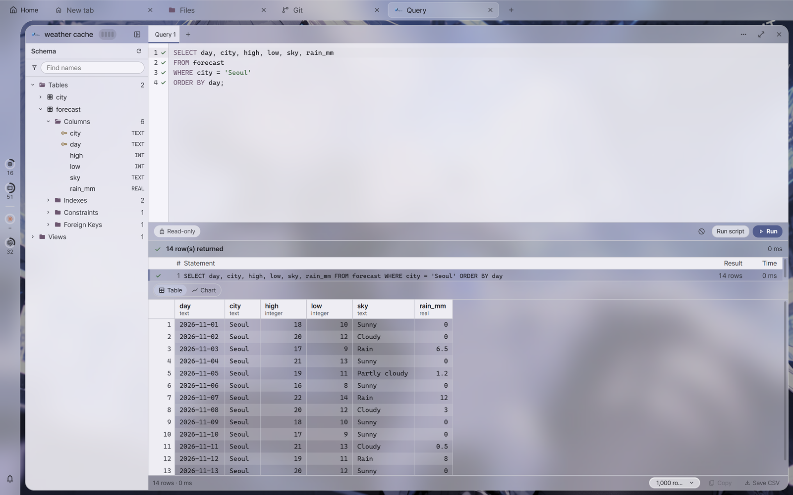
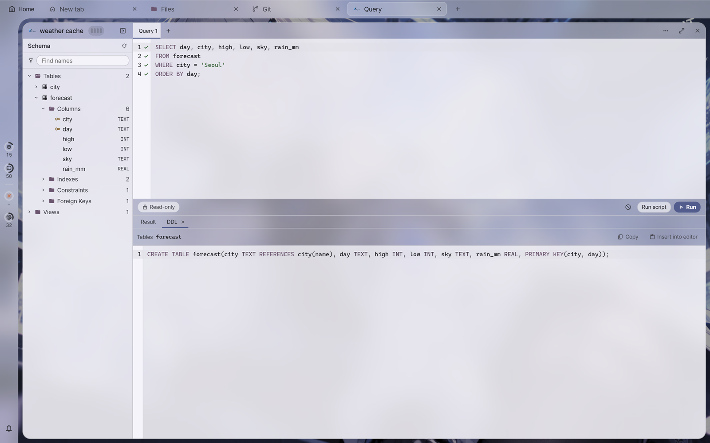
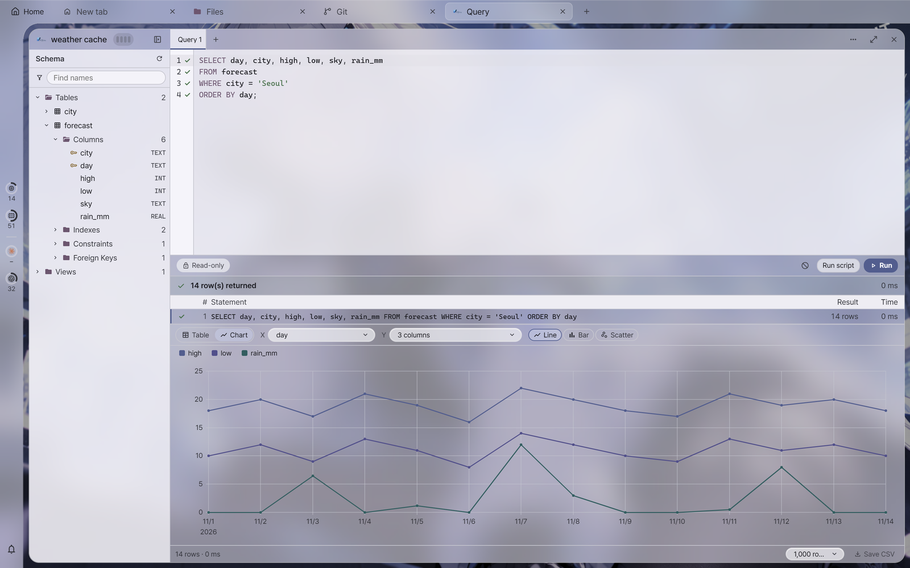
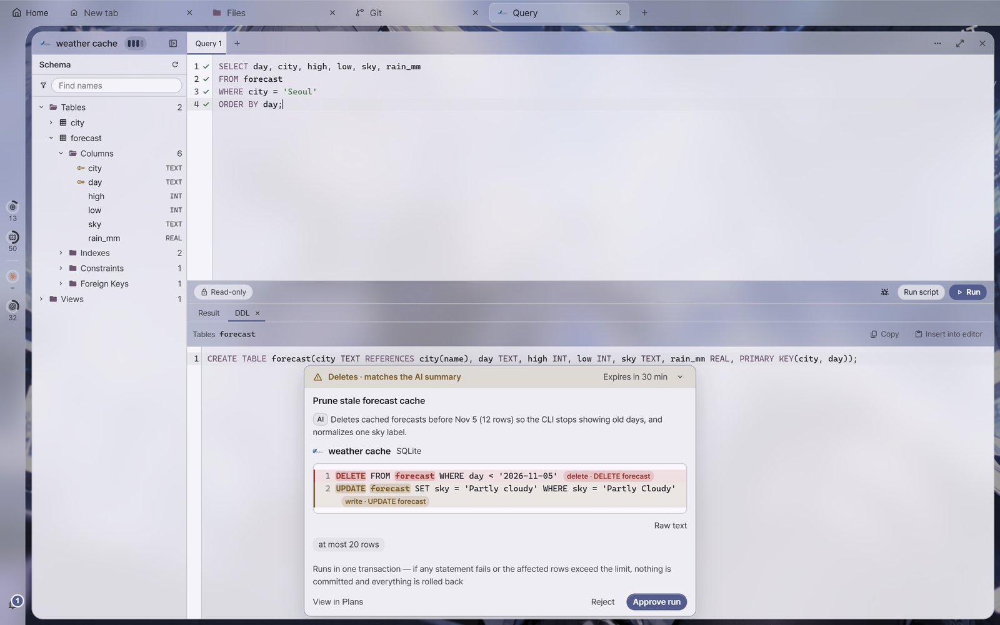

# Query tile guide

A **query tile** connects to a database, runs SQL and shows the results as a table. The engines are PostgreSQL, MySQL, MariaDB and SQLite. The app's session server holds the connection (the same process as terminal sessions), and the tile only draws the screen. So the connection survives a page reload or the app being briefly closed ([Connection lifetime](#lifetime)).

**Common rules**

- **Read-only is the default.** A tile always opens read-only, and writing is turned on per tile after a confirmation ([Read-only and writing](#write)).
- **Passwords are stored only in the vault.** The connection list file (`db-connections.json`) has no password field ([Passwords](#password)).
- **The AI sees only as much as you turn on per connection.** The default is off. When on, the AI reads structure and queries through a **read-only connection** opened separately from the query tile, and query result rows go to the AI model provider ([Showing a database to the AI](#ai)). At Ask or higher, it can **propose** writes, which run in one transaction only after a person approves ([AI write plans](#ai-write)).

---

<a id="open"></a>
## Ways to open

| Way | What opens |
| --- | --- |
| In the host list, right-click a host → **Open database ›** | Picks a DB connection that **goes through** that host and opens it as a tile in the current tab (SSH tunnel). It is shown only when a connection goes through that host, and **Add DB connection…** at the end of the submenu opens the form with Via already set to that host |
| In the palette (`Ctrl+Shift+P`), `>open-db` · **Open a database connection…** | A picker — top: **Via SSH** (per host), bottom: **This PC / direct**. Each row has edit and remove |
| In the dock (`Ctrl+Shift+K`, **DB** in the section bar, palette `>Dock: DB`), double-click a row or press Enter | Opens that connection in the current tab (a single click only selects, as in the Hosts and Projects sections). **If the current workspace already has a tile of that connection, the app goes there** (to open a new one, use `Ctrl+Enter` or right-click **Open in a new tile**). The list is **the same folder tree as the Hosts section** ("Folders in the dock" below): on each level, folders come first and then connections, both in name order. A connection row has the engine logo (PostgreSQL, MySQL, MariaDB, SQLite) and name. Via SSH, it shows the `SSH` chip and jump host (`jump host → DB host` if the DB host is not that server itself). Direct, it shows the host (with the port only if it is not the default). SQLite shows the file name (DB name and full address are in the tooltip). Beside the row, ⊞ = open in the current workspace, `name ↗` = open in another workspace, and a padlock = password stored in the vault. Right-click: Open, Open in a new tile, Edit…, Duplicate, Forget saved password, Delete… (with a confirmation). **Duplicate**, like duplicating a host, immediately creates `<name>-copy` (`-copy-2` … on a collision) and carries over the jump host, address, DB, user, TLS and folder (the copy sits in the original's folder). The vault's password is not carried over, so the copy asks when first opened |
| **New DB connection** in the picker or the dock's DB section | Creates a connection. In the Via field, choose **None (direct)** or a host (via SSH) |

- You can open several tiles on the same connection. Each tile holds its own connection (one query at a time per connection).
- The icon on the tile header, tab and session card is that connection's **engine logo** (the same picture as in the dock's DB section). Before the connection list is read, or if the connection has been deleted, it remains a DB picture.
- **Hovering over the tile name in the header shows a connection card** (the same look as the name card of a remote terminal tile). The top has the engine logo, tile name and tile code, followed by `user@address:port` (the address as seen from that host if via SSH, and the file path for SQLite). The rows are Engine, Server (the version text the DB reported — only when connected), Connection (when different from the tile name), Via, Database, TLS, Mode (Read-only / Writing on · auto-commit / manual commit) and AI permission (when not off). While connecting or disconnected, a state row appears at the top. No password is included. The engine name in the old top strip (hover = server version) moved to this card.
- Typing `open-db` in the palette without a prefix puts the quick connect row first. Prefix commands with `>`.

<a id="presets"></a>
### Folders in the dock

The dock's DB section uses **the same folder features** as the Hosts section (the same menu text, the same folder edit dialog, the same drag and drop).

- **Create**: Right-click an empty area → **Add folder…**, or right-click a folder → **Add subfolder…** (the name goes in a field inside the menu, and it is refused if empty, if it contains `/`, or if the same name exists on the same level). Right-click a folder → **New DB connection** creates one in that folder (the **+** in the find row also creates in the selected row's folder).
- **Edit**: Right-click a folder → **Edit…**, or press `F2` on a folder row — name, icon and color (the same dialog as host folders).
- **Ungroup**: Right-click a folder → **Ungroup** — the connections inside leave the folder (they go to the top level, and folders below move up one level). **Connections are not deleted.**
- **Selecting multiple rows** (same as the Hosts section): `Ctrl`+click (add or remove one at a time), `Shift`+click (range), drag from an empty area to select a rectangle (hold `Ctrl` to add), `Shift`+`↑`/`↓`/`Home`/`End` (widen the range), `Ctrl+A` (all). Clicking an empty area once or pressing `Esc` clears the selection.
- **Move**: Drag a connection or folder row and drop it on a folder row (that folder), a connection row (that connection's folder), or the empty bottom of the list (top level). **Dragging a selected row moves everything selected** at once (dragging an unselected row moves only that row). A folder cannot go inside itself, and items already in that folder are skipped. Selecting a folder together with its contents moves the folder as a whole. The order is by name, so dragging does not change the order (same as the Hosts section).
- **Cut, copy, paste**: Collect with `Ctrl+X` or `Ctrl+C`, and paste with `Ctrl+V` into **the selected row's folder** (right-click a folder → **Paste** = that folder, right-click an empty area → **Paste** = top level). Cut works like move (collected rows are dimmed), and copy duplicates: a connection becomes `<name>-copy`, and a folder is copied whole with its connections, subfolders, icon and color (`-copy` if the same name exists). The vault's passwords are not copied. In the find field, these keys act on the text.
- **Deleting several**: After selecting, press `Delete` or right-click → **Remove…**. It always goes through a confirmation (what and how many are deleted, and what goes with them). Selecting a folder deletes **all the connections inside it too** (to get rid of the folder while keeping the connections, use **Ungroup**). The deleted connections' vault passwords and AI permissions are deleted with them (same as deleting one row). If only one connection is selected, the dialog is the same as deleting one row.
- If you select several and right-click, a **multi-selection menu** (Cut, Copy, Paste, Remove…) appears.
- **Expand/collapse**: The arrow, double-click, `Enter`, or `→`/`←` (`←` collapses an expanded folder, and otherwise goes to the parent folder). The expanded state is remembered on this PC. Searching automatically expands the folders of matching connections, and folder names are searched too.
- **Storage**: A folder containing connections is written in the `folder` field of the connection list (`"prod/web"`, top level if absent). A folder's icon and color and **empty folders** are written to the companion file `<settings folder>/db-folders.json`. Folders have nothing to do with connecting or AI permission, so moving a folder does not drop AI permission.

## Connection form

All connections are written to **one file**, `<settings folder>/db-connections.json` (settings folder = `%APPDATA%\aynx` for release and `%APPDATA%\aynx-dev` for development builds). There is one form: **New DB connection** and editing in the dock's DB section and the picker all use the same form.

| Field | Meaning |
| --- | --- |
| Name | The name shown in the picker and the tile header (up to 64 characters). Up to 64 connections in total |
| Engine | PostgreSQL, MySQL, MariaDB, SQLite (SQLite is **direct only** — the Via field is hidden, see the limits below) |
| Via | **None (direct)** — connects directly from this PC. **Host** — opens an SSH tunnel through that host (a `~/.ssh/config` alias) and connects (using the host's connection settings and keys as is) |
| Host, Port | The DB address **as seen from that host** if via SSH (usually `localhost`), and as seen from this PC if direct. The port is filled with the engine default (5432, 3306), and a port you have edited stays when you change the engine |
| Database, User | Optional fields — the engine default if empty |
| TLS, CA file | See the table below |
| File | SQLite only — the full path |

A connection's id (the vault key) is set once when the connection is created, and stays the same if the name or Via changes. If a name collides within the same Via, saving is refused. If the jump host is renamed, the connection's Via follows the new name. If the jump host is deleted, the connection is deleted too (the delete confirmation states the count, and the vault's password is removed if the vault is open). If the jump host has disappeared from the host list, opening reports "Could not find the jump host 'X'". Edit the connection and choose Via again.

**Test connection** (bottom left of the form) connects once with the values **as they are in the form, before saving**, and closes again. The result is a small chip next to the button: *Connected · 412 ms* (hover or focus it for the server version, Via and time), or a short reason such as *Authentication failed*, *Host not found*, *Connection refused*, *TLS error* or *Timed out* (the full message is in the tooltip). Changing any field clears the chip. A password is asked for **only if the database needs one**, in the same password dialog as the tile but without the save option. **Nothing is saved**: not the password, not the connection, and no line in the recent-connections history. The vault's saved password is used only when you are **editing a saved connection and its target is unchanged** (engine, Via, host, port, database, user, or SQLite file). For a new connection or a changed target, the vault is not used. Jump-host prompts (host key, key passphrase, SSH password) work as when opening a tile, also without the save option. The button is hidden while an older session server is running. Restart it in Settings › Session server.

<a id="tls"></a>
### TLS modes

The trust basis is **the list of public certificate authorities built into the app (webpki-roots) + the CA file you provide**. **The OS certificate store is not used**, so that behavior does not differ between engines (other DB tools also commonly use "mode + CA file").

| Mode | Meaning (libpq name) | Server certificate check |
| --- | --- | --- |
| Off | `disable` — plain text | None |
| Use if available (default) | `prefer` — TLS if the server accepts TLS, otherwise plain text | **Not checked** |
| Required | `require` — fails if not TLS | **Not checked** |
| Verify CA | `verify-ca` — checks the chain and validity period, not the name | Trusts **only the CA file** — CA file required |
| Verify CA and name | `verify-full` — chain, validity period and name (SAN) | Public CAs + CA file |

- **Use if available and Required only encrypt and do not check the other side**, so they do not stop man-in-the-middle attacks. The form shows a warning when a **direct** connection to an address outside this PC chooses these two modes (or Off). There is no warning via SSH, because SSH wraps the connection. For a database on another server, **Verify CA or stricter** is recommended.
- **Verify CA can be saved only with a CA file.** For a server using a public certificate (Let's Encrypt and so on), choose Verify CA and name (no CA file needed).
- A CA file is PEM (a bundle of several is allowed, up to 4 MiB) and is read only in verifying modes. For corporate or cloud (RDS and so on) certificates, provide that CA file.
- SSH connections also verify the name against **the host name in the connection form** (even behind a tunnel). Enter the same name as on the certificate.
- Failure messages distinguish the cause: unknown certificate authority, name mismatch, expired, or this server does not accept TLS.

<a id="password"></a>
## Passwords and the vault

- The password is **asked for when connecting** (the DB connection modal shows the connection name, user@DB and Via). If you turn on **Save in this app (vault)** in the modal, it goes into the vault (`vault.bin`) **after authentication succeeds**, the same rule as SSH passwords. A wrong password is not saved.
- That modal is the only way to save one. The dock's DB section shows "password stored" (padlock) and can only **forget** it (you can also delete it from the list in Settings › Security, where it appears as "jump host · connection name" or "direct · connection name").
- If the database rejects a stored password, the modal appears again (the password changed). If the vault is locked, open the vault first.
- The password value is read only inside the session server. It does not go to the screen, settings files, logs or MCP. The password a tile connected with (typed, saved or not, or read from the vault) is also kept in the session server's memory while a tile of that connection is open, so an AI with permission can use it ([below](#ai)). The lock screen does not affect it; closing the last tile or changing the connection's target clears it.
- An SSH connection passes that host's SSH gates (host key, key passphrase, SSH password) exactly as a terminal tile does, and then asks for the DB password. If a terminal tile for the same host is already connected, that SSH connection is shared.

<a id="screen"></a>
## The screen

There are four layers from the top (on the left is the [schema tree](#tree)).



| Layer | What is there |
| --- | --- |
| **Script tab row** | Tree show/hide, **script tabs** `[Query 1 ●] [Query 2] [+]`, and at the right end the connection state dot (green = connected, red = disconnected) |
| **Editor** | The SQL of the current script tab. When a run finishes, each statement gets a mark next to the line numbers ([Run marks](#marks)) |
| **Run row** | At the far left, the **Read-only / Writing on** pill ([below](#write)). In write mode only, `[Auto \| Manual commit]` ([Commit mode](#autocommit)). `[Begin] [Commit] [Roll back]` ([Transactions](#tx)). The transaction state (`● Transaction · 3 stmt · 00:42`). At the right end, Ask AI, **[Run script]** and **[Run]** |
| **Result pane** | The last result of the current script tab: summary row, statement list and result table ([Results](#result)), and with several statements the [Summary] and [Result N] tabs ([Result tabs](#panel)). News that a transaction ended (committed, rolled back, idle rollback, disconnected, result unknown) also appears on the pane's head row. With no result, only a one-line hint and shortcuts (`Alt+X`, `Esc`, `Ctrl+T`) are shown, and in write mode one more line says when changes take effect |

Only the banner shown when the connection is lost ("The connection was lost · [Reconnect]") appears right below the script tab row. All other notices are in one place, the result pane.

<a id="tabs"></a>
### Script tabs

- Split SQL into several sheets within one tile (not the same as the app's **tabs**, so they are always called "script tabs"). **[+]** or `Ctrl+T` creates a new script tab. **×**, the middle button or `Ctrl+W` closes one (the last one cannot be closed, and if it has text, you are asked once). Rename by **double-clicking** or with `F2` (Enter = rename, Esc = cancel, empty = the default name "Query N"), and **drag** to change the order. Up to 20.
- `Ctrl+T` and `Ctrl+W` work **only while this tile has focus**. The app's tab open and close keys are `Ctrl+Shift+T` and `Ctrl+Shift+W`, so they do not collide (if you bind the same combination to a global shortcut in settings, the global one wins).
- **●** = unsaved changes. A script tab's text is saved in the tile (up to 32 KiB per script tab, and it survives an app restart). Shortly after you edit, it saves and the ● disappears. Text over 32 KiB is not saved, so the ● stays.
- **Results are separate per script tab.** Switching script tabs shows that tab's last result and run marks (results are not saved, so restarting the app leaves the pane empty).
- **Connection, write mode, commit mode and transaction are one per tile.** All script tabs use the same connection and the same transaction, and the run row's state stays the same when switching script tabs. Running a statement from another script tab inside a transaction started in one script tab is the same transaction. There is also one run per tile, so while it runs, running is blocked in the other script tabs too (you can [Cancel] from there), and the result lands in the script tab that sent the run.
- News that a transaction ended appears **in the script tab that sent the run, if the run brought the news**. Otherwise (idle rollback, disconnect, [Commit], [Roll back]) it appears **in the script tab being viewed at that moment**.
- **Open `.sql` files**: drop `.sql` or `.txt` files on the tile (from Explorer or from a file tile), or use **[Open SQL file…]** in the tile's ⋯ menu (`Ctrl+O`). Each file opens in a new script tab named after the file, and **nothing runs**. Files over 1 MiB and binary files are refused.
- **Save as `.sql`**: right-click a script tab → **[Save as .sql…]** (`Ctrl+S`). It always asks where to save; the script tab does not remember the file, so later edits are not written back. Data tabs have no save.

<a id="run"></a>
## Running

- **`Ctrl+Enter`** (in the editor) or **[Run]** on the run row sends the selection if there is one, and otherwise **the statement under the cursor**.
- [Run] runs **one statement**. To run several semicolon-separated statements at once, use **[Run script]** (`Alt+X`) — [below](#script). Selecting several statements and pressing `Ctrl+Enter` is refused with "[Run] runs one statement at a time — run several statements with Alt+X (Run script)". However, **if [auto-commit](#autocommit) is off or a transaction is open**, the selected statements run in order inside that transaction (not committed — the same path as Run script, with everything checked before running).
- While running, [Run] becomes **[Cancel]** and the elapsed time runs. **`Esc`** (in the editor) also cancels. The time limit is 30 seconds (exceeding it disconnects the run).
- **Row limit** — Next to [Copy] on the row below the results, choose 1,000, 5,000 or 10,000 rows (remembered per tile and used from the next run). It is in the same place when there is no result (before running, error, cancel, or a stopped script statement). Exceeding it is reported as "Cut at the N-row limit".
- The **schema tree** on the left — [below](#tree).
- The editor's text is saved in the tile per script tab (up to 32 KiB) and survives an app restart ([Script tabs](#tabs)).
- **Autocomplete** — While you type (two letters, or right after a dot), a list offers table and view names, columns and SQL keywords; `Ctrl+Space` opens it anytime. After `x.` (a table name or a `FROM`/`JOIN` alias in the same statement) it lists only that table's columns; after `schema.` it lists that schema's tables. `Enter` or `Tab` inserts, `Esc` closes. While the list is open these keys belong to it; otherwise `Enter`, `Esc` and `Ctrl+Enter` work as usual. Table names come from what the schema tree has already read (expand a schema once). Columns are read once per table when first needed, only while the connection is idle.
- When the tile is narrow, the run row drops the less important text first, in this order: the elapsed time of the transaction state → "Manual commit" becomes "Manual" → transaction buttons that cannot be clicked now ([Commit] and [Roll back] with no transaction, [Begin] during one) → "Transaction" in the state → the pill text (padlock only) → transaction button text (picture only) → [Run script] text (picture only) → the statement count in the state (during a warning, the remaining time is dropped last). **[Run] always keeps its text.** The connection state on the script tab row also drops its text when narrow, leaving only the dot (the name is in the tooltip).

<a id="tree"></a>
## Schema tree

The tree on the left goes down, as in DBeaver, as **schema → folders by kind → object → structure folders**. Every level **starts collapsed**, and only that level is read when you expand it (so first opening stays light even with a large database).

```text
▸ public                       Schema (database for MySQL/MariaDB) — only the name at first
  ▾ Tables                12    Expanding reads the schema's objects at once and splits them into folders by kind (count at the head)
    ▾ orders                    Table, view, materialized view, foreign table — click to select and expand, double-click for its data tab
      ▸ Columns            8
      ▸ Indexes            3    orders_pkey (id) PK — method (btree …), condition and definition are in the tooltip
      ▸ Constraints        2    Primary key, Unique, Check, Exclusion (PostgreSQL) — check expression is in the tooltip
      ▸ Foreign Keys       1    fk_customer  (customer_id) → customers(id) — ON UPDATE/DELETE is in the tooltip
      ▸ Referenced By      1    lines(order_id) → (id) — foreign keys of other tables pointing at this table
      ▸ Triggers           1    trg_audit  BEFORE INSERT OR UPDATE
      ▸ Partitions         4    PostgreSQL partitioned tables only — range expression is in the tooltip
  ▸ Functions              3    Function, procedure, sequence, type — click to insert the name at the cursor
```

| Engine | Folders under a schema | Folders under a table |
| --- | --- | --- |
| PostgreSQL | Tables (partitioned tables are marked `partitioned`, with their partitions hidden), Views, Materialized Views, Foreign Tables, Functions (including aggregate and window functions), Procedures (11+), Sequences, Types (enum, domain, range, composite) | Columns, Indexes, Constraints, Foreign Keys, Referenced By, Triggers, Partitions |
| MySQL, MariaDB | Tables, Views, Functions, Procedures, Sequences (MariaDB 10.3+) | Columns, Indexes, Constraints, Foreign Keys, Referenced By, Triggers |
| SQLite | Tables, Views — if the only attached DB is `main`, there is no schema level and folders come first | Columns, Indexes, Constraints, Foreign Keys, Referenced By, Triggers |

- **Indexes and triggers are only under tables, regardless of engine** (no schema-level folder, so the shape is the same for each engine).
- Views show columns (and `INSTEAD OF` triggers in PostgreSQL), and materialized views show columns and indexes.
- **Empty folders are not shown** (many kinds do not exist in a given engine or version). If a schema is empty, "No objects" appears.
- Functions and types created by extensions (PostGIS, pgcrypto …) and constructor functions of range types are not listed, so that a schema does not get flooded with hundreds of them.
- Up to **5,000 objects per kind group** are read at a time (and 5,000 per folder under a table). If there are more, `+` is added to the folder count and the line "Only the first 5000 are shown" appears.
- **Clicking**
  - Tables, views and partitions: **a single click only selects** (the editor text is not touched; to expand or collapse its structure folders, click the `›` arrow or press `→`/`←`), and **a double-click or `Enter` opens its [data tab](#data-tab)**. Right-click has **View data** and **Insert SELECT** (the old click — replaces the current query tab's text with `SELECT * FROM "schema"."table" LIMIT 100;`, without running it).
  - **Foreign Keys and Referenced By move the tree to the table on the other side**: they expand that schema and folder and select that table (reading the schema if it has not been read yet). If the table is not in the tree (a schema not listed, for example), its name goes into the editor.
  - Other leaves (functions, sequences, columns, indexes, constraints, triggers …) insert the quoted name **at the editor cursor** (functions and procedures include the opening parenthesis, as in `"public"."f1"(`).
- What each engine does not provide: SQLite has no constraint or foreign key names (they are shown without names), and an expression index shows `expr` instead of the expression text (the definition is in the tooltip). MySQL and MariaDB triggers are visible only with the `TRIGGER` privilege, and MariaDB does not give an account with only the `SELECT` privilege the ON UPDATE and ON DELETE of foreign keys.
- **Keyboard** — In the tree, `↑`/`↓` move, `→` expands (or goes to the first child if expanded), `←` collapses (or goes to the parent if collapsed), `Home`/`End`, `Enter` is the same as clicking (on a table, view or partition it opens the data tab), `F4` is [View DDL](#ddl), and `Ctrl+F` or `Ctrl+I` goes to the [Find names](#filter) field.
- The expanded state stays **as long as the tile lives**, even if the tree is hidden and shown or the connection is reopened. **Refresh** at the top reads again and keeps what is expanded. After an app restart, the tree starts collapsed (not saved).
- While a query runs, expansions that need a new read and refresh are blocked (one job at a time per connection). What has already been read can still be expanded and collapsed.

<a id="filter"></a>
### Find names

Typing in the **Find names** field below the tree's head (**`Ctrl+F`**, or **`Ctrl+I`** in the tree — the same keys as find in a file tile) narrows by name.

```text
⌕ ord                    ×
3 schemas not read yet [Read all]      ← schemas never expanded cannot be filtered — clicking reads them all
▾ public
  ▾ Tables            2/12           ← folder counts are matches/total
      orders                          ← the matching text is highlighted
    ▾ customers
      ▾ Foreign Keys  1/2            ← matches under a table (structure already read) too — ancestors expand by themselves
          fk_orders
```

- **Only names already read** are filtered (case-insensitive, partial match). Targets are object names (tables, views, functions …) and structure names under tables (columns, indexes, constraints, foreign keys, triggers, partitions). Names under a table match only after that table has been expanded and read once.
- Ancestors of matches expand by themselves, and branches with no match are hidden. Under a table whose name matches, things stay as you expanded them.
- **`Esc`** clears (pressing again on the empty field goes to the tree). `↓` and `Enter` go to the tree. Clearing restores the shape expanded before the search.
- Schemas not yet read are counted by "N schemas not read yet · [Read all]" at the top. [Read all] reads each schema once (this takes time on a large database). The server is not asked anything else.

<a id="ddl"></a>
## View DDL

**Right-click → View DDL** on a tree row (or select that row in the tree and press **`F4`**) shows the object's DDL (`CREATE …`) in the lower pane. Tables, views and partitions do not have this menu item: their DDL is on the **DDL** sub-tab of the [data tab](#data-tab) (`F4` still works on them).



```text
┌ Result │ DDL × ┐                                  ← Once DDL is opened, the lower pane splits in two (× closes the DDL)
 Tables  public.orders  [Reconstructed]      [Copy] [Insert into editor]
 Rebuilt from the catalog — may differ from pg_dump
  1  CREATE TABLE public.orders (
  2      id integer GENERATED ALWAYS AS IDENTITY NOT NULL,
  …                                               ← Read-only (selecting, copying and Ctrl+F find work)
```

- **It is read-only.** The DDL pane cannot be edited and has no run button. **[Insert into editor]** only inserts at the cursor of the editor above (separated from surrounding text by a blank line) and **does not run it**. **[Copy]** puts the whole DDL on the clipboard.
- Running a query returns the lower pane to the result side (the DDL remains if you click [DDL]). The DDL cannot be read while a query runs (one job at a time per connection).
- DDL is received up to 1 MiB. Beyond that, only the first part appears, marked "Cut at 1 MiB".

| Engine | What has DDL | Where it comes from |
| --- | --- | --- |
| PostgreSQL | Views, materialized views, functions, procedures, triggers, indexes, constraints (including foreign keys) | The server's `pg_get_viewdef`, `pg_get_functiondef`, `pg_get_triggerdef`, `pg_get_indexdef`, `pg_get_constraintdef` |
| PostgreSQL | Tables, foreign tables, partitions, sequences, types (enum, domain, range, composite), aggregate functions | **Reconstructed from the catalog** (PG has no function that gives table DDL): columns, defaults, NOT NULL, generated columns, identity, collation, constraints, partition key, partition range, and then indexes. Marked "Reconstructed" on screen |
| MySQL, MariaDB | Tables, views, functions, procedures, triggers, sequences (MariaDB) | The original text from the server's `SHOW CREATE …` (indexes and constraints are inside the table DDL) |
| SQLite | Tables, views, indexes, triggers | The original text stored in the file (`sqlite_schema.sql`). Indexes created automatically by primary keys and unique constraints have no original text |

- Columns and unnamed constraints (SQLite) have no "View DDL". Overloaded functions are told apart by the argument list of that row.
- **Privileges**: MySQL and MariaDB hide the body of views, functions and procedures unless you are the definer or have privileges such as `SHOW VIEW` or `SHOW_ROUTINE`, and report "You lack the privilege to see the DDL of {name}". Triggers are not even listed without the `TRIGGER` privilege. PostgreSQL's catalog and definition functions are visible regardless of privileges.

<a id="data-tab"></a>
## Data tab

Double-click a table, view or partition in the tree (or press `Enter`, or right-click → **View data**) to open its **data tab** beside the query tabs (grid icon + object name — the schema is in the tooltip). **One tab per object**: if it is already open, the app goes to it. There are no preview tabs. Close it with **×** like a query tab (no question — there is no text to lose).

- **[Data | Structure | DDL]** at the top. **Structure** shows the columns, indexes, constraints, foreign keys, referenced by, triggers and partitions as tables (empty sections are hidden). **DDL** is the same read-only view as [View DDL](#ddl) (hidden when the engine gives no DDL for that kind); **Insert into editor** puts it into a new query tab.
- **WHERE** — type the condition only (`id > 10 AND name LIKE 'a%'`), then press `Enter` (`Esc` reverts). **Refresh** queries again. The field autocompletes the table's columns and condition keywords the same way as the editor.
- **Sorting** — click a column header: ascending ▲ → descending ▼ → none. It queries again with `ORDER BY` (rows already received are not sorted on screen).
- **Pages** — ‹ › moves page by page with `LIMIT`/`OFFSET`, 100 rows per page by default (500 or 1,000 can be picked). The total is not counted (no `COUNT(*)`) — one extra row is read only to know whether there is a next page. The data tab uses its own page size, not the result row limit of query tabs.
- **Open as SQL** puts the `SELECT` for the current condition, sort and page into a new query tab (it does not run).
- The grid is the same as query results (copy, export, table/chart, find). The status row says **Read-only**.
- **Filter from a cell** — right-click a cell and open **Filter ▸**: **Filter by this value** replaces the condition with `column = value` (`IS NULL` for NULL), **Filter out this value** with `column <> value` (`IS NOT NULL`), and **Add to filter** adds it to the current condition with `AND`. It reads page 1 again. Binary cells cannot filter.
- **Follow a foreign key** — a foreign-key column has a link mark before its header name (a primary-key column has a key mark), and each non-NULL value shows a ↗ button when you hover over or select the cell (also **View in <table>** in the cell menu). It opens the referenced table's data tab with `ref_column = value` (all columns of a multi-column key); if that tab is already open, the app goes there and replaces its condition. The keys are read once after the first page loads; if that fails, there are just no ↗ marks.
- **Rows that reference this** — if other tables have foreign keys pointing at this table, the cell menu has **Rows that reference this ▸** listing them (table name, with the referencing columns on the right; up to 8). Picking one opens that table's data tab with `referencing_column = this row's value` (an already open tab gets its condition replaced). An entry is dimmed when this row's referenced value is NULL or its column is not in the result.
- On the **Structure** sub-tab, the table names under Foreign Keys and Referenced By are links: they open that table's data tab without a condition (or go to it if it is already open).
- **It always reads only**, even when the tile is in write mode: the session server checks the condition with the read-only rules and runs it in a read-only transaction (all three engines). Anything that would change data (a write function in the condition, a second statement) is refused. **While a transaction is open, the data tab does not query** (read-only cannot be set inside an open transaction) — commit or roll back, then refresh.
- One job at a time per connection: while a query runs (or the tree is reading), the data tab waits and then loads by itself; while the data tab loads, [Run] waits, and [Cancel] in either place stops it.
- The condition, sort and page size are saved with the tile and come back after a restart (the rows are not saved — the tab queries again when shown). Editing cells, adding or deleting rows are not built.

<a id="not-built"></a>
## What is not built

A query tile is **a window for quickly looking into a database during server work**. There is one standard: **include what is needed to read and understand, and do not include management or modification features.** Make changes with SQL (write mode).

| Included | Not included |
| --- | --- |
| Object list (schemas, folders by kind) | Screens that create or change objects (table, index and constraint editors, a "New table…" menu) |
| Table structure (columns, indexes, constraints, foreign keys, referenced by, triggers, partitions) | Editing cells in the result grid and writing them to the database |
| [Data tab](#data-tab) (read-only — condition, sort, pages) | Adding or deleting rows from the data tab |
| [Read-only DDL view](#ddl) (right-click, `F4` — copy and insert into editor only) | Managing roles, privileges and tablespaces, or editing or running in the DDL pane |
| [Tree name find](#filter) (over names already read — `Ctrl+F`, `Ctrl+I`) | ER diagrams, schema comparison, import/export wizards |
| | Rarely viewed objects such as operators, collations and operator classes |

Operational information (running queries, locks) is a second-phase candidate, considered only as a read-only view.

<a id="result"></a>
## Results

- Click and drag over cells to select, and copy with **`Ctrl+C`** (TSV, which pastes straight into a spreadsheet). `Ctrl+A` selects everything.
- **Right-click a cell** — **Copy** and **Copy as ▸** (CSV, JSON, Markdown — the selected cells). A cell outside the selection becomes the selection first. The menu is the same box as the document editor's right-click menu (Copy, Copy as ▸ ─ Filter ▸ ─ foreign-key items).
- **Filter the received rows** (query tab results) — the same cell menu has **Filter ▸** with **Filter by this value**, **Filter out this value** and **Add to filter**. It does not run the query again: it keeps only the rows already received (like sorting). Values are compared as values, not as shown text; NULL matches only NULL (`IS NULL`, `IS NOT NULL`). Binary cells cannot filter. The conditions (all `AND`) show as chips above the grid — **✕** removes one, **Clear all** removes them — and the status line shows `36 / 100 rows`. Copy, export, selection and sorting work on the filtered rows; the chart uses all received rows. Running again or switching results clears the filter. Data tabs filter with `WHERE` instead (see [Data tab](#data-tab)).
- **[Export ▾]** — **Save as CSV…** and **Save as JSON…**. It exports the received rows in the order shown (a data tab exports the current page). CSV is RFC 4180 with CRLF and an empty field for NULL (a saved file also has a UTF-8 BOM, so Excel reads non-ASCII text). JSON is an array of row objects (`null`, numbers and booleans as such; large integers stay text; a repeated column name gets `_2`).
- Double-clicking a cell expands a long value. For cells over 8 KiB, only the first part is received ("Long cells cut").
- Large integers (outside ±2^53) and NaN are shown as text, and bytes as the length and the first part in hex.
- Statements that change data end with "N row(s) changed". There is no feature to edit the result table and write to the database (write with SQL).

<a id="panel"></a>
### Per-statement result panel

A single-statement run, several statements and a script run share **the same frame** (a single statement has one row).

1. **Summary row** — picture, one-line conclusion, details and time. The color says which way it concluded: success (green), "only this run was rolled back" (orange), and failure, everything rolled back, and result unknown (red — result unknown also has the left bar). A single statement reads like "3 row(s) returned", "1 row(s) changed — Held in the transaction — click [Commit] to apply" or "1 row(s) changed — Applied at once (auto-commit)". With a `[db-needs-work]` notice, **[Start transaction]** appears at the end of this row.
2. **Statement list** — One row per statement: state picture, number, one line of SQL, result and time. **Success, rolled back and not run are all shown, and only failed rows are highlighted** (a red left bar, a faint background, and the original DB error inside that row).

   | Picture | Meaning |
   | --- | --- |
   | ✓ | Ran and remains (committed, a read-only query, or held in the transaction) |
   | ↶ | Ran but was rolled back (the script's first error, only this run rolled back, or the connection lost) |
   | ✕ | Stopped at this statement (DB error, refused, cancelled, or time limit) |
   | · | Did not run (after the stopped statement, or refused before running) |
   | ? | Result unknown — the app does not know whether it took effect |

   Clicking a row (or ↑/↓) selects that statement in the editor. Even if the transaction later ends by commit or rollback, these marks stay as they are. That news appears separately on the head row of the result pane.
3. **Row below** — "✓ 3 · ↶ 1 · ✕ 1 · skipped 1 · 2 row(s) affected" + the row limit.

**Result tabs (with two or more statements)** — A tab row appears below the summary row: `[Summary] [Result 1 3 rows] [Result 2 1 rows] …`.

- **[Summary]** = the statement list above + the row below. For a statement that returned rows, clicking the row count in the result column ("3 rows ›") goes to that result tab.
- **[Result N]** = the one result table of the Nth statement that returned rows (with columns — `SELECT`, `RETURNING` …), with copy, CSV, row limit and status row as usual. The number is the order of results, so it can differ from the statement number. Hovering over the tab shows that statement's SQL. Choosing a result tab also selects that statement in the editor.
- **The tab that opens first** — If anything failed, has an unknown result, was rolled back or did not run, [Summary] opens. If all succeeded, the **last result tab** opens (the last query in a script is usually what you wanted to see, the same rule as Beekeeper Studio). If there are no result tabs, only the list appears with no tab row.
- If there are too many tabs, the tab row scrolls horizontally (with the wheel, and the selected tab always stays visible). When narrow, the row counts collapse. On the tab row, ←/→ and Home/End move.
- The selected tab is remembered per script tab (not saved, and running again applies the first-tab rule).

A **single-statement run** (one statement) has no tab row: a one-row list and, for a query, one result table below it. When the table is shown, the count goes at the very front of the table's status row.

<a id="chart"></a>
### Charts

**[Table | Chart]** at the head of a result table shows the same result as a chart (both for a single statement's table and in [Result N] tabs). The result is not fetched again. The rows already received (within the row limit) are drawn as they are. The selected side, axes and type are remembered per result and are **not saved** (running again returns to the table and default axes).



- **Type** — Line, Bar, Scatter. **Scatter works only when X is a numeric or time column.**
- **Axes** — One X (a column or **Row order**), and several numeric Y columns (up to 8). At first the app chooses:

  | X (initial) | Y (initial) | Type (initial) |
  | --- | --- | --- |
  | First date or time column | Numeric columns other than X | Line |
  | Without dates, the first text (category) column | 〃 | Bar |
  | Without categories either, the first numeric column | Remaining numeric columns | Line |
  | With only one numeric column, Row order | That column | Bar |

- **How columns are classified** — The type name and the values are looked at together. **Numbers that arrive as text are numbers too**, such as PG `numeric`, MySQL `decimal` and large integers. Dates are read only in ISO form (`2026-10-15`, `2026-10-15 12:00:00+00`), and a SQLite text column entirely in that form counts as a date column. A column with a text type is a category even if it holds only digits (postal codes and so on). Boolean, bytes, json and array columns are not used (to draw 0/1, use `CASE` in SQL).
- **A time X** is sorted ascending for drawing, and rows whose date cannot be read (NULL, `infinity` and so on) are left out, with their count reported on one line. The time axis is **UTC**. Values without a time zone are placed exactly as written (the same text as in the table).
- **A category X** keeps **row order**, with one row per position. The same name appearing several times is not merged. Make sums, averages and counts with `GROUP BY` in SQL. A NULL in Y is a gap (the line breaks).
- With no rows or no numeric column, [Chart] is dimmed, and hovering shows why.
- If the result was cut at the row limit, "Charting only the N fetched rows (cut at the row limit)" appears. To draw more, raise the limit or reduce with SQL (aggregates, `WHERE`).
- Clicking a name in the legend hides or shows that series. Dragging over the picture zooms into that range, and double-clicking restores it. Hovering shows the value at that spot in a tooltip.
- On the chart side, the row below (row limit, [Save CSV]) stays as it is. Selecting and copying cells is on the [Table] side.

<a id="marks"></a>
### Run marks (editor)

When a run ends, each statement gets the same picture (✓ ↶ ✕ · ?) **next to the line numbers** in the editor, and the line background is tinted **very faintly** (remained = green, rolled back = blue, failed = red, and not-run text is dimmed). A failed statement gets a wavy underline, and hovering shows the DB error in a tooltip. A multi-line statement gets marks on all its lines. **The success of a single-statement run gets only ✓** (no background, so the editor is not tinted for the most common event), and result unknown gets only ?.

- Editing the editor text or running again clears them. If you edited the text after sending and before the result arrived, nothing is painted.
- Statement positions are painted **only when** the statement numbers and positions from the server match the app's statement splitting. If anything does not match, nothing is painted (so that no wrong line is painted). The list in the result panel still appears.
- A summary of a previous script received by a reattached screen (it does not know the text sent) is not painted in the editor.

<a id="write"></a>
## Read-only and writing

**Read-only mode is a device to prevent mistakes.** Only query statements run. It has three layers:

1. One statement only.
2. **Allow list of first words** — PostgreSQL `SELECT · WITH · VALUES · TABLE · EXPLAIN · SHOW`, MySQL and MariaDB add `DESCRIBE · DESC`, and SQLite has `SELECT · WITH · VALUES · EXPLAIN · read-only PRAGMA`. `SET`, `BEGIN`, DDL, `COPY` and `CALL` are outside the list and blocked automatically. `SELECT … INTO OUTFILE/DUMPFILE` in MySQL and MariaDB is also blocked.
3. **The engine's read-only** — A `READ ONLY` transaction per statement for PG and MySQL, and a file opened read-only for SQLite.

Even so, these layers cannot fully stop **side effects of server functions** (PG `pg_read_file()`, MariaDB `LOAD_FILE()`, session locks and so on). **The last line of defense is the DB account's privileges.** For a server that must be protected, connect with a **read-only account**.

**Turning on writing**: Clicking the **Read-only** pill at the far left of the run row shows the "Turn on writing?" confirmation. Clicking [Turn on writing] changes the pill to a red **Writing on**, and from then on INSERT, UPDATE, DELETE and DDL can run. As the confirmation says, **it starts in auto-commit, so each statement takes effect immediately**. To check before applying, change the run row's [commit mode](#autocommit) to **'Manual commit'** or open a [transaction](#tx). Reopening the tile returns to read-only.

- Clicking again returns to read-only with no confirmation (if a transaction is open, it asks once with "Roll back and turn off writing").
- **Transaction statements typed by a person are not accepted**, in all three engines, so that an open transaction does not stay around, invisible on screen, holding locks (the connection stays even after you leave the tile — [Connection lifetime](#lifetime)). Statements not accepted:
  - All: `BEGIN`, `START TRANSACTION`, `COMMIT`, `END`, `ROLLBACK`, `ABORT`, `SAVEPOINT`, `RELEASE` (including `ROLLBACK TO`).
  - PostgreSQL: two-phase commit `PREPARE TRANSACTION`, `COMMIT PREPARED`, `ROLLBACK PREPARED`. An ordinary `PREPARE name AS …` is accepted.
  - MySQL and MariaDB: `XA …`, `SET` that changes `autocommit` or `completion_type` (`SET autocommit = 0`, `SET @@session.autocommit`, and forms setting several values — `completion_type` can make a new transaction open by itself after a commit, or drop the connection), and locks that stay on the session: `LOCK TABLES`, `UNLOCK …`, `FLUSH TABLES … WITH READ LOCK`, `FLUSH TABLES … FOR EXPORT`.

  Group several statements into one transaction with a [transaction](#tx) the app opens and closes (instead of a `BEGIN` you type). The guard **cannot see what happens inside procedures and functions** (`COMMIT`, `SET autocommit` and `GET_LOCK()` inside a MySQL `CALL`, PG `pg_advisory_lock()` …). Even so, MySQL and MariaDB roll back an open transaction and return to auto-commit when writing is turned off. `COMMIT` and `ROLLBACK` sent by the app always carry `AND NO CHAIN NO RELEASE`, and afterwards the app checks again that the server really has no transaction.
- In PostgreSQL, statements that run only outside a transaction (`VACUUM`, `CREATE INDEX CONCURRENTLY`, `CREATE DATABASE` …) also run. However, these statements have **no server-side time limit** and stop only by the app's timer (a cancel request 2 seconds after the limit).
- The write state is not saved. **Reopening the tile (a new connection) means read-only**, and reattaching to the same connection after F5 or an app restart **keeps the state**. It cannot be clicked during a run.

<a id="autocommit"></a>
## Commit mode (auto-commit)

In write mode, the two-segment button **`[Auto | Manual commit]`** sits right next to the write pill on the run row (Auto by default). The selected segment is raised and bold, and that is the **current mode**. Clicking the other segment (or ← →) changes it. When the tile is narrow, it shrinks to "Auto | Manual".

- **Auto (auto-commit)** — As before: running a statement commits immediately. Click [Begin](#tx) only to group several statements.
- **Manual commit (auto-commit off)** — The moment a **statement that changes data** runs (INSERT, UPDATE, DELETE, DDL … — statements outside the read-only mode's first-word allow list), a [transaction](#tx) **opens by itself**. The run row's state, [Commit], [Roll back], the idle limit (10 minutes, warning 1 minute before) and the close confirmation are the same as for a transaction opened by hand. **Running only queries (SELECT and the like) does not open a transaction.** A query outside a transaction runs in the engine's read-only transaction per statement and ends immediately, so it leaves no MySQL metadata locks or PostgreSQL snapshots. While a transaction is open, SELECT also runs inside it (you see the rows you changed). After [Commit] or [Roll back], the mode stays 'Manual commit', and the next changing statement opens a transaction again.
  - This differs from 'manual commit' in other tools: **SELECT does not open a transaction** (similar to DBeaver's *Smart commit*). So a value read outside a transaction and a later UPDATE are different transactions, and **the value seen earlier is not protected** (you can overwrite a row another user changed in between). To group from the query onward or to lock the rows read, click [Begin] and start with `SELECT … FOR UPDATE`. (In PostgreSQL's default isolation level READ COMMITTED, the snapshot changes per statement even inside a transaction. What protects rows you read is a lock.)
  - Statements whose first word is a query but which change data (PostgreSQL `WITH x AS (DELETE …) SELECT`, `SELECT nextval(…)`, calls to writing functions, and SQLite `WITH … INSERT`) are refused by the engine's read-only (changes are not committed behind your back).
    - **SQLite** decides **before** running, so the app opens a transaction and runs that statement again inside it.
    - **PostgreSQL, MySQL and MariaDB** refuse **during** the run. Function or session side effects (`pg_advisory_lock()`, `GET_LOCK()`, external calls) may already have happened before that, so **it is not run again**. The app reports "This statement changes data … Use [Start transaction], then run it again." and does not open a transaction (a script stops at that statement). The **[Start transaction]** button at the end of the result pane's summary row opens a transaction on the spot, and a person runs the statement again.
  - If the first run of a self-opened transaction fails (a typo, a duplicate key and so on), that run is rolled back and the empty transaction is closed too. No transaction state appears, and "Everything was rolled back — nothing changed (no transaction was left open)." is added below the error (for a script or several statements with `Ctrl+Enter`, the summary row reads "Error at statement 2 — everything was rolled back (nothing changed · no transaction was left open)"). Since no transaction remains, the MySQL and MariaDB notice that row locks may remain until the transaction ends is not added either (the locks were released too).
  - Statements that cannot run in a transaction (DDL, account and admin statements in MySQL and MariaDB; `VACUUM`, `… CONCURRENTLY` and the like in PostgreSQL) do not open a transaction, and the app reports "While auto-commit is off, … do not run — flip the switch in the bar above to 'Auto-commit' and run it."
  - The [Begin] button **stays**. Changing statements open a transaction by themselves, but open one by hand to group from the query onward or to lock first with `SELECT … FOR UPDATE`.
  - [Run script](#script) works the same way: if a statement changes data, a transaction opens and the script runs inside it (not committed). With only queries, it runs in one read-only transaction.
- **The commit mode cannot be changed while a transaction is open.** Finish first with [Commit] or [Roll back] (so there is no confusion about whether the open transaction commits at the moment of changing). During that time, the two-segment button is slightly dimmed and hovering shows the reason in a tooltip. The selected segment stays as it is, so the current mode remains readable.
- It is not saved. **Reopening the tile (a new connection) means Auto**, and reattaching to the same connection after F5 or an app restart keeps the state (the session server holds it). Turning off writing also makes the two-segment button disappear, and turning writing on again starts at Auto.
- If the session server is an earlier version (version 12), the two-segment button does not appear. It appears after [Restart] in Settings › General › Session server.

<a id="tx"></a>
## Transactions

In write mode, clicking **[Begin]** on the run row makes the app open a transaction (if [auto-commit](#autocommit) is off, a changing statement can also open one by itself, and the button still remains). After that, statements run **one at a time as usual** (on the same connection and in the same transaction, so you can check changed rows right away with SELECT). You can also select several statements and press `Ctrl+Enter`, or run them at once with [Run script]. It ends **only with [Commit] or [Roll back]**. When it ends, the state returns to waiting (with auto-commit on, the next statement auto-commits again and no new transaction opens by itself).

- **One run = one savepoint** — Inside a transaction, the app sets a savepoint for each `Ctrl+Enter`, [Run] or [Run script] and then runs. **If a run fails (error, timeout, cancel), only that run is rolled back and the transaction continues.** Changes made before stay. All three engines behave the same (PostgreSQL too — the whole transaction no longer rolls back). If a script stops at its third statement, its first two statements are rolled back too ("Error at statement 3 — only this run was rolled back").
  - "Only this run was rolled back" is used **only when it is confirmed that** rolling back to the savepoint succeeded. If that rollback fails, nothing more runs and the **whole** transaction is rolled back (MySQL and MariaDB report it as **result unknown**, since something may have been committed before that).
  - Even if you [Cancel] during the last statement (including statements like MySQL's `SLEEP()` that end with no error when interrupted), the app checks again just before releasing the savepoint and rolls that run back.
  - In MySQL and MariaDB, a rolled-back run **may keep its row locks until the transaction ends** (InnoDB's `ROLLBACK TO SAVEPOINT` only undoes changes and does not release locks already taken on existing rows). Even though the changes are rolled back, finish the transaction if another connection is waiting on those rows.
  - If the server does not respond even after a cancel is sent past the time limit (the network has stalled, for example), the app stops waiting and **drops that connection**. The app cannot know whether that run finished, so it does not say "rolled back". During a transaction, the connection drop makes the server roll back (**Disconnected**). For an auto-commit statement, it is impossible to know whether it took effect: the result pane's summary row says **"Result unknown"** (red, with the left bar), and that statement is marked ?. Open a new connection with [Reconnect] and check the data.
- **One job at a time per connection** — While a run is going, [Commit], [Roll back], [Begin], the write pill, the commit mode, the schema tree and View DDL are blocked (the server also refuses at that moment with "something else is in progress", rather than waiting and quietly continuing). While [Commit] is being sent, [Run] is blocked. So a commit always applies only up to the runs whose results have appeared on screen.

- During a transaction, the run row shows the state **"● Transaction · 3 stmt · 00:42"** (the number of successful statements and the time since opening — the same when switching script tabs). **Table changes the transaction can roll back** are visible **only on this connection** until committed. Other users and services **wait** on the changed rows (locks). When finished, commit or roll back right away. What leaks out of the transaction immediately is the exception:
  - PostgreSQL **sequences** (numbers from `nextval()`, `serial`, identity) do not come back when rolled back (gaps appear in the numbers).
  - Changes to **non-transactional tables** (MyISAM and so on) in MySQL and MariaDB remain immediately (see below).
  - External side effects of functions and procedures (session locks `pg_advisory_lock()`, `GET_LOCK()`, external calls and so on).
- **Idle limit — after 10 minutes of no activity, the app rolls back.** One minute before, the state changes to a warning color and shows the **remaining time** instead of elapsed time ("Rolls back in 00:59 · Transaction · 3 stmt"), and [Extend] appears (clicking restarts the 10 minutes). Hovering over the state shows both elapsed and remaining time. If something else is going (a tree read and so on) at the moment of the limit, or the engine is busy, the app goes back to roll back after that finishes or after a short while (1.5 seconds).
- When the tile is narrow, the run row drops the less important text first (the collapse order in [Running](#run)). **[Commit], [Roll back] and [Extend] stay at any width during a transaction.** When narrow, only the picture is shown, and the name is in the tooltip.
- The clock is in the session server, so it keeps running through F5 and while the app is closed. Only **running a statement and [Extend]** extend the clock (schema tree, table structure and View DDL do not).
- `BEGIN`, `COMMIT`, `ROLLBACK` and `SAVEPOINT` typed by a person are not accepted inside a transaction either (a transaction ends only with the buttons).
- The outcome is reported on **the result pane's head row** (committed and rolled back go away at the next run — for which script tab it appears on, see [Script tabs](#tabs)). The following stay red until you click [Dismiss] (including idle rollback):
  - **Rolled back because of an error** — Only when the engine rewound the **whole** transaction (MySQL and MariaDB deadlock 1213, lock wait timeout on a server with `innodb_rollback_on_timeout` on, and SQLite's aborted writes). Ordinary run failures (duplicate key, missing table, timeout, lock wait timeout 1205, and all statement errors in PostgreSQL) roll back **only that run** with the savepoint above, and the transaction continues. This is also reported when the server refuses a commit (serialization failure, deferred constraint).
  - **Result unknown** — The connection dropped after the commit was sent and before the answer arrived; or the transaction ended during a run and how it ended cannot be proven (in MySQL and MariaDB, only deadlock 1213 and lock wait timeout 1205 with `innodb_rollback_on_timeout` count as "rolled back because of an error", and anything else is result unknown); or the rollback to a savepoint failed so the whole transaction was rolled back, and something may have been committed before that. The app does not send again. Reconnect and check the data.
  - **Disconnected** — The connection was lost and the server rolled back (nothing was committed).
- **MySQL and MariaDB do not accept DDL during a transaction** — `CREATE`, `ALTER`, `DROP`, `RENAME`, `TRUNCATE`, accounts and privileges (`GRANT`, `REVOKE`, `SET PASSWORD`), admin statements (`ANALYZE TABLE`, `OPTIMIZE`, `REPAIR`, `CHECK TABLE`, `FLUSH`, `RESET`), `LOAD DATA` and replication control, because the server **commits them behind your back** (MySQL's official "implicit commit" list). Finish the transaction and run them with the commit mode at 'Auto'. PostgreSQL and SQLite keep DDL inside the transaction too, so they accept it.
- **MySQL and MariaDB also do not accept `CALL` or `CREATE`/`DROP TEMPORARY TABLE` during a transaction.** The app cannot see `COMMIT` and `ROLLBACK` inside a procedure (if it commits and then raises an error, "rolled back" would be false), and temporary tables are not rolled back. Finish the transaction and run them one at a time with 'Auto-commit' (they are accepted as single auto-commit statements).
- Changes to **non-transactional tables (MyISAM and so on) in MySQL and MariaDB** are not rolled back. If the server raises warning 1196 during rollback, the result adds "Warning: changes to non-transactional tables (MyISAM, etc.) were not rolled back (MySQL warning 1196) — check that table's data."
- **PostgreSQL does not accept statements that run only outside a transaction during a transaction** — `VACUUM`, `… CONCURRENTLY`, `CREATE`/`DROP DATABASE`, `ALTER SYSTEM` and so on. Finish the transaction and run them with the commit mode at 'Auto'.
- During a transaction, the schema tree, table structure and View DDL read **inside the same transaction**. Tables created and columns changed in the transaction are visible, and a failed read does not break the transaction.
- It also works behind PgBouncer (transaction mode). While a transaction is open, the pooler holds the same server connection (leaving it idle ties up one pooler connection, and the idle limit prevents that too).

| Event | Open transaction |
| --- | --- |
| [Commit], [Roll back] | Ends and returns to waiting |
| Turning off writing | Rolls back after the "Roll back and turn off writing" confirmation |
| Closing a tile, a tab or a secondary window | "A transaction is open" — [Roll back and close] / [Cancel] |
| F5, webview dying, closing the main window, quitting the app | **Left as it is** — reattaching brings back the run row's state (the idle clock keeps running, and a running statement is not interrupted). This applies only to screen reloads, crashes and exits **while the session server is alive** |
| The tile staying detached (no window — [Connection lifetime](#lifetime)) | **Rolled back 10 minutes after it detached** (or earlier, at the idle limit) — the connection stays, so attaching it again shows that the app rolled the transaction back |
| The session server itself dying (forced kill, crash) | The connection drops and the database server rolls back. Uncommitted work does not survive |
| Moving the tile to another window | The transaction follows (the clock is kept) |
| Tray **Close all sessions**, the session server ending, or the 10-minute detached period passing | The connection closes and the server rolls back |

If the session server is an earlier version (version 8), the query tile works as usual but [Begin], [Commit] and [Roll back] do not appear. They appear after [Restart] in Settings › General › Session server. Session servers at version 14 or lower do not block [Commit] during a run on the server side (the screen does) and do not retry an idle rollback. [Restart] in the same place brings it to version 15.

<a id="script"></a>
## Run script

**[Run script]** on the run row or **`Alt+X`** in the editor (the same key as DBeaver) sends the selection if there is one, and otherwise **all the editor text** at once. Several semicolon-separated statements run in **one transaction**.

- **All statements are checked before running.** If even one is not accepted, **nothing runs** and that statement is pointed out (selected in the editor). Statements not accepted follow the rules in [Read-only and writing](#write) and [Transactions](#tx): `BEGIN`, `COMMIT`, `ROLLBACK` and `SAVEPOINT` typed by a person (all three engines); DDL, account and admin statements in MySQL and MariaDB (the server commits behind your back, so "everything rolled back" could not be kept — run them one at a time with auto-commit); `CALL` and `CREATE`/`DROP TEMPORARY TABLE` in MySQL and MariaDB (boundaries cannot be proven, and they are not rolled back); and statements that run only outside a transaction in PostgreSQL (`VACUUM`, `… CONCURRENTLY` …). DDL in PostgreSQL and SQLite stays inside the transaction, so it is accepted (and rolled back together on an error).
- In write mode, statements run in order, **stopping at the first error and rolling everything back**. It commits only if all succeed. The result pane's [summary row](#panel) reports the end: **"3 stmt committed"**, **"Error in statement 2 — everything rolled back (nothing committed)"** or **result unknown** (the connection dropped after the commit was sent and before the answer arrived — the app does not send again, so reconnect and check the data). "Everything rolled back" applies only to changes the transaction can roll back (the exceptions in [Transactions](#tx) — sequences and non-transactional tables).
- **In read-only mode**, query statements run in one read-only transaction, and results appear per statement (nothing changes).
- **During a transaction**, statements run in order inside it, and it **does not commit** ([Commit] ends it). A script as a whole is one savepoint, so stopping at the first error, cancel or time limit rolls back **only what this script did**, and the transaction continues ("Error at statement 2 — only this run was rolled back"). All three engines behave the same. The transaction ends only if the engine rewound the whole transaction (a deadlock and so on). However, if [auto-commit](#autocommit) is off and this script **opened the transaction by itself**, nothing remains after the rollback, so the transaction closes too: "Error at statement 2 — everything was rolled back (nothing changed · no transaction was left open)".
- **If [auto-commit](#autocommit) is off**, it does not commit even with no transaction. If even one statement changes data, a transaction opens by itself and the script runs inside it. With only queries, no transaction opens and it runs in one read-only transaction.
- Result pane: below the one-line summary, the statement list in the **[Summary] tab** (order, first word, row count, affected rows, time — the stopped statement in red, and only the count for later statements that did not run), and a **[Result N] tab** for each statement that returned rows ([Result tabs](#panel)). Clicking a list row selects that statement in the editor (not if you edited the text after sending).
- **Affected rows** is the number the engine reports per statement. `INSERT · UPDATE · DELETE … RETURNING` counts to the end even past the row limit. **Writes in triggers, foreign key cascades (`ON DELETE CASCADE`) and inside `WITH … ` are not counted.** MySQL's `UPDATE` counts rows actually changed (rows left unchanged because the value was the same are excluded).
- **[Cancel]** (`Esc`) stops the whole script and rolls it back.
- **Limits** — 100 statements, 1 MiB, a time limit per statement (30 seconds), 10 minutes for the whole script, the row limit per query for results, and 8 MiB for the whole response (beyond that, rows of the later results are cut first).
- **The session server splits statements.** Semicolons inside strings, comments, quoted identifiers and PostgreSQL `$$ … $$` function bodies do not split a statement. If boundaries could differ with server settings, as with strings containing backslashes, it does not split and reports it (select just that statement and use [Run]). The mysql client's **`DELIMITER` is not supported**.
- Even if the screen goes away through F5, a dying webview or quitting the app, **the session server finishes or rolls back the script to the end** (it does not leave a half-run transaction open — this applies while the session server is alive; if the session server dies, the connection drops and the database server rolls back). If you reattach within 10 minutes, a **"Finished before reattaching"** summary appears once in the result pane (with no result rows). Closing the tile stops and rolls back.

If the session server is an earlier version (version 9), [Run script] does not appear. It appears after [Restart] in Settings › General › Session server.

<a id="ai"></a>
## Showing a database to the AI

**Local AI tiles** started by AYNX (Claude Code, Codex) can read databases through the app's MCP server (`aynx-sessions`), **only when a person has turned on AI permission for that connection**. The default is off, and connections that are off are not even in the AI's list. The AI in a remote tile has no MCP token, so it has no DB tools either.

**Where to turn it on**: The **AI access** tab of the DB connection form (the dock's DB section right-click › Edit…, or edit in the picker modal), or the chip in the query tile header described below. The right-click menu of the dock's DB section has no AI permission item. View and clear in the **Databases with AI permission** table in Settings › Security. The AI (MCP) cannot change this permission.

**The AI permission chip in the query tile header** — The same chip and popover as on a remote terminal tile. A level chip (picture + name — an empty gauge + dim Off when off) always sits next to the name. Clicking lets you choose among the five levels on the spot: **Off · Schema · Read · Ask · YOLO** (the names are always these English words regardless of the display language, and the description line says what they mean). It saves the same way as the connection form and changes immediately with no confirmation, except that YOLO shows a confirmation dialog. The description lines of Read and higher state that query result rows go to the AI (model provider). If the chip is turned off in Settings › Terminal › Tile header chips, open it with **AI access…** in the ⋯ menu. If the connection is not in the list (deleted), a dim Off chip appears and cannot be clicked. If permission was dropped because the connection target changed, the chip appears as a warning-color 'Off', and the popover asks you to choose again.

| Level | What the AI does | What goes outside |
| --- | --- | --- |
| Off (default) | The connection is not visible | Nothing |
| **Schema** | Structure only — reads schemas, object lists, table structure and DDL | Names, types, constraints, definition text (**no rows**) |
| Read | + read-only queries | **Query result rows** |
| Ask | + proposes **write plans**, which run only after a person approves on the review card ([AI write plans](#ai-write)) | Query result rows, run results (affected rows, up to 20 returned rows) |
| **YOLO** | Ask + approves and runs write plans immediately with no person (when the global auto-approval switch is on — choosing it shows a confirmation dialog) | Same as Ask |

**Query result rows go to the servers of the AI model provider (Anthropic, OpenAI and so on).** For a database with personal or customer data, choose Schema, or create **a separate connection** with an account for the AI (with `GRANT` on only the views it needs) and give permission only to that connection. This is the surest defense (masking such as hiding columns is not done — `SELECT pw AS x` would leak it right away).

**How this is protected**

- **AI-only connection** — The AI does not use the query tile's connection. The session server opens one separately by connection id (closing it after 5 minutes of no use), and it is **always read-only**: an allow list of first words per statement + an engine `READ ONLY` transaction (opened read-only for SQLite). Turning on writing or opening a transaction in a tile does not spread to the AI (and the AI cannot see a person's uncommitted changes).
- **Changing the connection target drops the permission** — Permission is written together with the connection's engine, Via, address, port, DB and user (the file for SQLite), in `[[database]]` of `~/.aynx/delegation.toml`. If you change the connection to another server, it behaves as off and the form asks you to choose again. Changing the name or TLS mode keeps it. Deleting the connection deletes the permission too. Renaming the jump host carries it over.
- **Passwords: the open tile's, then the vault** — The AI cannot type a password. **While a query tile has the connection open**, the AI connects with the password that tile connected with — the one you typed (even if you did not save it) or the one from the vault (it is kept only in the session server's memory). This works the same as an open SSH session: the AI keeps working on it while the lock screen is up or no window is left. It stops as soon as you close the last tile of that connection, change the connection's target (engine, Via, host, port, database, user), or the database rejects it. A query already running is allowed to finish. Without an open tile, the AI can use the password saved in the vault only if the connection allows it (**Headless connection**, below) and only while the vault is unlocked. If neither is there, the AI's DB tools fail and ask you to open the tile, unlock the app or save the password. The value does not leave the session server.
- **Headless connection** — A switch under **Headless** on the **AI access** tab of the connection form (the form has two tabs on the left, **Connection** and **AI access**, like the host form; the switch is hidden while the permission is Off). When it is on, the AI opens the connection with the vault's password even when no query tile has it open — it does not connect while the vault is locked. When it is off (the default for new connections and for the first time you give a connection AI permission), the AI never reads the vault for this connection and opens nothing (not even the jump host); its DB tools ask you to open the connection in a query tile. Even when it is off, the AI works with the tile's password while a query tile has the connection open. **SQLite connections follow the same switch**: SQLite has no password and does not use the vault, so you can turn it on even without a vault. When it is off, the AI opens the file only while a query tile has the connection open; when it is on, the AI opens it (read-only) even without one. Connections that already had AI permission before this switch existed keep working as before (they count as on). Turning permission Off or pointing the connection at another target turns the switch off too. `list_db_connections` tells the AI whether a connection opens without a tile (`headless`). In the remote web client, changing it asks for the master password again, like the AI permission itself. The Settings › Security table shows it as a **Headless connection** chip.
- **Via SSH** — If a person already has the same host open, that connection is shared. Otherwise, a new connection is made only by the same rules as headless: a known host key, an agent or a key without a passphrase, and that host's AI access setting 'Use the key passphrase from the vault'. SSH passwords are not used.
- **Audit** — The AI's DB tool calls are recorded in the audit log (`db_read` lines in `<data folder>/audit/audit-<date>.jsonl`): tool, connection, SQL, row count, time taken and outcome (success, error, refused). **Result values are not recorded.**

**Limits**: Rows default 50, maximum 500 (per statement); cell 1 KiB; response 256 KiB; time default 15 seconds, maximum 60 seconds; object list 500; DDL 64 KiB; one AI query per connection at a time. Several statements (`;`) run as one read-only script (one `READ ONLY` transaction, stopping at the first error).

**Tools** (names the AI sees): `list_db_connections`, `db_list_schemas`, `db_list_objects`, `db_describe_table`, `db_get_definition` (from Schema), `db_query` (from Read), `create_db_write_plan` (from Ask — draft only, see below). The list contains only name, engine, DB name, whether via SSH, whether it opens without a tile, and level (no address, user name, file path or password). If no permission is given at all, the tools themselves are not in the list. AI CLIs read the list at startup, so if you turn on permission for the first time, restart the AI tile or reattach with `/mcp`.

If the session server is an earlier version (version 10), AI permission is saved but the AI cannot see the database. The form says so, and it starts working after [Restart] in Settings › General › Session server. At version 11, reading works but write plans do not (Ask is the same as Read — the form says so).

<a id="ai-write"></a>
### AI write plans

On connections at Ask or higher, the AI can **propose** changing data (`create_db_write_plan`). The AI cannot run it. The proposal appears on a **review card** at the bottom of the screen, and the app runs it only after a person approves. **DB plans are not auto-approved by an allow list.** Only connections whose AI permission is set to **YOLO** (the level above Ask — choosing it shows a confirmation dialog) are approved and run immediately with no person, and only while the global switch in Settings › Auto-approval is on (the run rules below still apply).



- **What the card shows**: connection name, engine, DB, via SSH, the full statements (with syntax highlighting), the **maximum affected rows** (`maxAffected` — the AI must set it), and "Runs in one transaction — if any statement fails or the affected rows exceed the limit, nothing is committed and everything is rolled back". If there are statements whose affected rows are not counted (DDL, `TRUNCATE`, `WITH …`), a warning that "the limit cannot stop them" is added, and [Approve run] must be clicked twice.
- **What is filtered at creation** (no plan is created): transaction statements (`BEGIN`, `COMMIT`, `SAVEPOINT`, `SET autocommit` …); DDL and `LOCK TABLES` in MySQL and MariaDB (implicit commits cannot go in one transaction — a person does these in a query tile); `CALL` and `CREATE`/`DROP TEMPORARY TABLE` in MySQL and MariaDB (commits inside a procedure cannot be seen, and they are not rolled back); statements that run only outside a transaction in PostgreSQL (`VACUUM`, `… CONCURRENTLY`); two statements in one item; and more than 20 statements or 64 KiB.
- **Running**: At the moment of approval, the session server opens that connection **separately for writing** (separate from the query tile's connection and the AI's read connection, and closed when the run ends) → statements run in order in **one transaction** → it commits if all succeed and the total affected rows is within the limit. If any statement fails, times out (30 seconds per statement by default), is [Cancelled], or exceeds the limit, it **does not commit and rolls everything back**, for changes a transaction covers (changes to non-transactional tables (MyISAM and so on) in MySQL and MariaDB are not rolled back — if the server raises warning 1196, the result says so). If a commit is sent and no answer arrives, the result is "Result unknown" (the app does not send again, and a person checks the data).
- **Checked again right before running**: If, while waiting for approval, the connection's AI permission is lowered or turned off, or the connection is changed to another server, DB or user (even if permission was given again for the new target), it does not run. Neither a connection nor a transaction opens before approval.
- **Results**: Both the task plan section and the AI (`get_operation_results`) see per-statement affected rows, time, returned rows (`RETURNING` — up to 20 rows per statement) and the end (commit, rollback reason, result unknown). Rows go to the AI only if the connection's current permission is Read or higher. The final line of the audit log records SQL, per-statement affected rows and the outcome, and **values are not recorded**.
- The last line of defense is still **the DB account's privileges**. Create connections for the AI with an account that has write privileges only on tables that may be changed.

<a id="ask-ai"></a>
### Ask AI

The **Ask AI** picture button on the query tile's run row (or `Ctrl+Shift+X`, the same shortcut as block → AI tile, when that tile has focus) only **pastes** this connection (name, engine, DB, `connId`, AI permission), the current script tab's SQL (the selection if there is one) and that script tab's last error into the AI tile's input line (a person presses Enter — if no AI tile is open, it opens a new one beside it or lets you pick). The AI uses DB tools with the `connId` it receives. **Row values in the result pane are not included.** If needed, the AI queries directly within its permission (recorded in the audit), and if a person wants to show them, they select from the results and paste directly. If that connection's AI permission is off, nothing is passed on and the app tells you where to turn it on.

<a id="lifetime"></a>
## Connection lifetime

| Event | Connection |
| --- | --- |
| Closing the tile | Closes |
| Reloading the page (F5), webview dying | **Detached for 10 minutes** — the new page reattaches to the same connection (no password prompt again, because the connection lives in the session server — while the session server is alive). A running query is cancelled (not interrupted if inside a transaction — [Transactions](#tx)) |
| Quitting the app, forced kill, closing the last window (including staying in the tray) | **Kept as a detached session — no time limit.** Restarting the app reattaches the restored tile. A tile the restore does not bring back (or any, while no window is open) appears under **Detached sessions** in the session list with [Attach in new tab] and [Close], like terminal sessions. An open transaction is **rolled back 10 minutes after the tile detached**, and the connection stays |
| Moving the tile to another window, tearing off a tab | Follows along |
| Closing a secondary window, tray **Close all sessions** | Closes |
| 10 minutes passing after a reload, [Close] in Detached sessions, the session server ending | Closes — the tile offers [Reopen] |
| The database server dropping it, the SSH connection dropping | "The connection was lost · [Reconnect]" — reconnecting is a new connection (read-only) |

A database tile kept as a detached session counts as a session: the session server keeps running until you close it or attach it again (the same rule as terminal sessions). If the database server dropped the connection in the meantime, attaching reconnects — with the password the tile last connected with, otherwise from the vault or by asking.

<a id="limits"></a>
## Known limits

- **There is no remote SQLite yet.** SSH connections are PG, MySQL and MariaDB only. View a server's SQLite file in that server's shell.
- **Verify CA in MySQL and MariaDB requires a SAN name in the certificate** (because of the driver, it reads and verifies that name). PostgreSQL's Verify CA does not look at names, so no SAN is needed. Verify CA and name looks at the SAN in all engines (recreate old certificates that hold only a CN).
- Read-only mode cannot fully stop side effects of server functions — see [Read-only and writing](#write) above. Stop them with the DB account's privileges.
- Results are received only up to the row limit (no "fetch more"). For many rows, narrow with `LIMIT` and `WHERE` or raise the limit.
- Accounts using MariaDB's `ed25519` or PARSEC authentication plugins have not been tested.
- **It also connects to PostgreSQL behind PgBouncer (transaction mode).** The app leaves no session settings and runs one transaction per statement. If the pooler's `max_prepared_statements` is 0, results with enum, domain or extension type (`citext` and so on) cells occasionally fail with "prepared statement … does not exist". Set that value above 0 on the pooler or reopen the connection.
